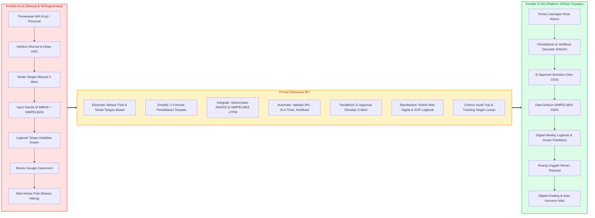

# SiRiset — Sistem Informasi MBKM Riset Terpadu

> **Transformasi Proses Bisnis Program MBKM Riset / Penelitian (Konversi MB04 — 20 SKS)**  
> Proyek Akhir Mata Kuliah **Pemodelan Proses Bisnis** · Program Studi S1 Teknik Informatika, Fakultas Teknik, Universitas Trunojoyo Madura (UTM)

---

## 📌 Identitas Proyek & Akademik

| Atribut | Keterangan |
| :--- | :--- |
| **Mata Kuliah** | Pemodelan Proses Bisnis (PPB) — Kelas IF 4B |
| **Semester / Tahun** | Semester 5 / Semester Ganjil 2026/2027 |
| **Dosen Pengampu** | **Dr. Rika Yunitarini, ST., MT.** (NIP. `198306072006042001`) |
| **Institusi** | Program Studi Teknik Informatika, Jurusan Teknik Informatika, Fakultas Teknik, Universitas Trunodjoyo Madura |
| **Studi Kasus** | Transformasi Proses Bisnis Program MBKM Riset / Penelitian (Kode Mata Kuliah Konversi: **MB04**) |
| **Nama Sistem** | **SiRiset** (*Integrated Research MBKM Information System*) |
| **Kelompok Penyusun** | **Kelompok 2** |

### Anggota Tim Pengembang (Kelompok 2)

1. **Rifda Nahariyah** (NIM: `240411100019`)
2. **Reno Syaelendra** (NIM: `240411100020`)
3. **Evan Rafa Radya Alifian** (NIM: `240411100063`)
4. **A. Choiril Anwar El - A. R.** (NIM: `240411100098`)
5. **Surya Maulana Akhmad** (NIM: `240411100160`)

---

## 🎯 Latar Belakang & Urgensi Proyek

Berdasarkan hasil wawancara mendalam bersama narasumber mahasiswa aktif MBKM Riset (**Ilyas**) dan Dosen Peneliti penerima hibah (**Dr. Mula'ab, S.Si., M.Kom.**) pada 14 Oktober 2026, serta telaah dokumen resmi universitas (*Buku Panduan MBKM Penelitian LPPM UTM 2023*, *Panduan Penelitian Mandiri Edisi IX LPPM UTM 2026*, dan *Panduan Sosialisasi MBKM IF FT UTM 2026/2027*), pelaksanaan program MBKM Riset kondisi *As-Is* menghadapi fragmentasi birokrasi dan data lintas unit:

- **Program Studi**: Pengurusan form MBKM, persetujuan manual dosen wali & kaprodi, sistem pendaftaran [SI MBKM](https://mbkm.trunojoyo.ac.id/gate/login), dan SIAKAD.
- **LPPM (Lembaga Penelitian dan Pengabdian kepada Masyarakat)**: Pengelolaan hibah dosen, pendataan anggota penelitian mahasiswa melalui [SIMPELMAS](https://simpelmas.trunojoyo.ac.id), monev, dan luaran penelitian.
- **Kanal Ad-Hoc**: Grup WhatsApp, Google Form, Google Classroom untuk laporan kemajuan, serta lembar penilaian fisik/kertas.

Kondisi tersebut menimbulkan **9 titik nyeri (*Pain Points*)**:

1. **PP1** — Penawaran riset informal tanpa portal terpusat.
2. **PP2** — Seleksi tanpa transparansi kriteria dan SLA waktu tunggu.
3. **PP3** — Hambatan mobilitas tanda tangan basah dari 3 aktor.
4. **PP4** — Duplikasi pengumpulan berkas di 3 kanal berbeda.
5. **PP5** — Desinkronisasi data peserta antara SI MBKM dan SIMPELMAS LPPM.
6. **PP6** — Kanal monev terfragmentasi menggunakan Google Classroom.
7. **PP7** — Logbook tidak berjadwal dan minim visibilitas bagi dosen pembimbing.
8. **PP8** — Penilaian akhir berbasis kertas fisik yang rawan hilang.
9. **PP9** — Ketidakjelasan target luaran individual mahasiswa sejak awal kegiatan.

**SiRiset** mengimplementasikan model proses bisnis target (**BPMN 2.0 To-Be**) berbasis prinsip rekayasa **ESIA** (*Eliminate, Simplify, Integrate, Automate*) dan **PSC** (*Parallelize, Standardize, Control*) dalam satu platform web terintegrasi.



---

## ✨ Fitur Utama & Pemetaan BPMN To-Be

| Fase | Tahap To-Be & Solusi | Modul Aplikasi | Aktor Utama |
| :---: | :--- | :--- | :--- |
| **Fase 0** | Fondasi, Autentikasi & RBAC | Login NIM/NIP, Sesi Terenkripsi, Role Switcher | Seluruh Aktor (6 Peran) |
| **Fase 1** | Tahap 1 — Portal Lowongan Resmi (**PP1**) | Publikasi Hibah & Katalog Lowongan Riset Berkuota | Dosen Peneliti, Mahasiswa |
| **Fase 2** | Tahap 2 — Pendaftaran 1 Pintu (**PP2, PP4**) | Verifikasi IPK/MK Wajib SIAKAD (*Fail-Fast*), SLA Timer 7 Hari Kerja, Pelacak Status | Mahasiswa, Dosen Peneliti |
| **Fase 3** | Tahap 3 — *Parallel E-Approval* (**PP3**) | Fork-Join 3 Pihak Simultan, Lembar Pengesahan & Stempel QR Terverifikasi HMAC | Dosen Peneliti, Dosen Wali, Kaprodi |
| **Fase 4** | Tahap 4 — Validasi & Sync SIMPELMAS (**PP5**) | Validasi Akhir Prodi, *1-Click Sync* Adapter SIMPELMAS LPPM, Ekspor SK Dekan | Koordinator MBKM |
| **Fase 5** | Tahap 5 — Logbook Mingguan (**PP7**) | Logbook 16 Pekan, Penandaan Keterlambatan Otomatis, *Inline Mentoring Notes* | Mahasiswa, Dosen Peneliti |
| **Fase 6** | Tahap 6 — Hub Monev Digital (**PP6**) | Unggah Laporan Kemajuan & Evaluasi Penilaian Reviewer LPPM | Mahasiswa, Reviewer LPPM |
| **Fase 7** | Tahap 7 — Luaran & Rubrik Nilai (**PP8, PP9**) | Repositori Luaran, Rubrik Digital 4 Komponen, Konversi MB04 (20 SKS) & Berita Acara QR | Mahasiswa, Dosen Peneliti, Koordinator MBKM |
| **Fase 8** | Evaluasi Kinerja BPI & Simulasi UAS | Dasbor Analitik KPI (*As-Is* vs *To-Be*), Quick Demo Bar, Panduan Demonstrasi | Koordinator MBKM, Penguji |

---

## 🛠️ Stack Teknologi

- **Framework & UI**: Next.js `15.5.29` (App Router, Server Actions, Middleware), React `19.1`, TypeScript `5.9`, Tailwind CSS `v4`
- **Basis Data & ORM**: Prisma `6.19` + SQLite (pengembangan/demo lokal; siap migrasi ke PostgreSQL) — 13 model relasional
- **Validasi & Keamanan**: Zod `3.25`, `bcryptjs` (hashing kata sandi), HMAC-SHA256 untuk stempel digital QR & sesi terenkripsi
- **Visualisasi & Utilitas**: Recharts `2.15`, `qrcode` `1.5`, Lucide React `1.72`

---

## 🚀 Petunjuk Instalasi & Menjalankan Sistem

### 1. Setup Lokal dari Awal

**Git Bash / Linux / macOS:**
```bash
# 1. Pasang seluruh dependensi
npm install

# 2. Salin konfigurasi environment
cp .env.example .env

# 3. Sinkronkan skema basis data & semai data demo awal
npm run db:push
npm run db:seed

# 4. Jalankan server pengembang
npm run dev
```

**Windows PowerShell:**
```powershell
# 1. Pasang seluruh dependensi
npm install

# 2. Salin konfigurasi environment
Copy-Item .env.example .env

# 3. Sinkronkan skema basis data & semai data demo awal
npm run db:push
npm run db:seed

# 4. Jalankan server pengembang
npm run dev
```

Buka **`http://localhost:3000`** di peramban. Pastikan variabel `SESSION_SECRET` dan `DOCUMENT_SIGNING_SECRET` di `.env` diisi string acak minimal 32 karakter sebelum digunakan di luar lingkungan demo lokal.

> **Catatan Demonstrasi UAS:** Tanggal tenggat dan jadwal logbook dihitung relatif terhadap tanggal saat seed dijalankan. Sebelum presentasi atau pengujian, jalankan **`npm run db:reset`** untuk menyegarkan basis data dan membuat ulang berkas contoh di `demo-assets/`. Panduan skenario menit-per-menit tersedia di [`DEMO-GUIDE.md`](DEMO-GUIDE.md).

### 2. Daftar Skrip `package.json`

| Perintah | Fungsi |
| :--- | :--- |
| `npm run dev` | Menjalankan server pengembang Next.js (Turbopack) |
| `npm run build` | Menghasilkan Prisma Client dan mem-build aplikasi produksi |
| `npm run start` | Menjalankan hasil build produksi |
| `npm run lint` | Menjalankan pemeriksaan ESLint |
| `npm run typecheck` | Menjalankan pemeriksaan tipe TypeScript (`tsc --noEmit`) |
| `npm run db:push` | Menerapkan `prisma/schema.prisma` ke basis data |
| `npm run db:seed` | Menyemai akun demo, lowongan, pendaftaran, logbook, dan `demo-assets/` |
| `npm run db:reset` | Reset paksa basis data (`--force-reset`) lalu menyemai ulang seluruh data demo |
| `npm run db:studio` | Membuka antarmuka Prisma Studio |

### 3. Akun Demo Bawaan

Semua akun hasil seed menggunakan kata sandi default **`password123`** (atau gunakan **Quick Demo Bar** di bagian bawah layar saat `DEMO_MODE="true"`):

| Nama | NIM / NIP | Peran | Keterangan Demo |
| :--- | :--- | :--- | :--- |
| **Reno Syaelendra** | `240411100020` | Mahasiswa | Pelamar baru (IPK 3.85, alur dari awal) |
| **Ilyas** | `220411100088` | Mahasiswa | Peserta riset aktif (16 logbook, tersinkron SIMPELMAS) |
| **Rifda Nahariyah** | `240411100019` | Mahasiswa | Akun mahasiswa tambahan |
| **Mahasiswa Uji Coba** | `230411100999` | Mahasiswa | IPK < 3.00 (uji validasi *fail-fast* SIAKAD) |
| **Dr. Mula'ab, S.Si., M.Kom.** | `197204152000031001` | Dosen Peneliti | Pemilik hibah riset, seleksi pelamar, E-Approval, penilaian |
| **Dr. Rika Yunitarini, ST., MT.** | `198306072006042001` | Dosen Wali, Dosen Peneliti | Multi-peran (*Role Switcher*), E-Approval |
| **Bain Khusnul Khotimah, S.T., M.Kom.** | `197905202005012002` | Kaprodi | Persetujuan E-Approval tingkat prodi |
| **Fifin Ayu Mufarroha, S.Kom., M.Kom.** | `198902122019032014` | Koordinator MBKM | Validasi prodi, sync SIMPELMAS, SK Dekan, Berita Acara, KPI |
| **Dr. Budi Santoso, MT.** | `196803121994031002` | Reviewer LPPM | Evaluasi laporan kemajuan monev digital |

---

## 🗺️ Struktur Direktori Repositori

```text
SiRiset/
├── .env.example                           # Templat konfigurasi variabel lingkungan
├── DEMO-GUIDE.md                          # Naskah panduan demonstrasi UAS (15 menit)
├── README.md                              # Dokumentasi utama repositori ini
├── package.json                           # Dependensi & skrip proyek
├── prisma/
│   ├── schema.prisma                      # Skema basis data relasional (13 model Prisma)
│   └── seed.ts                            # Seeder akun sivitas akademika TI UTM & data demo
├── storage/
│   └── uploads/.gitkeep                   # Direktori penyimpanan privat berkas PDF/bukti (terproteksi route)
├── src/
│   ├── middleware.ts                      # Proteksi sesi & matriks otorisasi RBAC
│   ├── app/
│   │   ├── actions/                       # Server Actions (auth, applications, approvals, coordinator, logbooks, monev, grading)
│   │   ├── api/                           # Endpoint RESTful API & unduhan berkas terotorisasi
│   │   ├── dashboard/
│   │   │   ├── applications/[id]/pengesahan/  # Lembar pengesahan digital ber-QR
│   │   │   ├── approvals/                 # Antrean E-Approval simultan 3 aktor
│   │   │   ├── coordinator/               # Modul Koordinator MBKM (verification, sync-simpelmas, sk-dekan, grade-conversion, analytics-kpi)
│   │   │   ├── lecturer/                  # Modul Dosen (vacancies, applicants, mentoring, grading)
│   │   │   ├── lppm/monev-session/        # Modul Reviewer LPPM
│   │   │   └── student/                   # Modul Mahasiswa (vacancies, tracker, logbook, monev, outputs)
│   │   ├── login/                         # Halaman autentikasi NIM/NIP & demo quick-login
│   │   └── verify/                        # Portal publik verifikasi keaslian QR pengesahan & berita acara
│   ├── components/                        # Komponen UI modular (charts, stepper, status badge, approval sheet, dll.)
│   └── lib/                               # Logika domain, adapter mock SIAKAD & SIMPELMAS, SLA, kriptografi QR, KPI
└── markdown/                              # Repositori dokumentasi analisis & rekayasa sistem
    ├── PRD.md
    ├── README.md
    ├── api-spec.md
    ├── arsitektur.md
    ├── bpmn-asis.md
    ├── bpmn-tobe.md
    ├── database-schema.md
    ├── implementation-roadmap.md
    ├── tech-stack.md
    ├── ui-ux-design-wireframes.md
    ├── urutan-pengerjaan.md
    └── images/                            # Diagram resmi BPMN 2.0 As-Is & To-Be (9 berkas PNG)
```

---

## 📊 Katalog Dokumen Teknis & Matriks Keselarasan Akademik

| Dokumen | Relevansi Materi Perkuliahan PPB | Luaran Praktis untuk SiRiset |
| :--- | :--- | :--- |
| [`markdown/PRD.md`](markdown/PRD.md) | *Process Identification & Requirements Engineering* | Spesifikasi kebutuhan fungsional, *epics*, *user stories*, dan NFR |
| [`markdown/bpmn-asis.md`](markdown/bpmn-asis.md) | *Process Discovery, BPMN 2.0 Collaboration, Qualitative Analysis* | Dokumentasi 7 tahap proses *As-Is*, 9 *pain points*, *waste*, dan KPI *baseline* |
| [`markdown/bpmn-tobe.md`](markdown/bpmn-tobe.md) | *Process Redesign (ESIA & PSC), Quantitative Analysis* | Model proses target *To-Be*, matriks ketertelusuran, dan target KPI SMART |
| [`markdown/arsitektur.md`](markdown/arsitektur.md) | *Process Implementation (System & Technical Layer)* | Diagram C4 Model, DFD Level 0/1, *state machines*, dan arsitektur keamanan |
| [`markdown/database-schema.md`](markdown/database-schema.md) | *Data Store & Data Object Mapping in BPMN 2.0* | ERD Mermaid, kamus data relasional, dan rancangan seeding |
| [`markdown/tech-stack.md`](markdown/tech-stack.md) | *Automate & Integrate Implementation Strategy* | Pemilihan dan justifikasi stack teknologi modern |
| [`markdown/api-spec.md`](markdown/api-spec.md) | *Inter-system Message Flow & Data Exchange Automation* | Spesifikasi kontrak RESTful API dan integrasi SIAKAD / SIMPELMAS |
| [`markdown/ui-ux-design-wireframes.md`](markdown/ui-ux-design-wireframes.md) | *User-centric BPM & Customer Experience (CX)* | Arsitektur informasi, token desain Navy & Gold UTM, dan *wireframes* |
| [`markdown/implementation-roadmap.md`](markdown/implementation-roadmap.md) | *Process Execution, Change Management, & Team RACI* | Roadmap sprint, matriks RACI Kelompok 2, rencana QA, dan panduan ujian |
| [`markdown/urutan-pengerjaan.md`](markdown/urutan-pengerjaan.md) | *Phased Execution Masterplan* | Panduan eksekusi bertahap Fase 0 hingga Fase 8 |
| [`DEMO-GUIDE.md`](DEMO-GUIDE.md) | *UAT & Final Presentation Script* | Naskah demonstrasi 15 menit siap pakai di hadapan dosen penguji |
