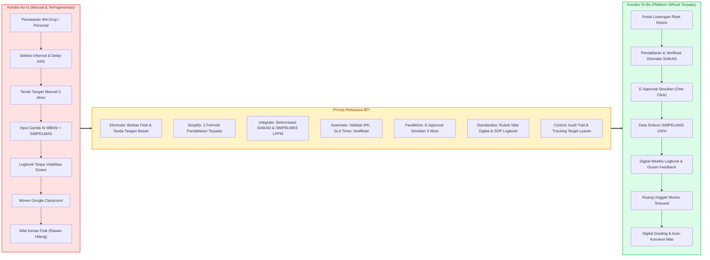

# SiRiset - Sistem Informasi MBKM Riset Terpadu
## Dokumentasi Resmi Proyek Pemodelan Proses Bisnis (Semester 5)
### Program Studi S1 Teknik Informatika, Fakultas Teknik, Universitas Trunodjoyo Madura

---

## 📌 Identitas Proyek & Akademik

| Atribut | Keterangan |
| :--- | :--- |
| **Mata Kuliah** | Pemodelan Proses Bisnis (PPB) - Kelas IF 4B |
| **Semester / Tahun** | Semester 5 / Semester Ganjil 2026/2027 |
| **Dosen Pengampu** | **Dr. Rika Yunitarini, ST., MT.** (NIP. 198306072006042001) |
| **Institusi** | Program Studi Teknik Informatika, Jurusan Teknik Informatika, Fakultas Teknik, Universitas Trunodjoyo Madura |
| **Studi Kasus** | Transformasi Proses Bisnis Program MBKM Riset / Penelitian (Kode Mata Kuliah Konversi: **MB04**) |
| **Nama Sistem** | **SiRiset** (*Integrated Research MBKM Information System*) |
| **Kelompok Penyusun** | **Kelompok 2** |

### Anggota Tim Pengembang (Kelompok 2)
1. **Rifda Nahariyah** (NIM: 240411100019)
2. **Reno Syaelendra** (NIM: 240411100020)
3. **Evan Rafa Radya Alifian** (NIM: 240411100063)
4. **A. Choiril Anwar El - A. R.** (NIM: 240411100098)
5. **Surya Maulana Akhmad** (NIM: 240411100160)

---

## 🎯 Latar Belakang & Urgensi Proyek

Berdasarkan hasil wawancara mendalam bersama narasumber mahasiswa aktif MBKM Riset (**Ilyas**) dan Dosen Peneliti penerima hibah (**Bapak Dr. Mula'ab, S.Si., M.Kom.**) pada 14 Oktober 2026, serta telaah dokumen resmi universitas (Buku Panduan MBKM Penelitian LPPM UTM 2023, Panduan Penelitian Mandiri Edisi IX LPPM UTM 2026, dan Panduan Sosialisasi MBKM IF FT UTM 2026/2027), ditemukan bahwa pelaksanaan program MBKM Riset saat ini (kondisi *As-Is*) menghadapi kendala fragmentasi birokrasi dan data yang masif.

Pelaksanaan MBKM Riset tersebar di berbagai unit dengan sistem terpisah (*siloed systems*):
- **Program Studi**: Pengurusan form MBKM, persetujuan manual dosen wali & kaprodi, sistem pendaftaran mandiri [SI MBKM](https://mbkm.trunojoyo.ac.id/gate/login), dan SIAKAD.
- **LPPM (Lembaga Penelitian dan Pengabdian kepada Masyarakat)**: Pengelolaan hibah dosen, pendataan anggota penelitian mahasiswa melalui [SIMPELMAS](https://simpelmas.trunojoyo.ac.id), monev, dan luaran penelitian.
- **Kanal Tambahan Ad-Hoc**: Grup chat WhatsApp, formulir daring (Google Form), Google Classroom untuk laporan kemajuan, serta berkas fisik/kertas untuk lembar penilaian akhir.

Kondisi tersebut menyebabkan **9 titik nyeri (*Pain Points*)** kritis:
1. Penawaran riset informal tanpa portal terpusat (*PP1*).
2. Seleksi tanpa transparansi kriteria dan SLA waktu tunggu (*PP2*).
3. Hambatan mobilitas tanda tangan basah dari 3 aktor (*PP3*).
4. Duplikasi pengumpulan berkas di 3 kanal berbeda (*PP4*).
5. Desinkronisasi data peserta antara SI MBKM dan SIMPELMAS LPPM (*PP5*).
6. Kanal monev terfragmentasi menggunakan Google Classroom (*PP6*).
7. Logbook tidak berjadwal dan tidak memiliki visibilitas bagi dosen pembimbing (*PP7*).
8. Penilaian akhir rentan hilang karena masih berbasis kertas manual (*PP8*).
9. Ketidakjelasan target luaran individual mahasiswa sejak awal kegiatan (*PP9*).

Sesuai arahan **Ibu Dr. Rika Yunitarini, ST., MT.** pada pertemuan perkuliahan ke-12 mengenai *Transformasi Pemodelan Proses Bisnis dari BPMN As-Is ke BPMN To-Be dengan Analisis Key Performance Indicator (KPI)*, luaran proyek akhir mahasiswa diarahkan untuk diwujudkan ke dalam bentuk **proyek perangkat lunak atau situs web fungsional**. 

**SiRiset** hadir sebagai solusi sistemik berbasis web untuk mewujudkan model proses bisnis target (*To-Be*) yang terintegrasi, transparan, terotomasi, dan terukur.

---

## 🗺️ Struktur & Katalog Dokumen Teknis

Dokumentasi arsitektur dan spesifikasi rekayasa sistem SiRiset disusun secara modular dan terstruktur dalam folder ini:

```
c:\Users\renos\Downloads\SEMESTER 5\PEMODELAN PROSES BISNIS\SiRiset\markdown\
│
├── INDEX.md                        # Master Index, Profil Proyek, Konteks Akademik UTM (Dokumen Ini)
├── PRD.md                          # Product Requirements Document (Fitur, Scope, Epics, User Stories, NFR)
├── bpmn-asis.md                    # Analisis Proses As-Is, 7 Tahap, 9 Pain Points, Root Causes, Waste & KPI Baseline
├── bpmn-tobe.md                    # Rekayasa Proses To-Be (ESIA + PSC), Traceability Matrix, & Evaluasi KPI Target
├── arsitektur.md                   # Arsitektur Sistem, C4 Model Diagrams, DFD Level 0/1, State Machines, & Keamanan
├── database-schema.md              # Skema Basis Data Relasional, ERD Mermaid, Kamus Data, & Rencana Seeding
├── tech-stack.md                   # Pemilihan & Justifikasi Stack Teknologi (Next.js, TypeScript, Tailwind, Prisma)
├── api-spec.md                     # Spesifikasi Kontrak RESTful API SiRiset (Payload, Response, & Error Codes)
├── ui-ux-design-wireframes.md      # Information Architecture, Sitemap, Token Desain, & Rangka Layar (Wireframes)
├── implementation-roadmap.md       # Roadmap Sprint, RACI Matrix Anggota Kelompok 2, Rencana QA, & Panduan Ujian
├── urutan-pengerjaan.md            # Panduan Eksekusi Bertahap (Fase 0 - Fase 8) untuk AI Agent Claude Code
├── prompts-claude-code.md          # Kumpulan Prompt Eksekusi Siap Pakai untuk Claude Code Opus (Branch: reno-development)
└── images/                         # Aset visual & diagram BPMN resmi
    ├── bpmn-asis-overview.png
    ├── bpmn-asis-tahap1-penawaran.png
    ├── bpmn-asis-tahap2-seleksi.png
    ├── bpmn-asis-tahap3-berkas.png
    ├── bpmn-asis-tahap4-validasi.png
    ├── bpmn-asis-tahap5-bimbingan.png
    ├── bpmn-asis-tahap6-monev.png
    ├── bpmn-asis-tahap7-luaran-nilai.png
    └── bpmn-tobe-overview.png      # Diagram Kolaborasi Makro BPMN 2.0 To-Be SiRiset
```

---

## 📊 Matriks Keselarasan Akademik & Bisnis

| Dokumen | Relevansi Materi Perkuliahan PPB (Dr. Rika Yunitarini) | Luaran Praktis untuk SiRiset |
| :--- | :--- | :--- |
| [PRD.md](file:///c:/Users/renos/Downloads/SEMESTER%205/PEMODELAN%20PROSES%20BISNIS/SiRiset/markdown/PRD.md) | *Process Identification & Requirements Engineering* | Landasan fungsionalitas produk & batasan implementasi |
| [bpmn-asis.md](file:///c:/Users/renos/Downloads/SEMESTER%205/PEMODELAN%20PROSES%20BISNIS/SiRiset/markdown/bpmn-asis.md) | *Process Discovery, BPMN 2.0 Collaboration, Qualitative Process Analysis (Issue Register, Waste Analysis)* | Dokumentasi baseline masalah operasional riil UTM |
| [bpmn-tobe.md](file:///c:/Users/renos/Downloads/SEMESTER%205/PEMODELAN%20PROSES%20BISNIS/SiRiset/markdown/bpmn-tobe.md) | *Process Redesign (ESIA & PSC Principles), Quantitative Performance Analysis (KPI Comparison)* | Alur kerja baru yang dioptimasi dan terukur secara matematis |
| [arsitektur.md](file:///c:/Users/renos/Downloads/SEMESTER%205/PEMODELAN%20PROSES%20BISNIS/SiRiset/markdown/arsitektur.md) | *Process Implementation (System & Technical Layer)* | Struktur perangkat lunak berstandar industri |
| [database-schema.md](file:///c:/Users/renos/Downloads/SEMESTER%205/PEMODELAN%20PROSES%20BISNIS/SiRiset/markdown/database-schema.md) | *Data Store & Data Object Mapping in BPMN 2.0* | Integritas data terpusat (*Single Source of Truth*) |
| [tech-stack.md](file:///c:/Users/renos/Downloads/SEMESTER%205/PEMODELAN%20PROSES%20BISNIS/SiRiset/markdown/tech-stack.md) | *Automate & Integrate Implementation Strategy* | Pemilihan alat pengembangan modern dan efisien |
| [api-spec.md](file:///c:/Users/renos/Downloads/SEMESTER%205/PEMODELAN%20PROSES%20BISNIS/SiRiset/markdown/api-spec.md) | *Inter-system Message Flow & Data Exchange Automation* | Kontrak integrasi antar-layanan (SIAKAD, SIMPELMAS) |
| [ui-ux-design-wireframes.md](file:///c:/Users/renos/Downloads/SEMESTER%205/PEMODELAN%20PROSES%20BISNIS/SiRiset/markdown/ui-ux-design-wireframes.md) | *User-centric BPM & Customer Experience (CX) Dimension* | Antarmuka pengguna intuitif untuk seluruh pemangku kepentingan |
| [implementation-roadmap.md](file:///c:/Users/renos/Downloads/SEMESTER%205/PEMODELAN%20PROSES%20BISNIS/SiRiset/markdown/implementation-roadmap.md) | *Process Execution, Change Management, & Team RACI* | Rencana kerja tim dan persiapan presentasi Ujian Akhir |

---

## 💡 Nilai Tambah Transformasi SiRiset



Dokumentasi ini dirancang agar siap dieksekusi oleh tim rekayasa perangkat lunak serta dapat dipertanggungjawabkan secara akademik dengan standar tertinggi di hadapan tim penguji. Silakan akses masing-masing dokumen teknis melalui tautan di atas.

