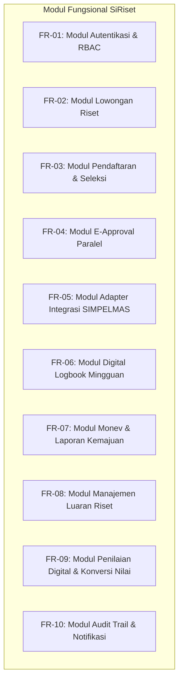

# Product Requirements Document (PRD)
## SiRiset: Sistem Informasi MBKM Riset Terpadu
### Program Studi S1 Teknik Informatika, Fakultas Teknik, Universitas Trunodjoyo Madura

---

## 1. Identitas Dokumen & Riwayat Versi

| Properti | Detail |
| :--- | :--- |
| **Nama Dokumen** | Product Requirements Document (PRD) - SiRiset |
| **Versi Dokumen** | 1.0.0 (Release Baseline) |
| **Status** | Approved & Ready for Technical Implementation |
| **Penulis** | Kelompok 2 - Pemodelan Proses Bisnis IF 4B |
| **Pemilik Produk** | Reno Syaelendra, Rifda Nahariyah, Evan Rafa Radya Alifian, A. Choiril Anwar El - A. R., Surya Maulana Akhmad |
| **Target Evaluasi** | Ujian Akhir Semester (UAS) PPB - Dosen Pengampu: **Dr. Rika Yunitarini, ST., MT.** |
| **Tanggal Pembaruan** | November 2026 |

---

## 2. Ringkasan Eksekutif & Pernyataan Visi

### 2.1 Ringkasan Eksekutif
Program Merdeka Belajar Kampus Merdeka (MBKM) skema Penelitian/Riset (kode mata kuliah konversi: **MB04**) pada Program Studi Teknik Informatika Universitas Trunodjoyo Madura (UTM) bertujuan untuk mengintegrasikan mahasiswa ke dalam penelitian dosen yang didanai hibah kompetitif. Meskipun secara akademis memberikan manfaat konversi hingga 20 SKS, implementasi operasionalnya saat ini terhambat oleh proses birokrasi manual dan fragmentasi data yang parah di antara tiga unit utama: Program Studi, Fakultas Teknik, dan Lembaga Penelitian dan Pengabdian kepada Masyarakat (LPPM).

**SiRiset** (*Sistem Informasi MBKM Riset Terpadu*) dirancang sebagai platform web *end-to-end* yang mentransformasi tata kelola proses bisnis MBKM Riset dari model *As-Is* (manual, tersebar, tidak pasti) menjadi model *To-Be* (terpusat, transparan, terotomasi, dan terukur) dengan mengadopsi prinsip *Business Process Improvement* (BPI: *Eliminate, Simplify, Integrate, Automate, Parallelize, Standardize, Control*).

### 2.2 Pernyataan Visi (*Vision Statement*)
> *"Menyediakan satu gerbang digital terpadu (Single Source of Truth) bagi seluruh siklus hidup program MBKM Riset di Teknik Informatika UTM, yang menghubungkan mahasiswa, dosen peneliti, pimpinan prodi, dan LPPM secara transparan, bebas hambatan berkas fisik (paperless), dan didukung pemantauan real-time berbasis KPI terukur."*

---

## 3. Latar Belakang Masalah & Bukti Lapangan

Berdasarkan investigasi empiris yang tertuang dalam laporan UTS Kelompok 2 (Oktober 2026), wawancara mendalam dilakukan dengan dua representasi pemangku kepentingan kunci:
1. **Ilyas** (Mahasiswa aktif peserta program MBKM Riset semester berjalan).
2. **Dr. Mula'ab, S.Si., M.Kom.** (Dosen peneliti senior penerima hibah penelitian yang membimbing mahasiswa MBKM Riset).

### 3.1 Temuan Lapangan (*Empirical Findings*)
- **Penawaran Tidak Formal**: Dosen peneliti hanya menyebarkan pengumuman kebutuhan perbantuan riset melalui grup WhatsApp angkatan atau pesan pribadi. Mahasiswa yang tidak terhubung dalam jejaring personal dosen tertinggal kesempatan (*information asymmetry*).
- **Seleksi dan Waktu Tunggu Tanpa Kepastian**: Mahasiswa tidak mengetahui kapan keputusan penerimaan diumumkan, sehingga memicu kecemasan akademik dan bentrok dengan batas akhir periode perwalian KRS reguler di SIAKAD.
- **Pemberatan Mobilitas Tanda Tangan Basah**: Mahasiswa wajib meminta tanda tangan basah secara sekuensial dari Dosen Pembimbing Akademik (Dosen Wali), Dosen Peneliti, dan Koordinator Program Studi (Kaprodi) pada lembar cetak Form MBKM, Rekomendasi KRS Konversi, dan Proposal.
- **Redundansi Kanal Pengumpulan**: Berkas yang telah ditandatangani harus diunggah ke SI MBKM universitas, diunggah ke formulir daring Google Form, dan diserahkan dalam bentuk salinan fisik (hardcopy) ke Koordinator MBKM Prodi (Ibu Fifin).
- **Desinkronisasi Dua Sistem Universitas**: Mahasiswa mendaftar di SI MBKM sebelum masa KRS, sementara Dosen Peneliti baru mendaftarkan nama mahasiswa ke SIMPELMAS LPPM setelah masa KRS. Tidak adanya jembatan data (*data bridge*) menyebabkan LPPM dan Fakultas sering kali menerima rekap peserta yang tidak konsisten.
- **Monev dan Laporan Tercecer**: Pengumpulan laporan kemajuan menggunakan Google Classroom LPPM yang terisolasi dari repositori prodi. Dosen pembimbing bahkan tidak dapat memantau logbook yang dikumpulkan mahasiswa ke LPPM karena tidak diberikan akses sistem.
- **Penilaian Manual di Atas Kertas**: Di akhir masa penelitian, dosen mengisi lembar penilaian fisik yang dititipkan kepada mahasiswa untuk diserahkan ke koordinator MBKM, memicu risiko kehilangan berkas, manipulasi data, dan keterlambatan konversi nilai SKS ke transkrip.

---

## 4. Ruang Lingkup Sistem & Batasan (*Scope & Boundaries*)

### 4.1 In-Scope (Batasan Dalam Sistem SiRiset)
1. **Portal Publikasi & Penemuan Riset**: Manajemen lowongan riset dosen terverifikasi hibah LPPM, detail proyek, kuota, persyaratan kompetensi, dan jadwal pendaftaran.
2. **Registrasi & Verifikasi Kelayakan Otomatis**: Formulir pendaftaran digital satu pintu, integrasi verifikasi prasyarat akademik (IPK $\ge$ 3.00 dan status kelulusan MK Wajib) via adapter SIAKAD.
3. **Workflow E-Approval Simultan**: Mekanisme persetujuan digital paralel tanpa kertas bagi Dosen Wali, Dosen Peneliti, dan Kaprodi dengan jejak audit digital (*digital signature audit trail*).
4. **Jembatan Sinkronisasi SIMPELMAS**: Fitur satu-klik (*one-click sync*) untuk sinkronisasi daftar mahasiswa riset ke sistem LPPM (SIMPELMAS).
5. **Logbook Mingguan Digital**: Pengisian aktivitas mingguan berjadwal, validasi pengingat otomatis, dan umpan balik (*feedback & inline grading*) langsung dari Dosen Peneliti.
6. **Hub Pelaporan Kemajuan & Monev**: Fasilitas unggah dokumen kemajuan terstandarisasi, penilaian reviewer monev LPPM, dan tindak lanjut rekomendasi perbaikan.
7. **Repositori Luaran Riset & Rubrik Penilaian Terstandar**: Pengunggahan luaran akhir (artikel jurnal, draf prosiding, poster, prototipe), validasi kontribusi luaran, dan pengisian formulir penilaian digital berbasis rubrik resmi prodi untuk auto-konversi nilai mata kuliah MB04.
8. **Dashboard Analitik & Monitoring Kinerja**: Pemantauan visual progres mahasiswa, kepatuhan logbook, status approval, dan metrik KPI proses.

### 4.2 Out-of-Scope (Di Luar Batasan Sistem SiRiset)
1. Proses seleksi internal dan penetapan proposal hibah pendanaan penelitian dosen oleh reviewer reviewer LPPM tingkat universitas/Kemendikbud (proses ini diasumsikan telah selesai dan data hibah diterima sebagai input eksternal).
2. Manajemen pencairan, pengelolaan, dan pelaporan Surat Pertanggungjawaban (SPJ) anggaran dana hibah penelitian dosen.
3. Pelaksanaan bimbingan teknis skripsi/tugas akhir formal (apabila topik riset kemudian dilanjutkan menjadi skripsi mandiri mahasiswa).
4. Konversi rincian mata kuliah Kerja Praktik (KP) reguler non-MBKM, kecuali pemetaan paket konversi 2 SKS KP MBKM sesuai ketentuan khusus program studi (proyek KP harus terpisah dari proyek laporan utama).
5. Skema program MBKM di luar Riset (seperti Kampus Mengajar/MB02, Magang Industri/MB03, Studi Independen/MB07, atau Kewirausahaan/MB08).

---

## 5. Analisis Pemangku Kepentingan (*User Personas*)

| Persona | Peran & Institusi | Tujuan Utama (*Goals*) | Titik Nyeri (*Pain Points*) yang Diselesaikan |
| :--- | :--- | :--- | :--- |
| **Mahasiswa** *(Ilyas)* | Mahasiswa S1 Teknik Informatika Semester 5-7 | Mendaftar lowongan riset secara adil, persetujuan cepat tanpa antre tanda tangan, logbook teratur, konversi 20 SKS tepat waktu. | Menghilangkan repot tanda tangan basah, multi-kanal pengumpulan berkas, ketidakpastian pengumuman seleksi. |
| **Dosen Peneliti** *(Dr. Mulaab)* | Dosen Peneliti Penerima Hibah LPPM UTM | Merekrut asisten peneliti berkompeten, memantau logbook mingguan mahasiswa secara langsung, menginput nilai praktis tanpa kertas. | Mengeliminasi pendaftaran manual di SIMPELMAS, kehilangan visibilitas logbook mahasiswa, penilaian fisik. |
| **Dosen Wali** | Pembimbing Akademik Mahasiswa | Memverifikasi rencana studi dan memastikan kelayakan konversi mata kuliah MBKM mahasiswa bimbingannya. | Tidak perlu melayani tanda tangan fisik berulang pada saat musim padat KRS. |
| **Kaprodi** | Koordinator Program Studi S1 Teknik Informatika | Mengawasi kelayakan akademik, menyetujui paket konversi kurikulum, meneruskan usulan pembimbing ke Dekan. | Kemudahan peninjauan usulan secara digital dalam satu dasbor terpusat. |
| **Koordinator MBKM** *(Bu Fifin)* | Tim Pengelola MBKM Program Studi Teknik Informatika | Melakukan verifikasi berkas, validasi penerimaan, mengontrol kuota prodi, merekap nilai untuk konversi ke SIAKAD. | Menghilangkan pemeriksaan tumpukan berkas cetak manual, rekapitulasi nilai otomatis. |
| **LPPM / Reviewer** | Pengelola Penelitian Universitas & Reviewer Monev | Memastikan keterlibatan mahasiswa pada hibah dosen terdata akurat, mengevaluasi monev berkala, memverifikasi luaran penelitian. | Mengganti Google Classroom dengan sistem terstruktur, eliminasi perbedaan rekap data mahasiswa riset. |
| **Administrator Sistem** | Tim IT / Pengelola Server SiRiset | Menjaga ketersediaan sistem, audit log keamanan, pemeliharaan integrasi API adapter. | Manajemen hak akses peran (RBAC) yang rapi dan terukur. |

---

## 6. Arsitektur Kebutuhan Produk (*Epics & User Stories*)

### Epic 1: Publikasi & Eksplorasi Lowongan Riset (Solusi PP1)
- **US-1.1**: Sebagai Dosen Peneliti, saya dapat membuat dan mempublikasikan penawaran riset resmi lengkap dengan topik, abstrak penelitian hibah, kuota mahasiswa, syarat keahlian khusus, dan jadwal seleksi, agar informasi tersebar secara terbuka dan adil.
- **US-1.2**: Sebagai Mahasiswa, saya dapat mencari, memfilter, dan melihat detail lowongan riset yang dibuka oleh dosen Teknik Informatika secara transparan melalui portal terpadu.

### Epic 2: Pendaftaran & Verifikasi Prasyarat Otomatis (Solusi PP2 & PP4)
- **US-2.1**: Sebagai Mahasiswa, saya dapat mengajukan lamaran riset dengan memilih lowongan, menentukan mata kuliah konversi, dan mengunggah dokumen proposal ringkas dalam satu formulir web.
- **US-2.2**: Sebagai Sistem, sistem harus memvalidasi prasyarat akademik secara otomatis (IPK $\ge$ 3.00 dan seluruh MK Wajib lulus) melalui adapter SIAKAD sebelum lamaran dapat dikirimkan.
- **US-2.3**: Sebagai Mahasiswa, saya dapat memantau status lamaran saya secara langsung (*real-time status tracker*) dengan kepastian batas waktu keputusan maksimal 7 hari kalender.

### Epic 3: Workflow Persetujuan Elektronik Paralel (Solusi PP3)
- **US-3.1**: Sebagai Dosen Wali, Dosen Peneliti, dan Kaprodi, kami dapat meninjau berkas pendaftaran mahasiswa dan memberikan persetujuan elektronik (*e-approval*) secara simultan dari dasbor masing-masing tanpa harus menunggu giliran fisik.
- **US-3.2**: Sebagai Mahasiswa, saya dapat melihat catatan revisi dan status persetujuan dari masing-masing pihak secara transparan.

### Epic 4: Sinkronisasi Data Lintas Sistem (Solusi PP5)
- **US-4.1**: Sebagai Koordinator MBKM Prodi / Dosen Peneliti, saya dapat melakukan sinkronisasi satu-klik (*1-click sync*) untuk mengirim data peserta riset yang telah diverifikasi ke SIMPELMAS LPPM tanpa perlu entri ulang setelah masa KRS.
- **US-4.2**: Sebagai LPPM, saya dapat mengunduh dan melihat rekap peserta riset yang valid dan telah sinkron 100% untuk penerbitan SK Dosen Pembimbing oleh Fakultas Teknik.

### Epic 5: Manajemen Logbook Digital & Mentoring Terpadu (Solusi PP7)
- **US-5.1**: Sebagai Mahasiswa, saya dapat mengisi log kegiatan mingguan (tanggal, aktivitas, capaian, kendala, bukti foto/tautan kode) sesuai jadwal mingguan yang ditentukan sistem.
- **US-5.2**: Sebagai Dosen Peneliti, saya dapat membaca riwayat logbook mahasiswa bimbingan saya, memberikan persetujuan (*approval*), dan menyematkan catatan bimbingan (*inline feedback*).
- **US-5.3**: Sebagai Sistem, sistem mengirimkan notifikasi pengingat otomatis (*automated reminder*) kepada mahasiswa yang belum mengisi logbook H-1 tenggat mingguan.

### Epic 6: Manajemen Laporan Kemajuan & Monev Digital (Solusi PP6)
- **US-6.1**: Sebagai Mahasiswa, saya dapat mengunggah dokumen Laporan Kemajuan riset sesuai format baku LPPM langsung ke dalam sistem SiRiset (meniadakan Google Classroom).
- **US-6.2**: Sebagai Tim Reviewer LPPM, saya dapat mengunduh laporan kemajuan, memasukkan catatan hasil evaluasi monev, dan memberikan rekomendasi tindak lanjut.

### Epic 7: Repositori Luaran Riset & Penilaian Digital (Solusi PP8 & PP9)
- **US-7.1**: Sebagai Mahasiswa, saya dapat mendaftarkan luaran riset yang dihasilkan (draf artikel jurnal/prosiding, poster, prototipe software/paten) dan mengunggah dokumen bukti capaian.
- **US-7.2**: Sebagai Dosen Peneliti, saya dapat memberikan penilaian akhir mahasiswa bimbingan secara digital menggunakan rubrik penilaian standar prodi yang mencakup aspek teknis, kedisiplinan, dan capaian luaran.
- **US-7.3**: Sebagai Koordinator MBKM Prodi, saya dapat mengekspor rekapitulasi nilai akhir peserta ke format resmi nilai konversi mata kuliah MB04 untuk diinputkan ke sistem penilaian akademik universitas (SIAKAD).

---

## 7. Kebutuhan Fungsional Rinci (*Detailed Functional Requirements*)

### 7.1 FR-01: Modul Autentikasi & Otorisasi Berbasis Peran (RBAC)
- **FR-01.1**: Sistem harus menyediakan mekanisme autentikasi aman berbasis kredensial universitas (NIM/NIP dan Kata Sandi).
- **FR-01.2**: Sistem harus mendukung 6 peran pengguna (*roles*): `MAHASISWA`, `DOSEN_PENELITI`, `DOSEN_WALI`, `KAPRODI`, `KOORDINATOR_MBKM`, dan `LPPM_REVIEWER`.
- **FR-01.3**: Pengguna dapat memiliki peran ganda (misal: seorang dosen dapat berperan sebagai Dosen Peneliti sekaligus Dosen Wali) dan dapat beralih peran (*switch context*) tanpa perlu keluar (*logout*).

### 7.2 FR-02: Modul Manajemen Lowongan Riset
- **FR-02.1**: Dosen Peneliti dapat membuat draf, mengubah, dan mempublikasikan lowongan riset dengan mencantumkan: Judul Proyek Riset, Nomor Kontrak/Sumber Hibah LPPM, Deskripsi & Ruang Lingkup Kerja, Kuota Mahasiswa (1-4 mahasiswa), Prasyarat Kompetensi (misal: Python, Data Mining, Web Development), serta Rentang Tanggal Seleksi.
- **FR-02.2**: Sistem harus secara otomatis menutup penawaran riset jika kuota telah terpenuhi atau tenggat waktu pendaftaran telah berakhir.

### 7.3 FR-03: Modul Pendaftaran & Seleksi Mahasiswa
- **FR-03.1**: Mahasiswa hanya dapat mendaftar pada satu judul riset aktif dalam satu periode semester.
- **FR-03.2**: Saat mahasiswa menekan tombol submit pendaftaran, sistem secara otomatis mengeksekusi validasi aturan kelayakan:
  - *Aturan 1*: IPK Mahasiswa $\ge$ 3.00.
  - *Aturan 2*: Status kelulusan mata kuliah wajib dasar $\ge$ 100% (tidak ada mata kuliah wajib yang belum lulus).
  - *Aturan 3*: Mahasiswa terdaftar aktif pada semester ganjil berjalan.
  Jika salah satu aturan tidak terpenuhi, pengajuan ditolak secara otomatis (*fail fast*) dengan pesan alasan yang spesifik.
- **FR-03.3**: Dosen Peneliti memiliki batas waktu maksimal 7 hari kalender (*SLA Timer*) sejak penutupan pendaftaran untuk menetapkan status: `DITERIMA` atau `DITOLAK`. Jika pendaftar ditolak, mahasiswa langsung memperoleh notifikasi dan hak mendaftar ke lowongan lain atau kembali ke kuliah reguler.

### 7.4 FR-04: Modul E-Approval Paralel
- **FR-04.1**: Setelah mahasiswa dinyatakan `DITERIMA` oleh Dosen Peneliti, sistem secara otomatis men-generate dokumen digital terpadu (Kombinasi Form MBKM + Usulan Paket Konversi KRS + Rencana Riset).
- **FR-04.2**: Sistem mengirimkan permintaan persetujuan secara simultan (*parallel fork*) ke antrean:
  1. Dosen Wali (persetujuan kelayakan studi dan konversi SKS).
  2. Dosen Peneliti (persetujuan rencana kerja riset).
  3. Kaprodi (persetujuan pemenuhan capaian pembelajaran program studi).
- **FR-04.3**: Masing-masing pihak dapat melakukan `APPROVE` atau `REJECT_WITH_NOTES` dalam satu kali klik melalui antarmuka web.
- **FR-04.4**: Berkas pendaftaran baru berstatus `VERIFIED_COMPLETE` ketika ketiga pihak telah menyetujui, lalu diteruskan ke Koordinator MBKM untuk validasi akhir.

### 7.5 FR-05: Modul Adapter Integrasi SIMPELMAS & SIAKAD
- **FR-05.1**: Sistem menyediakan antarmuka pertukaran data (*API Adapter*) yang memformat data mahasiswa terverifikasi menjadi skema yang kompatibel dengan sistem SIMPELMAS LPPM.
- **FR-05.2**: Koordinator MBKM dapat mengklik tombol `Sinkronkan ke SIMPELMAS`, yang mentransfer data: Nama Mahasiswa, NIM, Judul Riset, NIP Dosen Ketua, dan Tanggal Mulai Pelaksanaan secara aman via REST API payload.
- **FR-05.3**: Sistem mencatat status sinkronisasi (`SYNC_SUCCESS`, `SYNC_PENDING`, `SYNC_ERROR`) beserta log stempel waktu (*timestamp*).

### 7.6 FR-06: Modul Digital Weekly Logbook
- **FR-06.1**: Mahasiswa wajib mengisi logbook setiap periode 7 hari kalender. Form logbook mencakup: Tanggal Kegiatan, Jam Mulai - Jam Selesai, Deskripsi Rinci Pekerjaan Riset, Capaian Output Mingguan, Kendala yang Dihadapi, serta Unggah Berkas Bukti (PDF/JPG/PNG maksimal 5 MB) atau Tautan Repositori (GitHub/Google Colab).
- **FR-06.2**: Dosen Peneliti menerima notifikasi pengisian logbook dan wajib memberikan status peninjauan: `REVIEWED_VALID` atau `NEED_REVISION` disertai kolom komentar/arahan perbaikan.
- **FR-06.3**: Dashboard Dosen dan Koordinator MBKM menampilkan persentase kepatuhan pengisian logbook mingguan mahasiswa (*logbook submission rate*).

### 7.7 FR-07: Modul Monitoring & Evaluasi (Monev) Terpusat
- **FR-07.1**: Pada minggu ke-8 (pertengahan masa riset), sistem membuka jendela unggah Laporan Kemajuan dengan templat resmi LPPM UTM.
- **FR-07.2**: LPPM Reviewer dapat mengunduh dokumen laporan kemajuan dan lembar rekap logbook mahasiswa langsung dari sistem tanpa perlu membuka Google Classroom terpisah.
- **FR-07.3**: LPPM Reviewer menginputkan nilai evaluasi monev dan rekomendasi perbaikan yang otomatis dapat dibaca oleh Dosen Peneliti dan Mahasiswa.

### 7.8 FR-08: Modul Manajemen Luaran Riset
- **FR-08.1**: Mahasiswa mengunggah luaran riset yang telah ditetapkan sejak proposal awal, meliputi salah satu atau kombinasi dari:
  - Draf / *Published* Artikel Jurnal Ilmiah (File PDF & Bukti *Submission*).
  - Draf / *Accepted* Prosiding Seminar Ilmiah Nasional/Internasional.
  - Poster Ilmiah Hasil Riset (High-Resolution PDF/PNG).
  - Prototipe Perangkat Lunak / *Source Code Repository* / Manual Book Pengguna.
- **FR-08.2**: Dosen Peneliti memverifikasi kesesuaian luaran mahasiswa terhadap target proposal hibah sebelum penilaian akhir dapat diakses.

### 7.9 FR-09: Modul Penilaian Digital & Konversi Nilai
- **FR-09.1**: Dosen Peneliti menginput nilai akhir secara digital berdasarkan rubrik penilaian standar Program Studi Teknik Informatika UTM:
  - Aspek Kedisiplinan & Logbook Mingguan (Bobot: 20%).
  - Aspek Penguasaan Metodologi & Kualitas Teknis Riset (Bobot: 30%).
  - Aspek Pemenuhan Target Luaran (Bobot: 30%).
  - Aspek Laporan Akhir & Seminar/Presentasi Hasil (Bobot: 20%).
- **FR-09.2**: Sistem secara otomatis mengkalkulasi Nilai Angka (skala 0-100) menjadi Nilai Huruf (A, B+, B, C+, C, D, E) dan memetakan konversinya ke mata kuliah MB04 (20 SKS) serta mata kuliah KP (2 SKS, jika disetujui).
- **FR-09.3**: Koordinator MBKM dapat mengunci nilai (*freeze score*) dan mengekspor Berita Acara Nilai Resmi dalam format PDF bertanda tangan digital QR Code untuk diserahkan ke bagian Akademik Fakultas.

### 7.10 FR-10: Modul Audit Trail & Notifikasi Terpadu
- **FR-10.1**: Setiap aksi kritis (Approval, Penolakan, Pengisian Nilai, Perubahan Dokumen, dan Sinkronisasi API) wajib dicatat dalam tabel `audit_logs` dengan informasi: User ID, Peran, IP Address, Aksi, Waktu (ISO 8601), dan *Payload Snapshot*.
- **FR-10.2**: Sistem menyediakan notifikasi *in-app* (lonceng notifikasi) dan *web push/email notification* saat ada status baru atau tindakan yang membutuhkan respon pengguna.

---

## 8. Kebutuhan Non-Fungsional (*Non-Functional Requirements*)

| Kategori | Kode | Spesifikasi Kebutuhan |
| :--- | :--- | :--- |
| **Kinerja (*Performance*)** | **NFR-01** | Waktu respon halaman (*page load*) $\le$ 2.0 detik pada koneksi internet standar (4G/WiFi kampus). Waktu respon transaksi API backend $\le$ 500 ms untuk 95% permintaan (p95). |
| **Keamanan (*Security*)** | **NFR-02** | Seluruh komunikasi data wajib menggunakan protokol HTTPS (TLS 1.3). Penyimpanan kata sandi wajib menggunakan enkripsi *bcrypt* / *argon2id* dengan faktor salt $\ge$ 12. Token sesi disimpan dalam *HTTP-Only, Secure, SameSite=Lax Cookies*. Proteksi aktif terhadap *SQL Injection, XSS, dan CSRF*. |
| **Ketersediaan (*Availability*)** | **NFR-03** | Ketersediaan sistem ditargetkan mencapai 99.5% *uptime* selama masa operasional aktif pendaftaran MBKM dan masa pelaporan nilai. Tersedia pencadangan basis data (*database automated backup*) harian. |
| **Usabilitas (*Usability*)** | **NFR-04** | Antarmuka pengguna (*User Interface*) mengadopsi standar responsif (*mobile-friendly* dan *desktop-optimized*). Mengikuti pedoman aksesibilitas WCAG 2.1 Level AA dengan kontras warna yang nyaman dan navigasi maksimal 3 kali klik untuk mengakses tugas utama. |
| **Integritas Data (*Integrity*)** | **NFR-05** | Basis data menerapkan *Relational Constraints* (Foreign Key, Unique Key, Check Constraints) untuk menjamin tidak ada data yatim (*orphaned records*), duplikasi pengajuan, atau manipulasi nilai mahasiswa. |
| **Penyimpanan Berkas (*Storage*)** | **NFR-06** | Berkas yang diunggah divalidasi ketat (*magic bytes checking*) untuk mencegah unggahan berkas berbahaya (*malicious executable*). Batas ukuran maksimal: 5 MB untuk dokumen PDF dan 2 MB untuk gambar/bukti logbook. |

---

## 9. Kebijakan & Aturan Bisnis (*Business Rules*)

1. **BR-01 (Kompensasi SKS)**: Beban pengakuan kredit program MBKM Riset adalah paket maksimal 20 SKS dengan kode mata kuliah **MB04**, mencakup komponen Capstone Project, Pemrograman Lanjut, Rekayasa Kebutuhan, Metodologi Penelitian, dan Etika Profesi.
2. **BR-02 (Keterpisahan Proyek KP)**: Apabila mahasiswa mengonversi mata kuliah Kerja Praktik (KP - 2 SKS) bersamaan dengan kegiatan riset, topik dan luaran laporan KP wajib berbeda dengan proyek utama laporan riset MBKM untuk mencegah duplikasi luaran (*no output duplication policy*).
3. **BR-03 (Ambang Kelayakan Akademik)**: Mahasiswa wajib memiliki IPK kumulatif minimal **3.00** dan telah menyelesaikan seluruh mata kuliah wajib pada semester 1 hingga semester 4.
4. **BR-04 (Durasi Kegiatan)**: Durasi pengerjaan riset minimal **4 bulan kalender** aktif (ekuivalen dengan 16 minggu perkuliahan reguler).
5. **BR-05 (Rasio Bimbingan)**: Satu Dosen Peneliti hanya dapat membimbing maksimal 4 mahasiswa dalam satu judul penelitian hibah LPPM untuk menjaga kualitas luaran.
6. **BR-06 (Batas Waktu Keputusan Seleksi)**: Keputusan seleksi penerimaan mahasiswa oleh dosen wajib diumumkan paling lambat **7 hari kerja** setelah penutupan masa pendaftaran, dan wajib diselesaikan sebelum masa perwalian KRS semester reguler berakhir.

---

## 10. Matriks Evaluasi & Metrik Keberhasilan (KPI Target)

Tabel berikut mendefinisikan *Key Performance Indicators* (KPI) kuantitatif yang ditargetkan tercapai melalui implementasi SiRiset (sebagaimana dipelajari pada Pertemuan 12 PPB):

| Indikator Kinerja (KPI) | Metrik Pengukuran | Kondisi As-Is (Baseline) | Target To-Be (SiRiset) | Dampak Bisnis |
| :--- | :--- | :--- | :--- | :--- |
| **Lead Time Seleksi & Keputusan** | Hari kalender sejak submit s/d pengumuman | 10 – 21 hari (tidak pasti) | $\le$ 5 hari kerja | Menghilangkan kecemasan mahasiswa, mencegah bentrok KRS |
| **Waktu Pengurusan Persetujuan** | Jam kerja mahasiswa untuk mendapatkan persetujuan 3 pihak | 24 – 48 jam kerja (berkeliling prodi) | $\le$ 12 jam kerja (persetujuan simultan) | Pengurangan drastis pemborosan mobilitas (*motion waste*) |
| **Kanal Pengumpulan Berkas** | Jumlah portal yang wajib diakses mahasiswa | 3 kanal (SI MBKM, Google Form, Berkas Fisik) | **1 portal terpadu** (*Single Gateway*) | Meniadakan pengulangan pekerjaan (*overprocessing waste*) |
| **Tingkat Sinkronisasi Data** | Kesesuaian data peserta prodi vs LPPM | 60% – 75% (banyak selisih data) | **100% sinkron** | Mengeliminasi verifikasi manual silang antar-unit |
| **Kepatuhan Logbook Mingguan** | Persentase logbook terisi tepat waktu tiap minggu | 35% – 50% (diisi mendadak di akhir) | $\ge$ 90% tepat waktu | Catatan riset akurat, progres mahasiswa terpantau rapi |
| **Visibilitas Logbook oleh Dosen** | Akses dosen terhadap catatan harian mahasiswa | 0% (hanya dikirim ke LPPM) | **100% dapat diakses & diulas dosen** | Bimbingan substantif setiap minggu |
| **Waktu Input & Konversi Nilai** | Waktu dari penilaian s/d nilai terinput di sistem prodi | 7 – 14 hari kerja (kertas manual) | $\le$ 1 hari kerja (otomatis kalkulasi) | Menghilangkan risiko lembar nilai hilang, transkrip tepat waktu |
| **Paperless Rate (Efisiensi Kertas)** | Persentase dokumen fisik yang dieliminasi | 0% (semua berkas wajib cetak) | **100% digital & paperless** | Penghematan biaya cetak mahasiswa dan arsip prodi |

