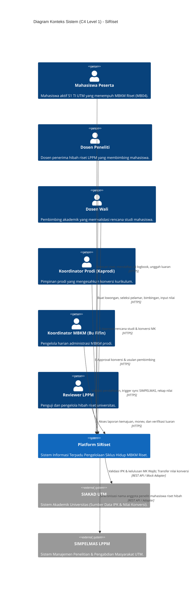
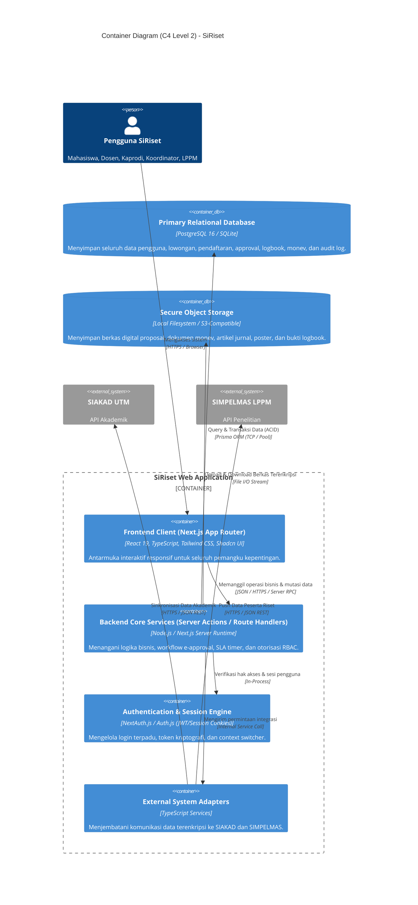
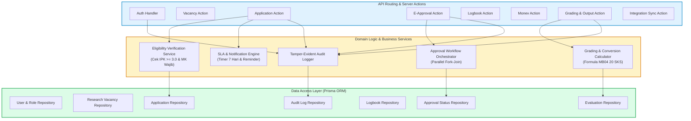
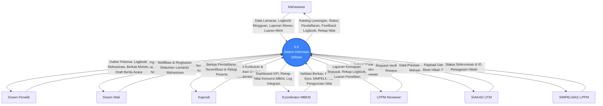
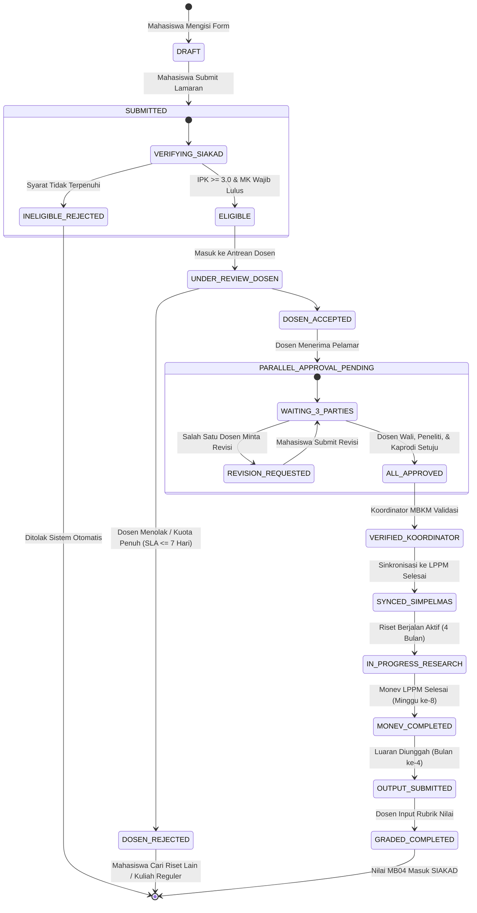
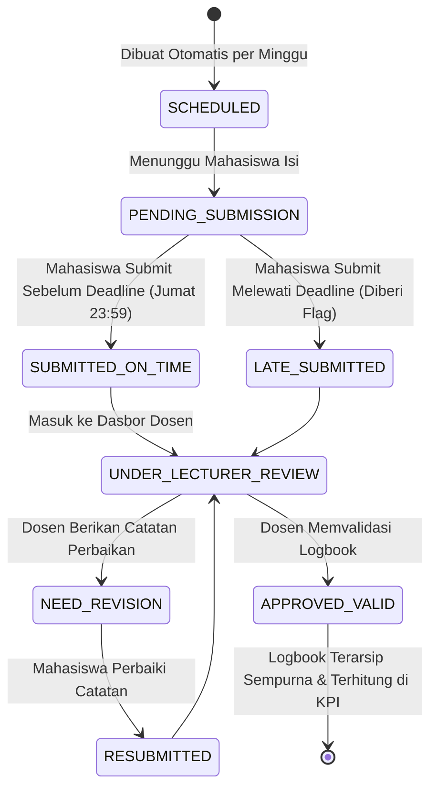

# Dokumen Arsitektur Sistem & Perangkat Lunak
## SiRiset: Sistem Informasi MBKM Riset Terpadu
### Program Studi Teknik Informatika, Fakultas Teknik, Universitas Trunodjoyo Madura

---

## 1. Ikhtisar & Pola Arsitektur Sistem

Sistem Informasi **SiRiset** dirancang menggunakan arsitektur perangkat lunak modern berbasis web dengan pola **Modular Monolith** yang dipadukan dengan prinsip **Clean Architecture** (Martin, 2017) dan model interaksi reaktif. Pola ini dipilih karena memberikan keseimbangan optimal antara kecepatan pengembangan tim mahasiswa, kemudahan pemeliharaan, kejelasan isolasi domain bisnis, serta keandalan saat diuji dalam demonstrasi perkuliahan dan lingkungan produksi kampus.

### Karakteristik Arsitektur Kunci:
1. **Single Source of Truth (SSOT)**: Menyatukan seluruh siklus hidup MBKM Riset ke dalam satu pangkalan data relasional terpusat, mengeliminasi duplikasi data yang sebelumnya tercecer di SI MBKM, SIMPELMAS, Google Classroom, dan map fisik.
2. **Loosely Coupled External Adapters**: Mengisolasi interaksi dengan sistem eksternal (SIAKAD dan SIMPELMAS LPPM) menggunakan pola *Adapter / Anti-Corruption Layer (ACL)*, sehingga perubahan antarmuka pada sistem kampus tidak merusak logika bisnis inti SiRiset.
3. **Role-Based Security by Design**: Mengintegrasikan otorisasi berbasis peran (*Role-Based Access Control - RBAC*) pada level middleware server dan baris data (*Row-Level Security*).
4. **Event-Driven Audit Logging**: Setiap mutasi status kritis (seperti perubahan status approval, penilaian, dan sinkronisasi data) secara otomatis memicu pencatatan jejak audit (*tamper-evident audit trail*).

---

## 2. Diagram Arsitektur C4 Model

Sesuai standar pendokumentasian arsitektur perangkat lunak industri (Brown, 2018), arsitektur SiRiset dimodelkan ke dalam 4 tingkatan C4 Model:

### 2.1 C4 Level 1: System Context Diagram
Diagram ini memperlihatkan interaksi platform SiRiset terhadap aktor manusia dan batas sistem eksternal universitas.

---

### 2.2 C4 Level 2: Container Diagram
Diagram ini memperlihatkan komponen runtime perangkat lunak, protokol komunikasi, dan media penyimpanan data SiRiset.

---

### 2.3 C4 Level 3: Component Diagram (Backend Core Services)
Diagram ini memperlihatkan struktur modular di dalam lapisan logika backend SiRiset:

---

## 3. Data Flow Diagram (DFD)

### 3.1 DFD Level 0: Context Diagram
Diagram Alir Data tingkat konteks memperlihatkan batas sistem dan aliran pertukaran data antara SiRiset dengan seluruh entitas eksternal:

---

### 3.2 DFD Level 1: Dekomposisi Proses Utama

Sistem SiRiset didekomposisi ke dalam **6 Sub-proses Fungsional**:
1. **1.0 Manajemen Otentikasi & Profil**: Verifikasi akun pengguna (NIM/NIP), pembuatan token sesi terenkripsi, dan pengaturan preferensi peran.
2. **2.0 Manajemen Lowongan & Lamaran Riset**: Publikasi topik riset hibah oleh dosen, penelusuran katalog riset, pengajuan lamaran mahasiswa, dan verifikasi otomatis aturan kelayakan via SIAKAD.
3. **3.0 Orkestrasi E-Approval Simultan**: Pemicu alur kerja persetujuan paralel untuk Dosen Wali, Dosen Peneliti, dan Kaprodi beserta penerbitan dokumen digital berstempel QR-Code.
4. **4.0 Jembatan Sinkronisasi Eksternal**: Pemrosesan transfer data peserta riset ke basis data SIMPELMAS LPPM pasca-validasi Koordinator MBKM.
5. **5.0 Pengelolaan Logbook & Monitoring Bimbingan**: Siklus mingguan pengisian kegiatan mahasiswa, pengiriman notifikasi pengingat, dan peninjauan langsung (*inline review*) oleh dosen.
6. **6.0 Evaluasi Monev, Repositori Luaran, & Auto-Konversi Nilai**: Pengunggahan dokumen kemajuan dan hasil luaran, pengisian rubrik multi-kriteria digital, serta kalkulasi otomatis paket konversi nilai 20 SKS mata kuliah MB04.

---

## 4. Diagram Transisi Status (*State Machine Diagrams*)

Untuk memastikan tidak ada kondisi ambivalen pada siklus hidup data, sistem menerapkan mesin status (*State Machine*) yang ketat:

### 4.1 Mesin Status Pendaftaran Mahasiswa (`ApplicationStatus`)

---

### 4.2 Mesin Status Logbook Mingguan (`LogbookStatus`)

---

## 5. Matriks Kontrol Akses Berbasis Peran (RBAC Matrix)

Keamanan akses data dijamin melalui matriks hak akses (*Access Control List*) pada tabel berikut:

| Modul / Kemampuan Sistem | Mahasiswa | Dosen Peneliti | Dosen Wali | Kaprodi | Koordinator MBKM | Reviewer LPPM | Administrator |
| :--- | :---: | :---: | :---: | :---: | :---: | :---: | :---: |
| **Katalog Lowongan Riset** | Read | Create, Read, Update, Delete | Read | Read | Read | Read | Full Access |
| **Pendaftaran Mahasiswa** | Create, Read, Update (Draft) | Read (Pelamar Miliknya) | Read (Bimbingannya) | Read (Semua TI) | Read (Semua TI) | Read (Peserta) | Full Access |
| **Seleksi Pelamar Riset** | None | Update (Terima/Tolak) | None | None | None | None | Full Access |
| **E-Approval Berkas** | Read (Status) | Approve/Reject (Riset) | Approve/Reject (Wali) | Approve/Reject (Prodi) | Validate Final | None | Full Access |
| **1-Click Sync SIMPELMAS** | None | Read (Status Sync) | None | None | **Execute Sync** | Read (Hasil Sync) | Full Access |
| **Logbook Mingguan** | Create, Update (Milik Sendiri) | Read, Review, Feedback | Read (Bimbingannya) | Read (Laporan) | Read (Rekap Prodi) | Read (Rekap) | Full Access |
| **Monev & Laporan Kemajuan** | Create, Update (Upload) | Read, Tindak Lanjut | None | Read | Read | **Evaluate & Score** | Full Access |
| **Manajemen Luaran Riset** | Create, Update (Upload) | Verify & Validate | None | Read | Read | Read (Arsip) | Full Access |
| **Penilaian Rubrik Digital** | Read (Transkrip) | **Input Nilai Rubrik** | None | Read | **Lock & Export Nilai** | Read | Full Access |
| **Audit Log Keamanan** | None | None | None | None | Read (Aktivitas Prodi) | None | **Full Access** |

---

## 6. Arsitektur Keamanan & Kepatuhan Data

1. **Autentikasi & Manajemen Sesi**:
   - Menerapkan arsitektur sesi berbasis *JSON Web Token (JWT)* yang ditandatangani menggunakan algoritma *HMAC-SHA256* dengan kunci rahasia berkekuatan tinggi (*256-bit entropy*).
   - Cookie sesi disetel dengan atribut ketat: `HttpOnly = true` (kebal pencurian via XSS), `Secure = true` (hanya lewat HTTPS), `SameSite = Lax` (mencegah eksploitasi CSRF).
2. **Proteksi Injeksi Basis Data & Sanitasi Input**:
   - Seluruh interaksi basis data dieksekusi melalui **Prisma ORM** yang menerapkan *Parameterized Queries* secara inheren, menjamin sistem 100% imun terhadap serangan *SQL Injection*.
   - Seluruh payload request divalidasi dan disanitasi menggunakan skema deklaratif **Zod** sebelum dieksekusi oleh controller.
3. **Keamanan Penyimpanan Berkas (*File Upload Security*)**:
   - Pemeriksaan ganda: ekstensi nama file dan validasi *MIME Type* berbasis *Magic Bytes* di sisi server untuk mencegah berkas biner berbahaya (*executable masquerading*).
   - File diacak namanya menggunakan UUIDv4 (`{uuid}.pdf`) untuk mencegah serangan *Path Traversal* dan *File Overwriting*.
4. **Jejak Audit Digital (*Audit Trail*)**:
   - Seluruh aksi yang mengubah status data secara permanen (Approval, Input Nilai, Sinkronisasi API, Perubahan Status) dicatat di tabel `audit_logs` yang bersifat *Append-Only* (tidak dapat diubah atau dihapus).

