# Analisis Model Proses Bisnis As-Is (BPMN 2.0)
## Program MBKM Riset - Program Studi Teknik Informatika UTM
### Berdasarkan Laporan Kelompok 2 & Riset Lapangan Empiris

---

## 1. Pendahuluan & Metodologi Process Discovery

Model proses bisnis *As-Is* ini merepresentasikan cara kerja aktual (*actual operating procedure*) pelaksanaan program MBKM Riset (kode mata kuliah konversi: **MB04**) di Program Studi S1 Teknik Informatika, Fakultas Teknik, Universitas Trunodjoyo Madura untuk periode Semester Ganjil 2026/2027.

Sesuai metodologi *Process Discovery* yang diajarkan oleh **Dr. Rika Yunitarini, ST., MT.** (merujuk pada Dumas dkk., 2018), pengumpulan fakta proses dilakukan melalui triangulasi tiga pendekatan:
1. **Evidence-based Discovery (Berbasis Dokumen & Bukti Sistem)**:
   - *Buku Panduan Program MBKM Penelitian Edisi II* (LPPM UTM, 2023).
   - *Panduan Penelitian Mandiri Edisi IX* (LPPM UTM, 2026).
   - *Materi Sosialisasi Persiapan MBKM Ganjil 2026/2027: Pengenalan MBKM Hybrid* (Prodi TI UTM, 2026).
   - Observasi arsitektur sistem [SI MBKM UTM](https://mbkm.trunojoyo.ac.id/gate/login), [SIAKAD UTM](https://siakad.trunojoyo.ac.id), dan [SIMPELMAS UTM](https://simpelmas.trunojoyo.ac.id).
2. **Interview-based Discovery (Wawancara Pelaku Utama)**:
   - **Narasumber Mahasiswa**: Wawancara bersama **Ilyas** (NIM aktif Prodi TI UTM) pada 14 Oktober 2026, yang sedang menempuh MBKM Riset di laboratorium prodi.
   - **Narasumber Dosen Peneliti**: Wawancara bersama **Bapak Dr. Mula'ab, S.Si., M.Kom.** pada 14 Oktober 2026, dosen senior penerima hibah penelitian yang membimbing mahasiswa MBKM Riset.
3. **Formal Modeling & Validation**:
   - Pemodelan formal menggunakan perangkat lunak **Bizagi Modeler 4.3** dengan standar notasi **BPMN 2.0.2** (Object Management Group, 2013). Model diverifikasi untuk menjamin kepatuhan semantik alur (*sequence flow* hanya di dalam pool, *message flow* lintas batas pool).

---

## 2. Struktur Partisipan, Pool, dan Swimlane

Model As-Is tersusun dalam diagram kolaborasi multipihak yang memisahkan batas tanggung jawab institusional ke dalam **4 Pool**:

| Pool / Swimlane | Entitas Partisipan | Peran Utama dalam Kondisi As-Is |
| :--- | :--- | :--- |
| **Pool 1: Prodi Teknik Informatika** | Unit Pengelola Akademik Jurusan | Bertanggung jawab atas administrasi akademik, pendaftaran, dan konversi SKS. Terbagi menjadi 5 Lane: |
| ├─ *Lane 1: Mahasiswa* | Pemohon / Mahasiswa Aktif Semester 5-7 | Mencari informasi, melamar ke dosen, meminta tanda tangan, unggah berkas, mengerjakan riset, mengisi logbook, lapor monev, menyerahkan luaran. |
| ├─ *Lane 2: Dosen Wali* | Pembimbing Akademik Mahasiswa | Memeriksa rencana studi dan menandatangani formulir pendaftaran MBKM serta formulir usulan konversi KRS. |
| ├─ *Lane 3: Dosen Peneliti* | Dosen Pengusul / Penerima Hibah LPPM | Membuka lowongan di grup, menyeleksi mahasiswa secara subjektif, tanda tangan proposal, bimbingan berkala, menginput nama ke SIMPELMAS, menilai di atas kertas. |
| ├─ *Lane 4: Kaprodi* | Koordinator Program Studi S1 TI | Menyetujui konversi mata kuliah, menandatangani formulir pendaftaran, dan mengusulkan SK Dosen Pembimbing ke tingkat fakultas. |
| └─ *Lane 5: Koordinator MBKM* | Tim MBKM Prodi (Ibu Fifin dkk.) | Menyosialisasikan program, membagikan templat word, memeriksa kelengkapan berkas fisik & SI MBKM, mencatat peserta, dan merekap nilai konversi. |
| **Pool 2: Fakultas Teknik** | Dekanat Fakultas Teknik UTM | Menerima usulan dari Kaprodi dan rekap peserta dari LPPM, kemudian menerbitkan Surat Keputusan (SK) Dekan tentang Dosen Pembimbing MBKM. |
| **Pool 3: LPPM UTM** | Lembaga Penelitian dan Pengabdian | Mengelola hibah dosen, merekap mahasiswa riset dari SIMPELMAS, menerima pengumpulan logbook sporadis, mengadakan Monev via Google Classroom, menerima luaran akhir penelitian. |
| **Pool 4: SIMPELMAS** | Sistem Informasi Penelitian LPPM | Sistem aplikasi eksternal tempat dosen mendaftarkan nama anggota peneliti mahasiswa dan rekapitulasi pelaporan hibah penelitian universitas. |

---

## 3. Gambaran Umum Proses As-Is (*Macro Process Overview*)

Model lengkap As-Is mencakup **53 aktivitas (tasks)**, **15 exclusive gateway (XOR)**, **6 parallel gateway (AND)**, dan **12 message flows**. Untuk menyajikan alur yang komprehensif, proses dikelompokkan ke dalam 7 tahapan yang saling terhubung menggunakan *Link Intermediate Events*.

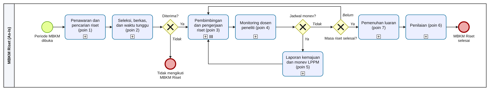
*Gambar 3.1: Gambaran umum proses As-Is MBKM Riset dalam bentuk collapsed sub-processes.*

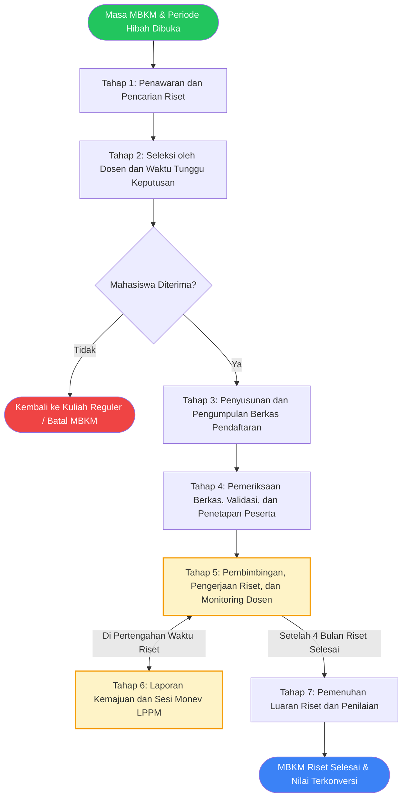

---

## 4. Dekomposisi 7 Tahapan Proses As-Is

### 4.1 Tahap 1: Penawaran dan Pencarian Riset
Tahap ini mencakup inisiasi riset hibah di LPPM dan interaksi pencarian informasi riset oleh mahasiswa di tingkat program studi.

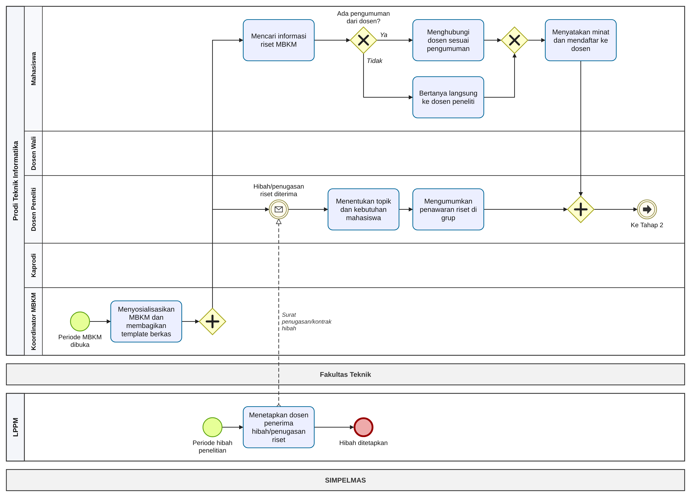
*Gambar 3.2: Model BPMN As-Is Tahap 1 - Penawaran dan Pencarian Riset.*

#### Alur Aktivitas:
1. Di Pool LPPM, pemicu dimulai dari *Timer Start Event* periode hibah penelitian tahunan. LPPM menerbitkan Surat Keputusan / Kontrak Penugasan Hibah Riset kepada Dosen Peneliti.
2. Di Pool Prodi (Lane Koordinator MBKM), koordinator memulai dengan menyosialisasikan pembukaan MBKM di Zoom/grup angkatan dan membagikan tautan Google Drive berisi templat formulir pendaftaran.
3. Alur terpecah dua via *Parallel Gateway (AND)*:
   - **Jalur Dosen**: Dosen Peneliti menerima kontrak hibah, merumuskan kebutuhan topik dan jumlah perbantuan mahasiswa, lalu menyebarkan penawaran secara informal di grup WhatsApp atau obrolan terbatas (*PP1*).
   - **Jalur Mahasiswa**: Mahasiswa mencari lowongan riset. Jika mahasiswa melihat pesan di grup WhatsApp, ia menghubungi dosen terkait. Jika tidak melihat pengumuman, mahasiswa terpaksa berinisiatif menghubungi dosen satu per satu secara langsung (door-to-door).
4. Mahasiswa menyatakan minat dan mengajukan diri kepada dosen peneliti.

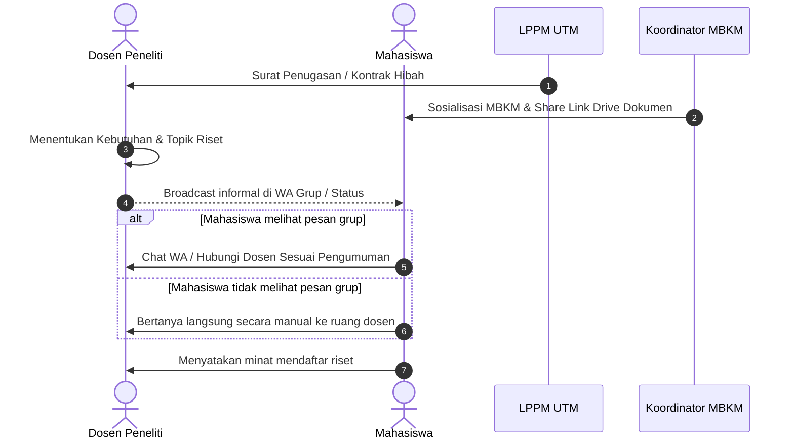

---

### 4.2 Tahap 2: Seleksi oleh Dosen dan Waktu Tunggu Keputusan
Tahap ini menggambarkan proses penyaringan pendaftar yang sepenuhnya bersifat subjektif tanpa kriteria baku prodi.

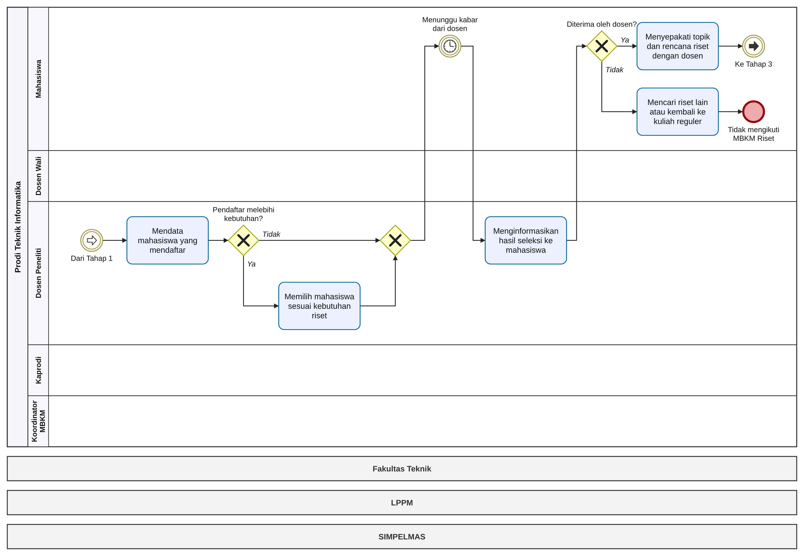
*Gambar 3.3: Model BPMN As-Is Tahap 2 - Seleksi oleh Dosen dan Waktu Tunggu Keputusan.*

#### Alur Aktivitas:
1. Dosen Peneliti merekap daftar nama mahasiswa yang menghubungi dirinya.
2. Melalui *Exclusive Gateway (XOR)* "Pendaftar melebihi kebutuhan?":
   - Jika pendaftar lebih banyak dari kuota (misal: butuh 4 orang, yang mendaftar 8 orang), dosen melakukan seleksi mandiri (*natural selection*) berdasarkan preferensi personal tanpa transparansi kriteria (*PP2*).
   - Jika pendaftar $\le$ kuota, semua pendaftar langsung diterima.
3. Selama proses pertimbangan dosen, mahasiswa tertahan dalam *Intermediate Timer Event* "Menunggu kabar dari dosen". Periode tunggu ini tidak memiliki batas SLA pasti (berkisar antara beberapa hari hingga lebih dari 2 minggu).
4. Dosen mengabarkan hasil keputusan via pesan WhatsApp.
5. Melalui Gateway "Diterima?":
   - Jika **Tidak Diterima**: Proses berakhir (*End Event*: Batal MBKM / Kembali ke perkuliahan reguler).
   - Jika **Diterima**: Mahasiswa dan Dosen Peneliti menyepakati rincian topik riset dan pembagian tugas awal.

---

### 4.3 Tahap 3: Penyusunan dan Pengumpulan Berkas Pendaftaran
Tahap ini merupakan titik kemacetan birokrasi manual yang paling membebani mahasiswa dalam proses As-Is.

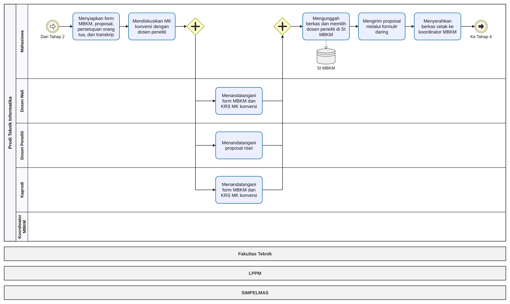
*Gambar 3.4: Model BPMN As-Is Tahap 3 - Penyusunan dan Pengumpulan Berkas Pendaftaran.*

#### Alur Aktivitas:
1. Mahasiswa mengunduh templat dan menyusun 5 berkas:
   - Formulir Pendaftaran MBKM.
   - Formulir Usulan Konversi Mata Kuliah KRS (maksimal 20 SKS / MB04).
   - Proposal Rencana Kerja Riset.
   - Surat Persetujuan Orang Tua bermaterai.
   - Lembar Transkrip Nilai Sementara dari SIAKAD.
2. Mahasiswa mendiskusikan daftar mata kuliah konversi dengan Dosen Peneliti.
3. **Pengumpulan Tanda Tangan Basah Paralel-Sekuensial Manual (*PP3*)**:
   - Mahasiswa menemui Dosen Wali untuk tanda tangan Form MBKM dan KRS Konversi.
   - Mahasiswa menemui Dosen Peneliti untuk tanda tangan Proposal Riset.
   - Mahasiswa menemui Koordinator Program Studi (Kaprodi) untuk tanda tangan Form MBKM dan KRS Konversi.
   Mahasiswa sering kali harus bolak-balik ke kampus selama beberapa hari karena padatnya jadwal mengajar para dosen.
4. **Pengumpulan Dokumen di Tiga Kanal Berulang (*PP4*)**:
   - Aktivitas 1: Mengunggah pindaian berkas lengkap ke sistem SI MBKM universitas.
   - Aktivitas 2: Mengirim dokumen proposal ke formulir Google Form daring khusus prodi.
   - Aktivitas 3: Menyerahkan 1 map berkas cetak (hardcopy) asli ke meja Koordinator MBKM Prodi (Ibu Fifin).

---

### 4.4 Tahap 4: Pemeriksaan Berkas, Validasi, dan Penetapan Peserta
Tahap ini mencakup verifikasi berkas oleh prodi serta jalur ganda pendaftaran peserta ke fakultas dan LPPM.

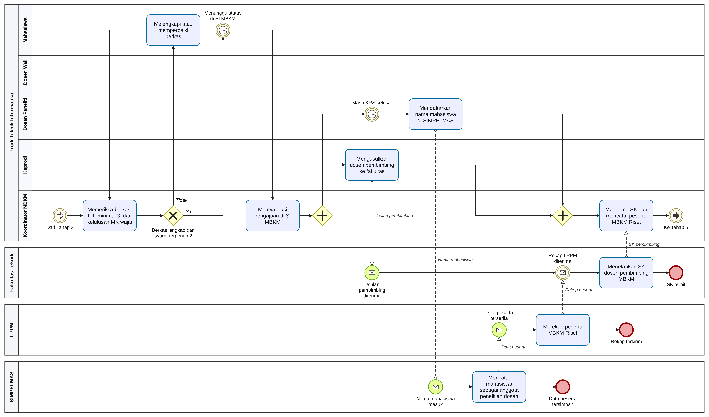
*Gambar 3.5: Model BPMN As-Is Tahap 4 - Pemeriksaan Berkas, Validasi, dan Penetapan Peserta.*

#### Alur Aktivitas:
1. Koordinator MBKM memeriksa tumpukan berkas cetak secara manual di meja kerjanya:
   - Mencocokkan nilai transkrip untuk memastikan IPK $\ge$ 3.00.
   - Memastikan tidak ada mata kuliah wajib dasar yang belum lulus.
2. Jika ada berkas kurang/salah format, berkas dikembalikan ke mahasiswa untuk direvisi (*Rework Loop*).
3. Jika berkas valid, Koordinator MBKM membuka SI MBKM universitas dan menekan tombol *Validate Application*.
4. **Alur Terpecah Dua Jalur Terpisah (*PP5*)**:
   - **Jalur Administrasi Prodi & Fakultas**: Kaprodi membuat surat usulan penunjukan Dosen Pembimbing Riset ke Dekan Fakultas Teknik. Fakultas menunggu rekapitulasi untuk kemudian menerbitkan Surat Keputusan (SK) Dekan.
   - **Jalur SIMPELMAS LPPM**: Dosen Peneliti menunggu hingga "Masa Perwalian KRS Selesai", kemudian baru melakukan entri manual nama mahasiswa bimbingannya ke sistem SIMPELMAS LPPM.
   *Akibatnya*: Terdapat selang waktu berminggu-minggu antara pendaftaran di SI MBKM dan pencatatan di SIMPELMAS LPPM, yang sering memicu ketidaksinkronan data peserta (*data mismatch*).

---

### 4.5 Tahap 5: Pembimbingan, Pengerjaan Riset, dan Monitoring Dosen
Tahap pelaksanaan inti riset yang berlangsung selama minimal 4 bulan (16 minggu).

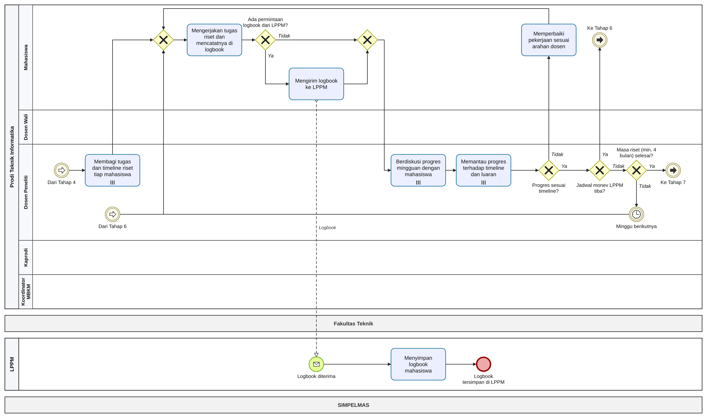
*Gambar 3.6: Model BPMN As-Is Tahap 5 - Pembimbingan, Pengerjaan Riset, dan Monitoring Dosen.*

#### Alur Aktivitas & Siklus Mingguan:
1. Dosen Peneliti membagi tugas teknis dan jadwal kerja (*timeline*) kepada masing-masing mahasiswa (ditandai dengan notasi *Multi-instance Task*).
2. Mahasiswa mengerjakan riset di lab/lapangan dan mencatat kegiatan di buku log (*logbook*).
3. **Kendala Logbook (*PP7*)**:
   - LPPM meminta logbook sewaktu-waktu tanpa jadwal berkala yang pasti.
   - Mahasiswa mengirimkan berkas logbook secara mandiri ke LPPM via email atau tautan gdrive.
   - **Dosen Peneliti sama sekali tidak memiliki akses melihat isi logbook yang dikirim mahasiswa ke LPPM**, sehingga dosen hanya mengandalkan ingatan saat sesi diskusi verbal mingguan.
4. Evaluasi mingguan dosen: Dosen meninjau progres riset secara tatap muka. Jika pekerjaan belum memenuhi target, mahasiswa diminta memperbaiki di minggu berikutnya.
5. Siklus ini berulang hingga minggu ke-8 (terpicu jadwal Monev LPPM) dan terus berlanjut hingga tuntas 4 bulan.

---

### 4.6 Tahap 6: Laporan Kemajuan dan Sesi Monev bersama LPPM
Tahap evaluasi tengah semester yang diselenggarakan oleh LPPM UTM.

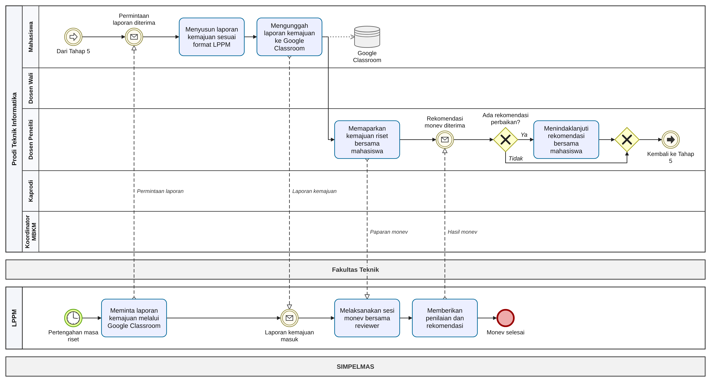
*Gambar 3.7: Model BPMN As-Is Tahap 6 - Laporan Kemajuan dan Sesi Monev bersama LPPM.*

#### Alur Aktivitas:
1. Pada pertengahan periode riset (sekitar minggu ke-8), LPPM membuka ruang penugasan pada platform **Google Classroom** (*PP6*).
2. Mahasiswa menyusun Laporan Kemajuan mengikuti format laporan hibah LPPM, lalu mengunggahnya ke Google Classroom tersebut.
3. LPPM mengundang Dosen Peneliti dan Mahasiswa untuk menghadiri seminar Monev di hadapan Tim Reviewer Independen LPPM.
4. Tim Reviewer mengevaluasi kesesuaian target hibah, memberikan skor, dan menerbitkan Berita Acara Rekomendasi Monev.
5. Dosen dan Mahasiswa menindaklanjuti masukan reviewer, lalu kembali ke siklus riset Tahap 5.

---

### 4.7 Tahap 7: Pemenuhan Luaran dan Penilaian
Tahap penutupan program MBKM Riset di akhir semester.

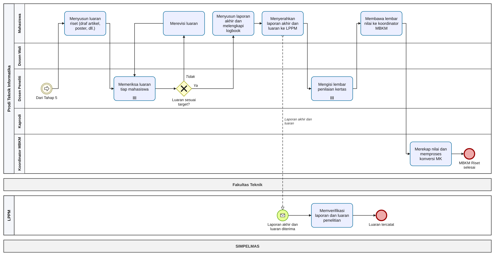
*Gambar 3.8: Model BPMN As-Is Tahap 7 - Pemenuhan Luaran dan Penilaian.*

#### Alur Aktivitas:
1. Mahasiswa menyusun draf luaran (artikel jurnal, naskah prosiding seminar, atau poster ilmiah).
2. Dosen Peneliti memeriksa draf luaran. Jika belum memenuhi standar publikasi, mahasiswa wajib melakukan revisi berulang kali.
3. **Masalah Target Luaran Tidak Terstandar (*PP9*)**: Karena sejak awal tidak ada kontrak luaran individual tertulis di sistem, sering timbul perbedaan ekspektasi antara dosen dan mahasiswa di akhir kegiatan.
4. Mahasiswa melengkapi laporan akhir dan menyerahkannya sendiri ke kantor LPPM.
5. **Penilaian Berbasis Kertas Fisik (*PP8*)**:
   - Dosen Peneliti mengisi lembar blangko penilaian di atas selembar kertas.
   - Lembar nilai kertas tersebut **dititipkan dan dibawa sendiri oleh mahasiswa** untuk diserahkan ke meja Koordinator MBKM Prodi.
   - Koordinator MBKM merekap nilai fisik tersebut ke dalam spreadsheet Excel prodi, lalu mengurus konversi nilai 20 SKS ke sistem SIAKAD universitas.
   *Risiko*: Kertas nilai rentan tercecer, terselip, rusak, atau terlambat diserahkan mahasiswa.

---

## 5. Taksonomi 9 Titik Nyeri (*Pain Points / PP*)

Berdasarkan penelusuran model As-Is di atas, teridentifikasi 9 titik nyeri kritis yang dirangkum pada tabel berikut:

| Kode | Pain Point | Tahap BPMN | Ringkasan Permasalahan di Lapangan |
| :---: | :--- | :--- | :--- |
| **PP1** | Penawaran riset hanya lewat WhatsApp grup dan kontak personal | Tahap 1 (Task 1.2, 1.3) | Informasi lowongan tidak transparan, tidak terstandar, dan berisiko terlewat bagi mahasiswa yang tidak memiliki kedekatan personal dengan dosen. |
| **PP2** | Seleksi tanpa kriteria objektif dan SLA waktu tunggu tidak pasti | Tahap 2 (Task 2.2, 2.3) | Dosen menyeleksi secara subjektif; mahasiswa menunggu kabar berhari-hari hingga berminggu-minggu tanpa kejelasan batas waktu penerimaan. |
| **PP3** | Tanda tangan manual basah dari 3 pihak terpisah | Tahap 3 (Task 3.3, 3.4, 3.5) | Mahasiswa harus meluangkan waktu berhari-hari menemui Dosen Wali, Dosen Peneliti, dan Kaprodi demi membubuhkan tanda tangan basah di lembar kertas. |
| **PP4** | Pengumpulan berkas pendaftaran berulang di 3 kanal berbeda | Tahap 3 (Task 3.7, 3.8, 3.9) | Mahasiswa wajib mengunggah berkas di SI MBKM, mengunggah ulang di Google Form, dan mencetak fisik berkas untuk diserahkan ke koordinator. |
| **PP5** | Pendaftaran peserta di dua sistem berbeda waktu (SI MBKM vs SIMPELMAS) | Tahap 4 (Task 4.4, 4.5) | Mahasiswa mendaftar di SI MBKM sebelum KRS, dosen menginput nama mahasiswa ke SIMPELMAS setelah KRS. Data peserta berisiko tidak sinkron. |
| **PP6** | Pengumpulan Laporan Kemajuan monev menggunakan Google Classroom | Tahap 6 (Task 6.1, 6.2) | Dokumen laporan monev terisolasi di Google Classroom luar, tidak terarsip di sistem repositori resmi prodi maupun SIMPELMAS. |
| **PP7** | Logbook dikirim sporadis ke LPPM dan tertutup dari akses dosen | Tahap 5 (Task 5.2, 5.3) | Logbook diisi mendadak ketika ada panggilan LPPM. Dosen pembimbing tidak dapat melihat logbook mahasiswa yang dikirim ke LPPM. |
| **PP8** | Lembar penilaian manual di atas kertas yang dititipkan ke mahasiswa | Tahap 7 (Task 7.4, 7.5) | Penilaian akhir ditulis tangan di atas kertas fisik yang rentan hilang, rusak, lambat diproses, dan tidak memiliki standar rubrik transparan. |
| **PP9** | Target luaran mahasiswa tidak disepakati sejak awal proposal | Tahap 7 (Task 7.1, 7.2) | Jenis dan bobot luaran individual mahasiswa baru dibahas di akhir masa kegiatan, memicu konflik ekspektasi dan risiko penundaan kelulusan MBKM. |

---

## 6. Analisis Dampak, Pemborosan (*Muda*), dan Akar Masalah (5-Whys)

Sesuai materi kuliah *Analisis Kinerja Proses & Waste Analysis* (Dumas dkk., 2018; Yunitarini, 2026c), setiap pain point diuraikan akar masalahnya melalui metode 5-Whys dan diklasifikasikan jenis pemborosannya (*7 Wastes / Muda*):

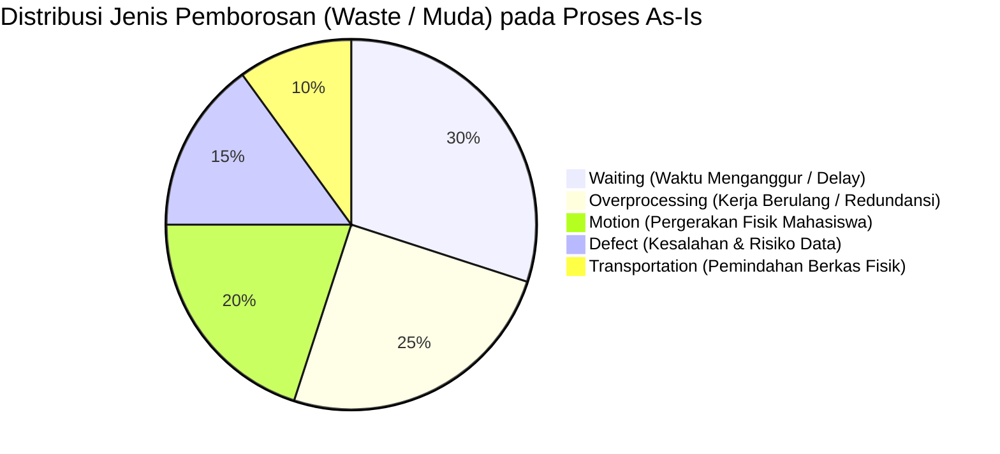

| Kode | Analisis Akar Masalah (5-Whys) | Dampak pada Pemangku Kepentingan | Jenis Pemborosan (*Muda*) | Skor Prioritas $(D \times F)$ |
| :---: | :--- | :--- | :--- | :---: |
| **PP1** | **Why 1**: Informasi riset lewat WA. **Why 2**: Belum ada menu lowongan di SI MBKM. **Why 3**: Sistem pendaftaran prodi tidak dirancang sebagai portal karier/riset. **Root Cause**: Ketiadaan kanal resmi dan template baku publikasi riset prodi. | - **Mahasiswa**: Kesempatan tidak merata. - **Dosen**: Pendaftar tidak sesuai kualifikasi riset. - **Prodi**: Tidak memiliki rekapitulasi penawaran riset aktif. | *Motion*, *Waiting* | $2 \times 3 = \mathbf{6}$ (Sedang) |
| **PP2** | **Why 1**: Mahasiswa cemas menunggu kabar. **Why 2**: Waktu pengumuman tidak terjadwal. **Why 3**: Dosen memilih sendiri tanpa batas waktu. **Root Cause**: Ketiadaan SOP penetapan batas waktu seleksi (*SLA*) dan rubrik kualifikasi tertulis. | - **Mahasiswa**: Risiko bentrok jadwal KRS reguler, stres akademik. - **Dosen**: Subjektivitas tinggi, potensi konflik kepentingan. | *Waiting* | $3 \times 3 = \mathbf{9}$ (**Tinggi**) |
| **PP3** | **Why 1**: Mahasiswa keliling meminta tanda tangan. **Why 2**: Dokumen pendaftaran berbentuk cetak. **Why 3**: SI MBKM belum memiliki fitur tanda tangan digital/approval workflow. **Root Cause**: Birokrasi masih bertumpu pada tanda tangan basah konvensional. | - **Mahasiswa**: Waktu terbuang 2-3 hari hanya untuk mencari dosen di kampus. - **Dosen & Kaprodi**: Terganggu tumpukan berkas fisik saat jam kerja. | *Motion*, *Waiting* | $2 \times 3 = \mathbf{6}$ (Sedang) |
| **PP4** | **Why 1**: Mahasiswa unggah di SI MBKM, Form, & Cetak. **Why 2**: Koordinator butuh berkas fisik, LPPM butuh gform. **Why 3**: Tidak ada sistem tunggal yang dipercaya bersama. **Root Cause**: Setiap unit kerja membuat kanal sendiri tanpa integrasi repositori. | - **Mahasiswa**: Biaya cetak kertas, kerja ekstra 3x lipat. - **Koordinator**: Ruang arsip penuh map kertas, verifikasi manual lambat. | *Overprocessing* | $2 \times 3 = \mathbf{6}$ (Sedang) |
| **PP5** | **Why 1**: Data peserta SI MBKM beda dengan SIMPELMAS. **Why 2**: Pendaftaran mahasiswa dan dosen terpisah jadwal. **Why 3**: SI MBKM prodi dan SIMPELMAS LPPM berjalan di basis data terpisah. **Root Cause**: Tiadanya Application Programming Interface (API) jembatan sinkronisasi antarsistem. | - **Dosen**: Kerja ganda mendaftarkan ulang mahasiswa setelah KRS. - **LPPM & Fakultas**: Data mahasiswa riset tidak sinkron, SK Dekan terhambat. | *Overprocessing*, *Defect* | $3 \times 3 = \mathbf{9}$ (**Tinggi**) |
| **PP6** | **Why 1**: Laporan kemajuan dikirim ke GClassroom. **Why 2**: SIMPELMAS belum menyediakan modul unggah berkas mahasiswa. **Why 3**: LPPM memilih alat gratisan instan. **Root Cause**: Penggunaan kanal ad-hoc di luar ekosistem resmi sistem universitas. | - **Mahasiswa**: Mengelola banyak akun & ruang aplikasi. - **LPPM & Prodi**: Rekam jejak monev tidak terpusat, sulit diaudit. | *Transportation*, *Overprocessing* | $2 \times 2 = \mathbf{4}$ (Sedang) |
| **PP7** | **Why 1**: Dosen tidak bisa pantau logbook. **Why 2**: Mahasiswa langsung kirim logbook ke LPPM. **Why 3**: Format logbook manual (word/excel) dan tidak ada akun dosen di kanal pengumpulan. **Root Cause**: Logbook diposisikan sebagai kewajiban administratif LPPM semata, bukan alat kendali mutu bimbingan dosen. | - **Mahasiswa**: Logbook dikerjakan borongan (sistem kebut semalam), data tidak akurat. - **Dosen**: Pembimbingan tidak berbasis data riil catatan harian. | *Defect*, *Waiting* | $3 \times 3 = \mathbf{9}$ (**Tinggi**) |
| **PP8** | **Why 1**: Penilaian pakai lembar kertas dititipkan mahasiswa. **Why 2**: Belum ada modul e-assessment di SI MBKM. **Why 3**: Belum ada rubrik terstandarisasi prodi di aplikasi. **Root Cause**: Tradisi pengisian nilai manual tanpa digitalisasi sistem penilaian terpadu. | - **Mahasiswa**: Risiko kehilangan berkas nilai, konversi SKS tertunda. - **Koordinator**: Lambat merekap, risiko human-error saat input nilai ke SIAKAD. | *Transportation*, *Defect* | $3 \times 2 = \mathbf{6}$ (Sedang) |
| **PP9** | **Why 1**: Dosen dan mahasiswa beda pemahaman luaran. **Why 2**: Jenis luaran ditentukan sepihak oleh dosen di akhir kegiatan. **Why 3**: Tidak ada kontrak target luaran individual di proposal awal. **Root Cause**: Ketiadaan standardisasi kontrak kinerja luaran mahasiswa sejak awal pendaftaran. | - **Mahasiswa**: Beban kerja tidak terprediksi, potensi tidak lulus jika mitra gagal. - **LPPM**: Target luaran hibah penelitian dosen terancam tidak tercapai. | *Defect* | $3 \times 3 = \mathbf{9}$ (**Tinggi**) |

*Keterangan Skor: Dampak (D) 1-3 $\times$ Frekuensi (F) 1-3. Nilai 7-9 = Prioritas Tinggi; 4-6 = Prioritas Sedang.*

---

## 7. Sintesis 3 Meta-Akar Masalah (*Meta Root Causes*)

Dari analisis mendalam terhadap 9 pain point tersebut, ditemukan 3 problem struktural fundamental yang menjadi induk permasalahan:

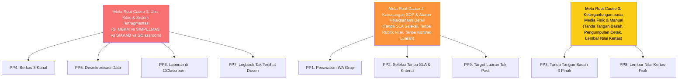

1. **Fragmentasi Sistem dan Isolasi Antar-Unit (*Unit Silos*)**: Program Studi, Fakultas, dan LPPM mengoperasikan platform teknologi masing-masing tanpa jembatan pertukaran data (*no API integration*), memaksa mahasiswa dan dosen menjadi "kurir data manual".
2. **Kekosongan Regulasi Operasional Terperinci (*Regulatory Vacuum*)**: Panduan universitas hanya mengatur aspek umum, namun tidak menetapkan aturan operasional mikro mengenai SLA waktu pengumuman seleksi, kontrak target luaran individual, dan standar jadwal bimbingan.
3. **Ketergantungan Kuat pada Media Fisik (*Paper-based Culture*)**: Kebiasaan mengandalkan tanda tangan basah, pengumpulan map fisik, dan kertas penilaian yang memicu pemborosan waktu (*motion & waiting waste*).

Analisis *As-Is* yang komprehensif ini menjadi fondasi ilmiah yang kokoh dalam merancang model proses target *To-Be* dan arsitektur perangkat lunak **SiRiset**.

