# Perancangan Model Proses Bisnis To-Be (BPMN 2.0) & Analisis KPI
## SiRiset: Transformasi Proses MBKM Riset Teknik Informatika UTM
### Menggunakan Pendekatan Business Process Improvement (BPI) & Pengukuran Kinerja KPI SMART

---

## 1. Filosofi & Pendekatan Transformasi Proses Bisnis

Model proses bisnis *To-Be* ini merupakan rancangan keadaan target (*future state design*) yang merekonstruksi tata kelola program MBKM Riset di Program Studi Teknik Informatika Universitas Trunodjoyo Madura (UTM). Sesuai arahan materi perkuliahan **Dr. Rika Yunitarini, ST., MT.** pada Pertemuan ke-6 (*Pemodelan Proses Bisnis To-Be dan Hubungannya dengan KPI*) dan Pertemuan ke-12 (*Transformasi Pemodelan Proses Bisnis dari BPMN As-Is ke BPMN To-Be dengan Analisis Key Performance Indicator*):

> *"To-Be bukan sekadar menggambar ulang As-Is dengan teknologi komputer. To-Be adalah rancangan proses masa depan yang menghilangkan pemborosan (non-value added activities), mengoptimalkan jalur keputusan, memperkuat kontrol, dan membuktikan keunggulannya melalui indikator kinerja terukur (Key Performance Indicators)."*

### Kerangka Kerja BPI: Prinsip ESIA + PSC
Transformasi ini dibangun di atas kerangka kerja *Business Process Improvement* (Harrington, 1991; Peppard & Rowland, 1995; Yunitarini, 2026e) dengan aturan urutan baku yang tidak boleh dibalik:

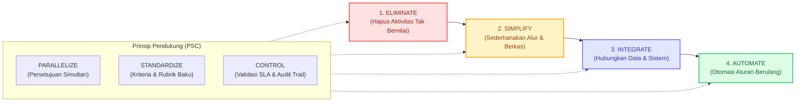

1. **Eliminate**: Menghapus tanda tangan basah di atas kertas, menghilangkan pengumpulan fisik berkas ke meja koordinator, menghapus penggunaan kanal *Google Classroom* dan *Google Form* terpisah, serta menghapus entri ulang manual data mahasiswa ke SIMPELMAS setelah masa KRS.
2. **Simplify**: Menggabungkan tiga lembar dokumen (Form Pendaftaran MBKM, Usulan Konversi KRS, dan Ringkasan Proposal) menjadi satu formulir aplikasi digital cerdas terpadu.
3. **Integrate**: Mengintegrasikan sistem **SiRiset** secara langsung dengan basis data akademik [SIAKAD UTM](https://siakad.trunojoyo.ac.id) (untuk verifikasi IPK & riwayat MK) dan sistem penelitian [SIMPELMAS LPPM](https://simpelmas.trunojoyo.ac.id) (untuk sinkronisasi anggota riset hibah).
4. **Automate**: Mengotomasi pengecekan kelayakan akademik, pengiriman notifikasi pengingat tenggat waktu (*automated SLA deadline timer*), pembuatan dokumen Berita Acara, dan penghitungan konversi nilai angka ke huruf.
5. **Parallelize**: Mengubah proses pengumpulan persetujuan tanda tangan yang sebelumnya sekuensial (berkeliling mencari 3 dosen) menjadi *Parallel E-Approval* (Dosen Wali, Dosen Peneliti, dan Kaprodi menerima berkas pada waktu bersamaan).
6. **Standardize**: Menstandarkan format pengumuman lowongan riset, jadwal baku pengisian logbook mingguan, format laporan kemajuan, serta rubrik penilaian digital multi-kriteria berbasis prodi.
7. **Control**: Menerapkan batas waktu layanan (*Service Level Agreement / SLA*) maksimal 7 hari untuk pengumuman seleksi dosen, kontrol validasi prasyarat sistem, dan *system audit trail* yang merekam setiap transaksi.

---

## 2. Struktur Arsitektur Kolaborasi BPMN 2.0 To-Be

Model To-Be mengintegrasikan seluruh interaksi antar-unit ke dalam satu ekosistem orkestrasi digital melalui platform web **SiRiset**:

| Pool / Swimlane | Peran Baru dalam Model To-Be |
| :--- | :--- |
| **Pool: Program Studi Teknik Informatika** | Mengelola alur akademik dan konversi MB04. Terbagi dalam 5 Lane: |
| ├─ *Lane: Mahasiswa* | Mengeksplorasi lowongan resmi, mendaftar 1 pintu, memantau tracker status real-time, mengisi logbook mingguan, mengunggah laporan monev & luaran akhir. |
| ├─ *Lane: Dosen Wali* | Meninjau rencana studi mahasiswa dan memberikan persetujuan elektronik (*1-click e-approval*) secara simultan. |
| ├─ *Lane: Dosen Peneliti* | Mempublikasikan lowongan terverifikasi hibah, menyeleksi pendaftar sesuai kuota, mereview & memberi umpan balik logbook, menilai luaran via rubrik digital. |
| ├─ *Lane: Kaprodi* | Menyetujui konversi kurikulum secara digital dan mengesahkan usulan pembimbing ke tingkat fakultas melalui sistem. |
| └─ *Lane: Koordinator MBKM* | Memvalidasi berkas daring, memicu sinkronisasi data 1-klik ke SIMPELMAS, memantau dasbor KPI prodi, dan mengekspor konversi nilai ke SIAKAD. |
| **Pool: Sistem SiRiset (Platform)** | Berfungsi sebagai *Automated Business Logic Engine* yang melakukan verifikasi data otomatis, mengelola timer SLA, mendistribusikan notifikasi, dan menyimpan dokumen (*Single Data Store*). |
| **Pool: Fakultas Teknik** | Menerima usulan SK pembimbing secara digital dan mengunggah SK Dekan langsung ke platform. |
| **Pool: LPPM UTM & SIMPELMAS** | Menerima sinkronisasi data peserta riset secara otomatis via API, mengakses ruang Monev terpusat, dan memvalidasi luaran akhir penelitian. |

---

## 3. Gambaran Makro Alur Proses To-Be (*Macro Flow*)

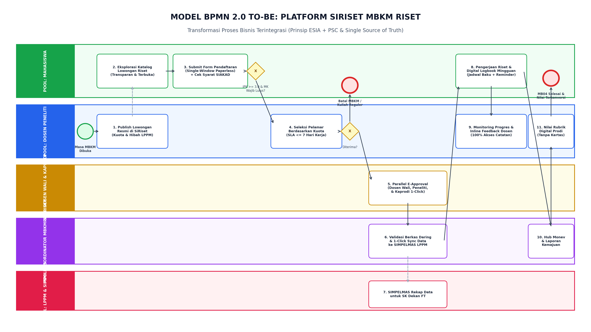
*Gambar 4.1: Diagram kolaborasi BPMN 2.0 To-Be menyeluruh pada platform SiRiset (Integrasi 5 Pool & Alur Kerja Bebas Kertas).*

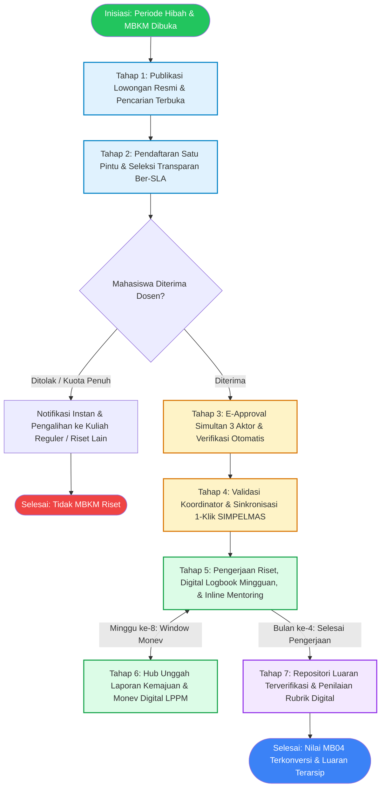

---

## 4. Rincian Rekayasa Ulang 7 Tahapan Proses To-Be

### 4.1 Tahap 1: Publikasi Lowongan Resmi & Eksplorasi Terpadu (Solusi PP1)
*Prinsip BPI: Standardize, Integrate, Eliminate.*

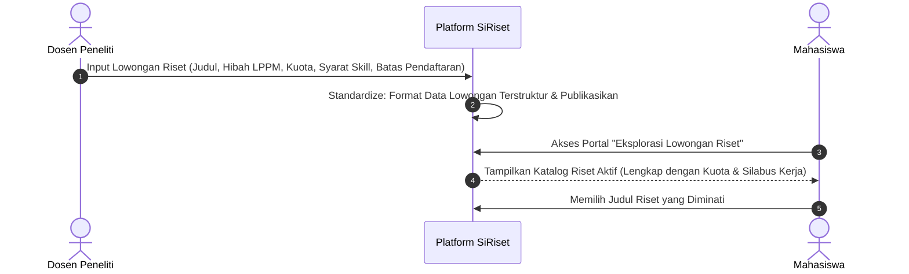

- **Perubahan Kunci**: Dosen tidak lagi menyebarkan pesan informal di WhatsApp. Seluruh lowongan riset diumumkan secara resmi melalui menu *Katalog Riset SiRiset*.
- **Manfaat**: Menghilangkan asimetri informasi; seluruh mahasiswa memiliki hak akses yang sama dan adil.

---

### 4.2 Tahap 2: Pendaftaran Satu Pintu & Seleksi Transparan Ber-SLA (Solusi PP2 & PP4)
*Prinsip BPI: Automate, Standardize, Control.*

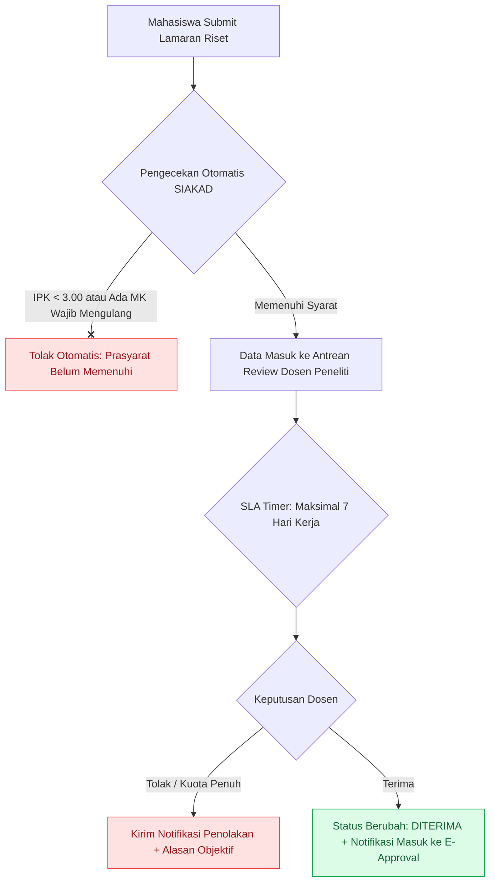

- **Perubahan Kunci**: Sistem secara otomatis memvalidasi IPK ($\ge$ 3.00) dan kelulusan mata kuliah wajib dari basis data SIAKAD (*Fail Fast*).
- **Aturan SLA**: Dosen Peneliti memiliki batas waktu maksimal 7 hari kerja untuk mengambil keputusan. Mahasiswa dapat memantau status secara *real-time* di dasbor (*Submitted $\rightarrow$ Under Review $\rightarrow$ Accepted/Rejected*).

---

### 4.3 Tahap 3: E-Approval Simultan 3 Aktor (Solusi PP3 & PP4)
*Prinsip BPI: Eliminate, Parallelize, Automate.*

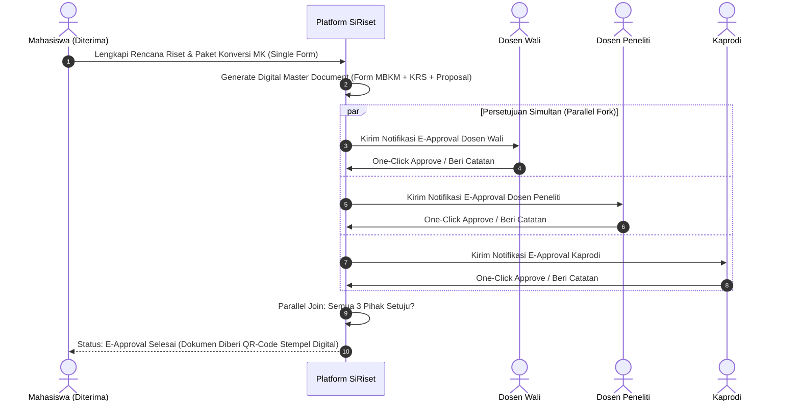

- **Perubahan Kunci**: Mengeliminasi seluruh kebutuhan tanda tangan basah dan pencetakan kertas. Permintaan persetujuan dikirim secara paralel ke dasbor Dosen Wali, Dosen Peneliti, dan Kaprodi. Waktu perolehan tanda tangan terpangkas dari rata-rata 3 hari menjadi kurang dari 12 jam.

---

### 4.4 Tahap 4: Validasi Terpusat & Sinkronisasi 1-Klik SIMPELMAS (Solusi PP5)
*Prinsip BPI: Integrate, Automate, Eliminate.*

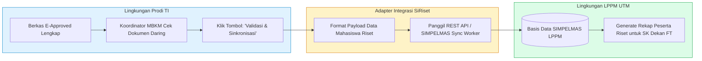

- **Perubahan Kunci**: Dosen Peneliti tidak perlu lagi melakukan registrasi ulang anggota peneliti di SIMPELMAS setelah masa KRS. Data mahasiswa yang telah divalidasi oleh Koordinator MBKM langsung disinkronkan ke SIMPELMAS secara otomatis via API. Data peserta antara prodi dan LPPM dijamin sinkron 100%.

---

### 4.5 Tahap 5: Manajemen Digital Logbook Mingguan & Mentoring Terpadu (Solusi PP7)
*Prinsip BPI: Standardize, Control, Integrate.*

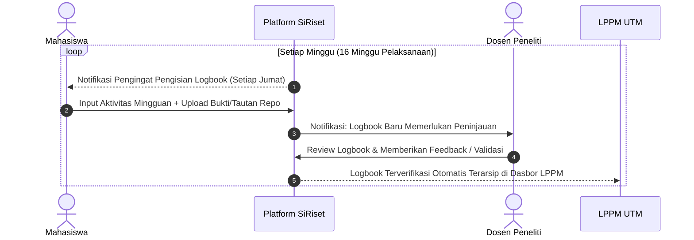

- **Perubahan Kunci**: Jadwal pengisian logbook ditetapkan secara baku setiap 7 hari kalender. Dosen Peneliti dapat memantau, memvalidasi, dan memberi catatan bimbingan secara langsung (*inline review*). LPPM dapat memantau rekap kepatuhan logbook kapan saja tanpa perlu menerbitkan surat penagihan ad-hoc.

---

### 4.6 Tahap 6: Hub Unggah Laporan Kemajuan & Monev Digital LPPM (Solusi PP6)
*Prinsip BPI: Integrate, Eliminate, Standardize.*

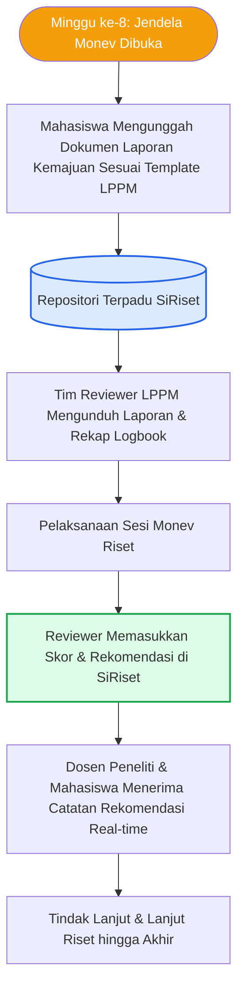

- **Perubahan Kunci**: *Google Classroom* dieliminasi sepenuhnya. Dokumen laporan kemajuan diunggah langsung ke platform SiRiset. Tim Reviewer LPPM menilai dan memasukkan rekomendasi ke dalam sistem, sehingga seluruh rekam jejak monev tersimpan rapi dan dapat diaudit.

---

### 4.7 Tahap 7: Repositori Luaran Terverifikasi & Penilaian Rubrik Digital (Solusi PP8 & PP9)
*Prinsip BPI: Standardize, Eliminate, Automate, Control.*

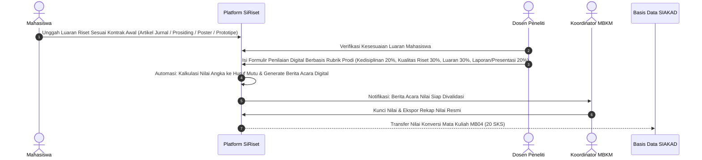

- **Perubahan Kunci**: Meniadakan pengisian nilai di atas kertas fisik yang dititipkan ke mahasiswa. Penilaian dilakukan 100% digital berbasis rubrik baku prodi. Nilai akhir dihitung secara otomatis dan langsung diteruskan ke Koordinator MBKM untuk dikonversi ke sistem nilai universitas.

---

## 5. Matriks Perubahan Aktivitas (As-Is vs To-Be)

Tabel berikut mendokumentasikan transformasi setiap aktivitas operasional sesuai kaidah Business Process Improvement:

| No | Aktivitas As-Is (Manual) | Prinsip BPI | Arah Perubahan pada Proses To-Be (SiRiset) | Status Aktivitas |
| :---: | :--- | :--- | :--- | :---: |
| 1 | Dosen menyebarkan pengumuman di WhatsApp grup | **Standardize, Integrate** | Dosen mengunggah penawaran resmi di menu *Katalog Riset* dengan format baku (topik, kuota, syarat kompetensi, jadwal). | **Ditransformasi** |
| 2 | Mahasiswa bertanya personal door-to-door ke dosen | **Simplify** | Mahasiswa mencari, memfilter, dan melamar riset secara transparan melalui satu portal web. | **Ditransformasi** |
| 3 | Seleksi subjektif & mahasiswa menunggu tanpa batas waktu | **Standardize, Control** | Seleksi dilakukan via sistem dengan kriteria terstandar dan notifikasi otomatis ber-SLA maksimal 7 hari kerja. | **Diperketat & Diotomasi** |
| 4 | Mahasiswa mencetak berkas & berkeliling meminta tanda tangan | **Eliminate, Parallelize** | Tanda tangan basah dihapus; digantikan mekanisme *Parallel E-Approval* oleh Dosen Wali, Peneliti, dan Kaprodi. | **Dieliminasi Fisik** |
| 5 | Mengunggah di SI MBKM, Google Form, dan serah berkas cetak | **Eliminate, Integrate** | Google Form dan penyerahan berkas cetak dihapus; cukup satu kali submit formulir digital di SiRiset. | **Dieliminasi 2 Kanal** |
| 6 | Pemeriksaan syarat IPK dan mata kuliah wajib secara manual | **Automate** | Sistem memvalidasi kelayakan mahasiswa secara otomatis melalui integrasi API / basis data SIAKAD. | **Diotomasi Penuh** |
| 7 | Dosen menginput ulang nama mahasiswa ke SIMPELMAS | **Integrate, Eliminate** | Input ganda dihapus; data peserta tersinkronisasi otomatis dari SiRiset ke SIMPELMAS via 1-Click Sync. | **Dieliminasi Kerja Ganda** |
| 8 | Mahasiswa mengirim logbook sporadis & dosen tak bisa melihat | **Standardize, Control** | Jadwal pengisian logbook ditetapkan mingguan; dosen pembimbing wajib memeriksa dan memberi catatan bimbingan online. | **Ditingkatkan Kontrol** |
| 9 | Pengumpulan laporan kemajuan via Google Classroom | **Integrate, Eliminate** | Google Classroom dihapus; laporan diunggah langsung ke modul Monev SiRiset yang terhubung ke LPPM. | **Dieliminasi Kanal Luar** |
| 10 | Target luaran mahasiswa baru dibahas di akhir kegiatan | **Standardize, Control** | Kontrak komitmen jenis luaran (artikel/poster/aplikasi) disepakati sejak pengajuan proposal awal. | **Ditetapkan di Awal** |
| 11 | Dosen mengisi nilai di lembar kertas dititipkan ke mahasiswa | **Eliminate, Automate** | Lembar kertas dihapus; dosen mengisi nilai di rubrik digital sistem; konversi nilai 20 SKS terhitung otomatis. | **Dieliminasi Kertas** |

---

## 6. Matriks Penelusuran Masalah ke Solusi (*Traceability Matrix*)

| Pain Point | Akar Masalah Lapangan | Prinsip BPI | Solusi Proses To-Be | Modul Web SiRiset |
| :---: | :--- | :--- | :--- | :--- |
| **PP1** | Penawaran riset via WhatsApp grup | *Integrate, Standardize* | Portal resmi lowongan riset berkuota | Modul Lowongan Riset (`FR-02`) |
| **PP2** | Seleksi informal & waktu tunggu tanpa SLA | *Standardize, Control* | Seleksi transparan dengan SLA 7 hari | Modul Pendaftaran & Seleksi (`FR-03`) |
| **PP3** | Tanda tangan basah keliling 3 aktor | *Parallelize, Eliminate* | E-Approval simultan satu klik | Modul E-Approval Paralel (`FR-04`) |
| **PP4** | Pengumpulan di 3 kanal (SI MBKM, GForm, Cetak) | *Eliminate, Simplify* | Single window registration & paperless | Form Registrasi Terpadu (`FR-03`) |
| **PP5** | Desinkronisasi data SI MBKM & SIMPELMAS | *Integrate, Automate* | Integrasi API adapter data peserta | Modul Adapter SIMPELMAS (`FR-05`) |
| **PP6** | Monev tercecer di Google Classroom | *Integrate, Eliminate* | Repositori laporan kemajuan terpusat | Modul Monev & Progress Hub (`FR-07`) |
| **PP7** | Logbook sporadis & tertutup dari dosen | *Standardize, Control* | Digital weekly logbook & inline feedback | Modul Digital Logbook (`FR-06`) |
| **PP8** | Nilai di lembar kertas rawan hilang | *Eliminate, Automate* | E-assessment rubrik & auto-konversi SKS | Modul Penilaian Digital (`FR-09`) |
| **PP9** | Target luaran tidak jelas di awal | *Standardize, Control* | Kontrak komitmen luaran sejak proposal | Modul Manajemen Luaran (`FR-08`) |

---

## 7. Evaluasi Kinerja Kuantitatif: Analisis KPI As-Is vs To-Be

Sebagaimana ditekankan dalam materi kuliah *Transformasi Pemodelan Proses Bisnis Akhir* oleh Dr. Rika Yunitarini, keberhasilan desain To-Be wajib dibuktikan melalui evaluasi 4 dimensi kinerja utama: **Efisiensi (Waktu)**, **Biaya**, **Kualitas**, dan **Pengalaman Pengguna (Customer Experience)**.

```mermaid
xychart-beta
    title "Perbandingan Cycle Time As-Is vs To-Be (Dalam Hari Kerja)"
    x-axis ["Seleksi & Approval", "Verifikasi Berkas", "Sinkronisasi Sistem", "Pengumpulan Logbook", "Penilaian & Konversi"]
    y-axis "Durasi (Hari Kerja)" 0 --> 25
    bar [18, 5, 14, 7, 10]
    bar [4, 1, 0.1, 1, 0.5]
```

### 7.1 Tabel Perbandingan KPI Terukur

| No | Dimensi Proses | Indikator Kinerja (KPI) | Kondisi As-Is (Baseline) | Target To-Be (SiRiset) | Persentase Peningkatan / Efisiensi |
| :---: | :--- | :--- | :--- | :--- | :--- |
| 1 | **Efisiensi (Waktu)** | **Lead Time Seleksi Pendaftar** | 10 – 21 hari kalender | **Maksimal 5 hari kerja** | $\mathbf{\downarrow\ 76\%}$ lebih cepat |
| 2 | **Efisiensi (Waktu)** | **Waktu Tunggu E-Approval 3 Pihak** | 3 – 5 hari kerja (keliling prodi) | $\mathbf{\le 12}$ **jam kerja** | $\mathbf{\downarrow\ 85\%}$ waktu tereduksi |
| 3 | **Efisiensi (Waktu)** | **Waktu Sinkronisasi ke SIMPELMAS** | 14 – 30 hari (menunggu pasca-KRS) | **Real-time (< 5 menit)** | $\mathbf{\downarrow\ 99\%}$ eliminasi penundaan |
| 4 | **Efisiensi (Waktu)** | **Waktu Proses Konversi Nilai MB04** | 7 – 14 hari kerja (kertas manual) | **$\le$ 1 hari kerja** | $\mathbf{\downarrow\ 90\%}$ penerbitan nilai cepat |
| 5 | **Kualitas & Risiko** | **Tingkat Ketidakcocokan Data Peserta** | 20% – 35% selisih data prodi-LPPM | **0% (100% sinkron sempurna)** | $\mathbf{\downarrow\ 100\%}$ bebas selisih data |
| 6 | **Kualitas & Risiko** | **Tingkat Kepatuhan Pengisian Logbook** | 35% – 50% (diisi mendadak di akhir) | $\mathbf{\ge 95\%}$ **patuh mingguan** | $\mathbf{\uparrow\ 90\%}$ akurasi data riset |
| 7 | **Kualitas & Risiko** | **Risiko Kehilangan Lembar Nilai Fisik** | Risiko Tinggi (berkas kertas dipegang mhs) | **Nol Risiko (Tersimpan di Cloud DB)** | $\mathbf{\downarrow\ 100\%}$ proteksi integritas nilai |
| 8 | **Biaya (Cost)** | **Biaya Pencetakan Berkas per Mahasiswa** | Rp 35.000 – Rp 60.000 per mahasiswa | **Rp 0 (100% Paperless Digital)** | $\mathbf{\downarrow\ 100\%}$ hemat biaya mahasiswa |
| 9 | **Pengalaman Pengguna** | **Kepuasan Pengguna (CSAT Score)** | 2.4 / 5.0 (Banyak keluhan birokrasi) | $\mathbf{\ge 4.5\ /\ 5.0}$ **(Sangat Memuaskan)** | $\mathbf{\uparrow\ 87.5\%}$ peningkatan kepuasan |
| 10 | **Otomasi Sistem** | **Tingkat Otomasi Proses (*Automation Rate*)** | 15% (sebagian besar manual kertas) | **78% aktivitas terotomasi sistem** | $\mathbf{\uparrow\ 420\%}$ lonjakan otomasi |

---

## 8. Penanganan Eksepsi & Kasus Kegagalan (*Exception Handling*)

Desain To-Be yang matang wajib memodelkan alur alternatif saat terjadi kegagalan operasional (*negative path*):
1. **Kasus 1: Kuota Lowongan Riset Penuh**
   - *Pemicu*: Jumlah pendaftar melebihi kuota yang dibuka dosen (misal: kuota 4, pelamar 7).
   - *Penanganan*: Dosen memilih 4 terbaik; 3 pelamar yang tidak terpilih secara otomatis menerima notifikasi alasan objektif dan diberikan opsi langsung memilih judul riset lain yang masih memiliki kuota kosong atau dialihkan kembali ke perwalian semester reguler sebelum KRS ditutup.
2. **Kasus 2: Penolakan oleh Salah Satu Aktor E-Approval**
   - *Pemicu*: Dosen Wali menganggap mata kuliah konversi tidak sesuai, atau Kaprodi menilai judul riset melenceng dari kurikulum.
   - *Penanganan*: Sistem membunyikan status `REJECTED_WITH_FEEDBACK`. Berkas tidak dibatalkan sepenuhnya, melainkan dikembalikan ke antrean revisi mahasiswa dengan highlight catatan revisi yang spesifik, untuk diperbaiki dalam waktu 2x24 jam.
3. **Kasus 3: Keterlambatan Pengisian Logbook Mingguan**
   - *Pemicu*: Mahasiswa tidak mengisi logbook hingga hari Minggu pukul 23:59 WIB.
   - *Penanganan*: Sistem membekukan (*lock*) pengisian mandiri dan menandai status `TERLAMBAT`. Mahasiswa wajib mengajukan izin buka blokir (*unlock request*) disertai alasan yang harus disetujui Dosen Peneliti, menjaga kedisiplinan riset.
4. **Kasus 4: Hasil Monev LPPM Membutuhkan Revisi Mayor**
   - *Pemicu*: Tim Reviewer LPPM menilai kemajuan riset di bawah target 40% pada minggu ke-8.
   - *Penanganan*: Status pendaftaran di-*flag* menjadi `UNDER_SUPERVISION`. Dosen Peneliti dan Mahasiswa diwajibkan menyusun rencana aksi pemulihan (*recovery plan*) dalam waktu 14 hari yang dipantau khusus oleh Koordinator MBKM prodi.

