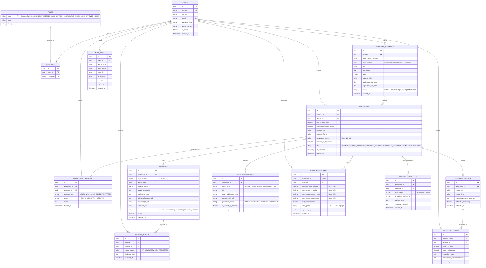

# Spesifikasi Skema Basis Data Relasional
## SiRiset: Pangkalan Data Terpadu MBKM Riset
### Program Studi Teknik Informatika, Fakultas Teknik, Universitas Trunodjoyo Madura

---

## 1. Prinsip Desain & Integritas Relasional

Skema basis data **SiRiset** dirancang untuk menjadi pangkalan data terpadu (*Single Source of Truth*) yang mengakhiri fragmentasi informasi antara Program Studi Teknik Informatika, Fakultas Teknik, dan LPPM UTM. 

Desain basis data menerapkan prinsip rekayasa perangkat lunak berstandar tinggi:
1. **Normalisasi Tingkat Ketiga (3NF / BCNF)**: Seluruh tabel dirancang tanpa redundansi transitif, memastikan tidak terjadi anomali pembaruan (*update anomalies*), penyisipan (*insertion anomalies*), atau penghapusan (*deletion anomalies*).
2. **Integritas Referensial Ketat (*Referential Integrity*)**: Menggunakan pembatasan kunci asing (*Foreign Key Constraints*) dengan aturan `ON DELETE RESTRICT` pada entitas finansial/akademik dan `CASCADE` pada entitas riwayat detail (seperti review logbook).
3. **Optimasi Indeks Kinerja (*Performance Indexing*)**: Menempatkan indeks B-Tree pada kolom-kolom yang sering difilter (seperti `status`, `user_id`, `vacancy_id`, dan `created_at`) guna menjamin latensi query $\le 10$ ms.
4. **Append-Only Immutability**: Tabel `audit_logs` dan `simpelmas_sync_logs` dirancang bersifat hanya-tambah (*immutable append-only*) untuk menjamin keabsahan audit akademik dan forensik digital.

---

## 2. Entity-Relationship Diagram (ERD)

Diagram berikut memodelkan seluruh relasi antar-entitas di dalam basis data SiRiset:



---

## 3. Kamus Data Rinci (*Data Dictionary*)

### 3.1 Tabel `users` & `user_roles`
Menyimpan identitas terpusat seluruh sivitas akademika yang mengakses platform SiRiset.

| Nama Kolom | Tipe Data | Constraint | Keterangan |
| :--- | :--- | :--- | :--- |
| `id` | `UUID` | Primary Key, Default UUIDv4 | Identifikator unik pengguna |
| `nim_nip` | `VARCHAR(30)` | Not Null, Unique | Nomor Induk Mahasiswa (NIM) atau NIP Dosen |
| `full_name` | `VARCHAR(150)` | Not Null | Nama lengkap beserta gelar akademik |
| `email` | `VARCHAR(100)` | Not Null, Unique | Alamat surat elektronik resmi (domain UTM) |
| `password_hash` | `VARCHAR(255)` | Not Null | Hash kata sandi terenkripsi (*Argon2id/Bcrypt*) |
| `phone_number` | `VARCHAR(20)` | Nullable | Nomor WhatsApp untuk pengiriman notifikasi |
| `is_active` | `BOOLEAN` | Default `true` | Status keaktifan akun pengguna |
| `created_at` | `TIMESTAMPTZ` | Default `CURRENT_TIMESTAMP` | Stempel waktu pendaftaran akun |

### 3.2 Tabel `research_vacancies` (Lowongan Riset)
Menyimpan katalog penawaran riset dosen yang telah tervalidasi hibah penelitian LPPM (Solusi *PP1*).

| Nama Kolom | Tipe Data | Constraint | Keterangan |
| :--- | :--- | :--- | :--- |
| `id` | `UUID` | Primary Key, Default UUIDv4 | Identifikator unik lowongan riset |
| `lecturer_id` | `UUID` | Foreign Key $\rightarrow$ `users(id)` | Dosen peneliti pemilik riset hibah |
| `grant_contract_number` | `VARCHAR(100)` | Not Null | Nomor Kontrak Hibah / Surat Tugas LPPM UTM |
| `grant_scheme` | `VARCHAR(50)` | Not Null | Skema hibah (Penelitian Dosen Mandiri, Fundamental, dll) |
| `title` | `VARCHAR(255)` | Not Null | Judul riset yang ditawarkan |
| `description` | `TEXT` | Not Null | Deskripsi topik, silabus kerja, dan tujuan riset |
| `quota` | `INTEGER` | Not Null, Check `quota >= 1` | Kuota mahasiswa yang dibutuhkan (maks 4) |
| `required_skills` | `VARCHAR(255)` | Not Null | Kualifikasi keahlian (Python, AI, Web, UI/UX, dll) |
| `application_start_date`| `DATE` | Not Null | Tanggal pembukaan pendaftaran |
| `application_end_date`  | `DATE` | Not Null | Tanggal penutupan pendaftaran |
| `status` | `VARCHAR(20)` | Not Null, Default `'PUBLISHED'` | Status: `DRAFT`, `PUBLISHED`, `CLOSED`, `COMPLETED` |

### 3.3 Tabel `applications` (Pendaftaran Mahasiswa)
Menyimpan berkas lamaran mahasiswa dan status kemajuan siklus hidup MBKM Riset (Solusi *PP2, PP4*).

| Nama Kolom | Tipe Data | Constraint | Keterangan |
| :--- | :--- | :--- | :--- |
| `id` | `UUID` | Primary Key, Default UUIDv4 | Identifikator unik pengajuan lamaran |
| `vacancy_id` | `UUID` | Foreign Key $\rightarrow$ `research_vacancies(id)` | Judul riset yang dilamar |
| `student_id` | `UUID` | Foreign Key $\rightarrow$ `users(id)` | Mahasiswa pengaju |
| `gpa_at_application` | `DECIMAL(3,2)` | Not Null, Check `gpa >= 3.00` | Nilai IPK riil dari SIAKAD saat mendaftar |
| `mandatory_courses_passed` | `BOOLEAN` | Not Null, Default `true` | Validasi kelulusan mata kuliah wajib dasar |
| `proposal_title` | `VARCHAR(255)` | Not Null | Judul proposal rencana kegiatan riset |
| `proposal_file_url` | `VARCHAR(255)` | Not Null | Path penyimpanan file PDF proposal |
| `conversion_scheme` | `VARCHAR(20)` | Not Null, Default `'MB04'` | Skema konversi paket mata kuliah 20 SKS |
| `includes_kp_conversion`| `BOOLEAN` | Default `false` | Apakah mencakup konversi 2 SKS Kerja Praktik |
| `status` | `VARCHAR(30)` | Not Null, Default `'SUBMITTED'` | Status: `SUBMITTED`, `DOSEN_ACCEPTED`, `APPROVAL_PENDING`, `VERIFIED`, `IN_PROGRESS`, `COMPLETED`, `REJECTED` |
| `sla_deadline` | `TIMESTAMPTZ` | Not Null | Batas waktu SLA dosen memutuskan (7 hari kerja) |

### 3.4 Tabel `application_approvals` (E-Approval Simultan)
Merekam alur persetujuan elektronik paralel oleh tiga pihak secara independen (Solusi *PP3*).

| Nama Kolom | Tipe Data | Constraint | Keterangan |
| :--- | :--- | :--- | :--- |
| `id` | `UUID` | Primary Key, Default UUIDv4 | Identifikator unik catatan approval |
| `application_id` | `UUID` | Foreign Key $\rightarrow$ `applications(id)` | Pengajuan yang dimintakan persetujuan |
| `approver_id` | `UUID` | Foreign Key $\rightarrow$ `users(id)` | Pihak yang berwenang menyetujui |
| `approver_role` | `VARCHAR(30)` | Not Null | Peran: `DOSEN_WALI`, `DOSEN_PENELITI`, `KAPRODI` |
| `status` | `VARCHAR(20)` | Not Null, Default `'PENDING'` | Status: `PENDING`, `APPROVED`, `REJECTED` |
| `notes` | `TEXT` | Nullable | Catatan koreksi / alasan penolakan |
| `decided_at` | `TIMESTAMPTZ` | Nullable | Waktu keputusan persetujuan diberikan |

### 3.5 Tabel `logbooks` & `logbook_reviews`
Mencatat kegiatan harian/mingguan mahasiswa dan umpan balik pembimbingan dosen (Solusi *PP7*).

| Nama Kolom | Tipe Data | Constraint | Keterangan |
| :--- | :--- | :--- | :--- |
| `id` | `UUID` | Primary Key, Default UUIDv4 | Identifikator unik entri logbook |
| `application_id` | `UUID` | Foreign Key $\rightarrow$ `applications(id)` | Pengajuan riset terkait |
| `week_number` | `INTEGER` | Not Null, Check `1 <= week <= 16` | Periode minggu pelaksanaan ke-1 s/d 16 |
| `activity_date` | `DATE` | Not Null | Tanggal pelaksanaan aktivitas |
| `duration_hours` | `INTEGER` | Not Null, Check `duration >= 1` | Durasi pengerjaan riset (dalam jam) |
| `activity_description` | `TEXT` | Not Null | Uraian detail pekerjaan yang dilakukan |
| `challenges_faced` | `TEXT` | Nullable | Kendala teknis/lapangan yang dihadapi |
| `solutions_implemented`| `TEXT` | Nullable | Upaya pemecahan masalah yang dilakukan |
| `evidence_file_url` | `VARCHAR(255)` | Nullable | Tautan bukti foto / dokumen screenshot |
| `repository_link` | `VARCHAR(255)` | Nullable | Tautan GitHub / Google Colab / repositori |
| `status` | `VARCHAR(20)` | Default `'SUBMITTED'` | Status: `SUBMITTED`, `VALIDATED`, `REVISION` |
| `is_late` | `BOOLEAN` | Default `false` | Apakah diisi melewati batas waktu mingguan |

### 3.6 Tabel `grade_assessments` (Penilaian Digital & Konversi Nilai)
Menyimpan nilai akhir terstruktur multi-kriteria berbasis rubrik resmi prodi (Solusi *PP8, PP9*).

| Nama Kolom | Tipe Data | Constraint | Keterangan |
| :--- | :--- | :--- | :--- |
| `id` | `UUID` | Primary Key, Default UUIDv4 | Identifikator unik lembar penilaian |
| `application_id` | `UUID` | Unique, FK $\rightarrow$ `applications(id)` | Pengajuan mahasiswa yang dinilai |
| `evaluator_id` | `UUID` | Foreign Key $\rightarrow$ `users(id)` | Dosen peneliti yang melakukan penilaian |
| `score_discipline_logbook` | `DECIMAL(5,2)` | Check `0 <= score <= 100` | Skor kedisiplinan & logbook (Bobot: 20%) |
| `score_research_quality` | `DECIMAL(5,2)` | Check `0 <= score <= 100` | Skor penguasaan riset (Bobot: 30%) |
| `score_output_achievement`| `DECIMAL(5,2)` | Check `0 <= score <= 100` | Skor capaian luaran target (Bobot: 30%) |
| `score_report_presentation`| `DECIMAL(5,2)` | Check `0 <= score <= 100` | Skor laporan akhir & presentasi (Bobot: 20%) |
| `final_numeric_score` | `DECIMAL(5,2)` | Check `0 <= score <= 100` | Nilai Akhir Angka Terkalkulasi Otomatis |
| `letter_grade` | `VARCHAR(5)` | Not Null | Nilai Huruf Mutu: `A`, `B+`, `B`, `C+`, `C`, `D`, `E` |
| `is_locked_by_coordinator`| `BOOLEAN` | Default `false` | Nilai dikunci oleh Koordinator MBKM |
| `finalized_at` | `TIMESTAMPTZ` | Default `CURRENT_TIMESTAMP` | Waktu penguncian nilai resmi |

---

## 4. Definisi Skema Prisma (`schema.prisma`)

Berikut adalah definisi kode sumber `schema.prisma` yang siap dijalankan dalam proyek Next.js:

```prisma
datasource db {
  provider = "postgresql" // atau "sqlite" untuk development lokal
  url      = env("DATABASE_URL")
}

generator client {
  provider = "prisma-client-js"
}

enum RoleCode {
  MAHASISWA
  DOSEN_PENELITI
  DOSEN_WALI
  KAPRODI
  KOORDINATOR_MBKM
  LPPM_REVIEWER
  ADMIN
}

enum VacancyStatus {
  DRAFT
  PUBLISHED
  CLOSED
  COMPLETED
}

enum ApplicationStatus {
  SUBMITTED
  DOSEN_ACCEPTED
  APPROVAL_PENDING
  VERIFIED
  IN_PROGRESS
  COMPLETED
  REJECTED
}

enum ApprovalRole {
  DOSEN_WALI
  DOSEN_PENELITI
  KAPRODI
}

enum ApprovalStatus {
  PENDING
  APPROVED
  REJECTED
}

enum LogbookStatus {
  DRAFT
  SUBMITTED
  VALIDATED
  REVISION_NEEDED
}

enum OutputType {
  JURNAL
  PROSIDING
  POSTER
  PROTOTIPE
}

model User {
  id            String         @id @default(uuid())
  nimNip        String         @unique @map("nim_nip")
  fullName      String         @map("full_name")
  email         String         @unique
  passwordHash  String         @map("password_hash")
  phoneNumber   String?        @map("phone_number")
  isActive      Boolean        @default(true) @map("is_active")
  createdAt     DateTime       @default(now()) @map("created_at")

  roles         UserRole[]
  vacancies     ResearchVacancy[]
  applications  Application[]  @relation("StudentApplications")
  approvals     ApplicationApproval[]
  logbookReviews LogbookReview[]
  monevReviews  MonevEvaluation[]
  assessments   GradeAssessment[]
  auditLogs     AuditLog[]
  syncLogs      SimpelmasSyncLog[]

  @@map("users")
}

model UserRole {
  id       String   @id @default(uuid())
  userId   String   @map("user_id")
  roleCode RoleCode @map("role_code")

  user     User     @relation(fields: [userId], references: [id], onDelete: Cascade)

  @@unique([userId, roleCode])
  @@map("user_roles")
}

model ResearchVacancy {
  id                    String        @id @default(uuid())
  lecturerId            String        @map("lecturer_id")
  grantContractNumber   String        @map("grant_contract_number")
  grantScheme           String        @map("grant_scheme")
  title                 String
  description           String
  quota                 Int
  requiredSkills        String        @map("required_skills")
  applicationStartDate  DateTime      @map("application_start_date")
  applicationEndDate    DateTime      @map("application_end_date")
  status                VacancyStatus @default(PUBLISHED)
  createdAt             DateTime      @default(now()) @map("created_at")

  lecturer              User          @relation(fields: [lecturerId], references: [id])
  applications          Application[]

  @@map("research_vacancies")
}

model Application {
  id                     String            @id @default(uuid())
  vacancyId              String            @map("vacancy_id")
  studentId              String            @map("student_id")
  gpaAtApplication       Decimal           @map("gpa_at_application") @db.Decimal(3, 2)
  mandatoryCoursesPassed Boolean           @default(true) @map("mandatory_courses_passed")
  proposalTitle          String            @map("proposal_title")
  proposalFileUrl        String            @map("proposal_file_url")
  conversionScheme       String            @default("MB04") @map("conversion_scheme")
  includesKpConversion   Boolean           @default(false) @map("includes_kp_conversion")
  status                 ApplicationStatus @default(SUBMITTED)
  slaDeadline            DateTime          @map("sla_deadline")
  createdAt              DateTime          @default(now()) @map("created_at")

  vacancy                ResearchVacancy   @relation(fields: [vacancyId], references: [id])
  student                User              @relation("StudentApplications", fields: [studentId], references: [id])
  approvals              ApplicationApproval[]
  logbooks               Logbook[]
  progressReports        ProgressReport[]
  outputs                ResearchOutput[]
  assessment             GradeAssessment?
  syncLogs               SimpelmasSyncLog[]

  @@map("applications")
}

model ApplicationApproval {
  id            String         @id @default(uuid())
  applicationId String         @map("application_id")
  approverId    String         @map("approver_id")
  approverRole  ApprovalRole   @map("approver_role")
  status        ApprovalStatus @default(PENDING)
  notes         String?
  decidedAt     DateTime?      @map("decided_at")

  application   Application    @relation(fields: [applicationId], references: [id], onDelete: Cascade)
  approver      User           @relation(fields: [approverId], references: [id])

  @@unique([applicationId, approverRole])
  @@map("application_approvals")
}

model Logbook {
  id                    String        @id @default(uuid())
  applicationId         String        @map("application_id")
  weekNumber            Int           @map("week_number")
  activityDate          DateTime      @map("activity_date")
  durationHours         Int           @map("duration_hours")
  activityDescription   String        @map("activity_description")
  challengesFaced       String?       @map("challenges_faced")
  solutionsImplemented String?       @map("solutions_implemented")
  evidenceFileUrl       String?       @map("evidence_file_url")
  repositoryLink        String?       @map("repository_link")
  status                LogbookStatus @default(SUBMITTED)
  isLate                Boolean       @default(false) @map("is_late")
  submittedAt           DateTime      @default(now()) @map("submitted_at")

  application           Application   @relation(fields: [applicationId], references: [id], onDelete: Cascade)
  reviews               LogbookReview[]

  @@unique([applicationId, weekNumber])
  @@map("logbooks")
}

model LogbookReview {
  id           String   @id @default(uuid())
  logbookId    String   @map("logbook_id")
  reviewerId   String   @map("reviewer_id")
  reviewStatus String   @map("review_status")
  feedbackNotes String? @map("feedback_notes")
  reviewedAt   DateTime @default(now()) @map("reviewed_at")

  logbook      Logbook  @relation(fields: [logbookId], references: [id], onDelete: Cascade)
  reviewer     User     @relation(fields: [reviewerId], references: [id])

  @@map("logbook_reviews")
}

model ProgressReport {
  id                       String            @id @default(uuid())
  applicationId            String            @map("application_id")
  reportTitle              String            @map("report_title")
  reportFileUrl            String            @map("report_file_url")
  researchProgressSummary  String            @map("research_progress_summary")
  estimatedPercentage      Decimal           @map("estimated_percentage") @db.Decimal(5, 2)
  submittedAt              DateTime          @default(now()) @map("submitted_at")

  application              Application       @relation(fields: [applicationId], references: [id], onDelete: Cascade)
  monevEvaluations         MonevEvaluation[]

  @@map("progress_reports")
}

model MonevEvaluation {
  id                          String         @id @default(uuid())
  progressReportId            String         @map("progress_report_id")
  reviewerId                  String         @map("reviewer_id")
  scoreProgress               Decimal        @map("score_progress") @db.Decimal(5, 2)
  scoreMethodology            Decimal        @map("score_methodology") @db.Decimal(5, 2)
  evaluationNotes             String         @map("evaluation_notes")
  improvementRecommendations  String?        @map("improvement_recommendations")
  evaluatedAt                 DateTime       @default(now()) @map("evaluated_at")

  progressReport              ProgressReport @relation(fields: [progressReportId], references: [id], onDelete: Cascade)
  reviewer                    User           @relation(fields: [reviewerId], references: [id])

  @@map("monev_evaluations")
}

model ResearchOutput {
  id                     String     @id @default(uuid())
  applicationId          String     @map("application_id")
  outputType             OutputType @map("output_type")
  title                  String
  targetPublicationName  String     @map("target_publication_name")
  documentFileUrl        String     @map("document_file_url")
  publicationStatus      String     @default("DRAFT") @map("publication_status")
  isVerifiedByLecturer   Boolean    @default(false) @map("is_verified_by_lecturer")
  submittedAt            DateTime   @default(now()) @map("submitted_at")

  application            Application @relation(fields: [applicationId], references: [id], onDelete: Cascade)

  @@map("research_outputs")
}

model GradeAssessment {
  id                        String      @id @default(uuid())
  applicationId             String      @unique @map("application_id")
  evaluatorId               String      @map("evaluator_id")
  scoreDisciplineLogbook    Decimal     @map("score_discipline_logbook") @db.Decimal(5, 2)
  scoreResearchQuality      Decimal     @map("score_research_quality") @db.Decimal(5, 2)
  scoreOutputAchievement    Decimal     @map("score_output_achievement") @db.Decimal(5, 2)
  scoreReportPresentation   Decimal     @map("score_report_presentation") @db.Decimal(5, 2)
  finalNumericScore         Decimal     @map("final_numeric_score") @db.Decimal(5, 2)
  letterGrade               String      @map("letter_grade")
  isLockedByCoordinator     Boolean     @default(false) @map("is_locked_by_coordinator")
  finalizedAt               DateTime    @default(now()) @map("finalized_at")

  application               Application @relation(fields: [applicationId], references: [id], onDelete: Cascade)
  evaluator                 User        @relation(fields: [evaluatorId], references: [id])

  @@map("grade_assessments")
}

model SimpelmasSyncLog {
  id                  String      @id @default(uuid())
  applicationId       String      @map("application_id")
  triggeredBy         String      @map("triggered_by")
  syncStatus          String      @map("sync_status")
  simpelmasExternalId String?     @map("simpelmas_external_id")
  payloadSent         String      @map("payload_sent")
  responseReceived    String      @map("response_received")
  syncedAt            DateTime    @default(now()) @map("synced_at")

  application         Application @relation(fields: [applicationId], references: [id], onDelete: Cascade)
  user                User        @relation(fields: [triggeredBy], references: [id])

  @@map("simpelmas_sync_logs")
}

model AuditLog {
  id          String   @id @default(uuid())
  userId      String?  @map("user_id")
  actionName  String   @map("action_name")
  entityName  String   @map("entity_name")
  entityId    String   @map("entity_id")
  ipAddress   String?  @map("ip_address")
  userAgent   String?  @map("user_agent")
  payloadJson String?  @map("payload_json")
  createdAt   DateTime @default(now()) @map("created_at")

  user        User?    @relation(fields: [userId], references: [id])

  @@map("audit_logs")
}
```

---

## 5. Rencana Penyemaian Data Uji (*Mock Data Seeding Plan*)

Untuk mendemonstrasikan sistem secara realistis sesuai konteks Program Studi S1 Teknik Informatika UTM, file *seeder* (`prisma/seed.ts`) disiapkan dengan data representatif:

### 5.1 Akun Sivitas Akademika Realistis UTM
1. **Dosen Peneliti**: `Dr. Mula'ab, S.Si., M.Kom.` (NIP: `197204152000031001`) - Role: `DOSEN_PENELITI`.
2. **Dosen Pengampu / Dosen Wali**: `Dr. Rika Yunitarini, ST., MT.` (NIP: `198306072006042001`) - Role: `DOSEN_WALI`, `DOSEN_PENELITI`.
3. **Koordinator MBKM**: `Fifin Ayu Mufarroha, S.Kom., M.Kom.` (NIP: `198902122019032014`) - Role: `KOORDINATOR_MBKM`.
4. **Koordinator Prodi (Kaprodi)**: `Bain Khusnul Khotimah, S.T., M.Kom.` (NIP: `197905202005012002`) - Role: `KAPRODI`.
5. **Reviewer LPPM**: `Dr. Budi Santoso, MT.` (NIP: `196803121994031002`) - Role: `LPPM_REVIEWER`.
6. **Mahasiswa 1 (Narasumber Wawancara)**: `Ilyas` (NIM: `220411100088`, IPK: `3.78`) - Peserta Riset Aktif.
7. **Mahasiswa 2 (Anggota Kelompok 2)**: `Reno Syaelendra` (NIM: `240411100020`, IPK: `3.85`) - Pelamar Baru.
8. **Mahasiswa 3 (Anggota Kelompok 2)**: `Rifda Nahariyah` (NIM: `240411100019`, IPK: `3.90`) - Pelamar Baru.

### 5.2 Contoh Judul Riset Hibah LPPM UTM Aktif
- **Riset 1 (Dr. Mula'ab)**: *"Pengembangan Model Klasifikasi Citra Medis Berbasis Arsitektur Vision Transformer untuk Deteksi Dini Tumor Otak"*.
  - *Nomor Kontrak*: `042/UN46.4.1/PT/2026` (Skema Penelitian Mandiri LPPM UTM).
  - *Kuota*: 4 Mahasiswa. *Syarat*: Penguasaan Python, PyTorch, dan Pengolahan Citra Digital.
- **Riset 2 (Dr. Rika Yunitarini)**: *"Rancang Bangun Framework Otomasi Rekayasa Proses Bisnis Berbasis BPMN 2.0 dan Integrasi Layanan Kampus Cerdas"*.
  - *Nomor Kontrak*: `088/UN46.4.1/PT/2026` (Skema Penelitian Terapan Fakultas Teknik).
  - *Kuota*: 3 Mahasiswa. *Syarat*: Next.js, Analisis Proses Bisnis, REST API.

