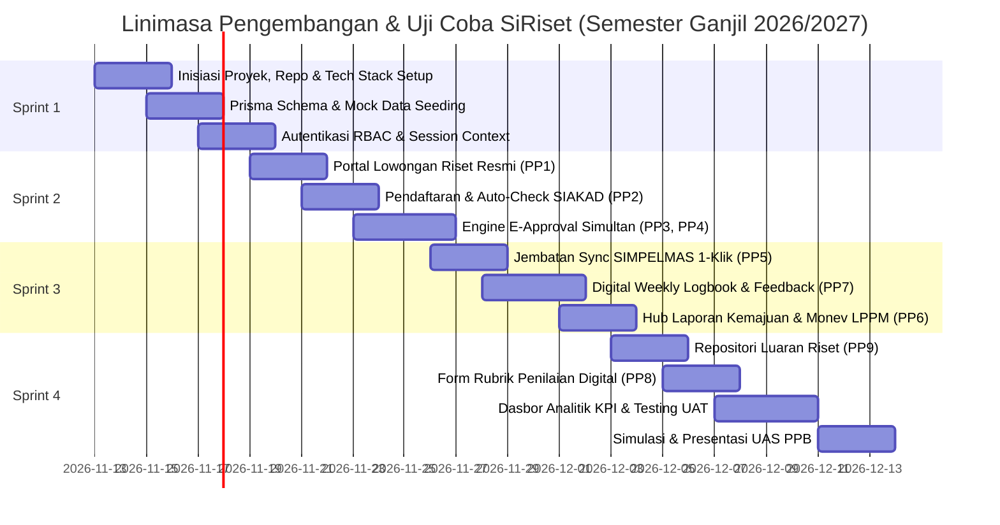

# Peta Jalan Implementasi (Implementation Roadmap) & Rencana Pengujian
## SiRiset: Sistem Informasi MBKM Riset Terpadu
### Program Studi Teknik Informatika, Fakultas Teknik, Universitas Trunodjoyo Madura

---

## 1. Ikhtisar & Jadwal Kerja Sprint

Peta jalan implementasi **SiRiset** disusun mengikuti metodologi pengembangan perangkat lunak tangkas (*Agile Scrum*) yang disesuaikan dengan linimasa perkuliahan Pemodelan Proses Bisnis Semester 5 (Pertemuan 12 hingga Pertemuan 16 / Ujian Akhir Semester) di bawah bimbingan dosen pengampu **Dr. Rika Yunitarini, ST., MT.**.

Proyek dibagi menjadi **4 Siklus Sprint** intensif:

---

## 2. Rincian Deliverables per Sprint

### 2.1 Sprint 1: Fondasi Arsitektur, Basis Data, & Autentikasi RBAC
- **Fokus Utama**: Menyiapkan repositori, konfigurasi Next.js 15, Prisma ORM, dan autentikasi multi-peran.
- **Hasil Luaran (*Deliverables*)**:
  - Repositori GitHub terkonfigurasi dengan linter TypeScript dan Tailwind CSS.
  - Skema basis data terkompilasi (`schema.prisma`) dan termigrasi ke basis data.
  - Berkas seeder (`prisma/seed.ts`) terisi data realistis profil sivitas akademika UTM (Dr. Mulaab, Bu Fifin, Ilyas, Reno, dkk.).
  - Fitur Login kredensial kampus (NIM/NIP) dan proteksi *middleware* RBAC untuk 6 peran.

### 2.2 Sprint 2: Core Intake Engine (Solusi PP1, PP2, PP3, & PP4)
- **Fokus Utama**: Mengatasi permasalahan penawaran informal, waktu tunggu tidak pasti, dan kerumitan tanda tangan basah berkeliling kampus.
- **Hasil Luaran (*Deliverables*)**:
  - Modul *Katalog Lowongan Riset* dengan filter skema hibah LPPM dan kuota mahasiswa.
  - Formulir pendaftaran satu pintu (*Single Window Application*) dengan validasi otomatis SIAKAD (IPK $\ge$ 3.00 & kelulusan MK wajib).
  - Workflow *Parallel E-Approval* simultan untuk Dosen Wali, Dosen Peneliti, dan Kaprodi beserta generator cap QR-Code digital.

### 2.3 Sprint 3: External Integration & Monitoring Engine (Solusi PP5, PP6, & PP7)
- **Fokus Utama**: Menghilangkan kerja ganda entri data ke SIMPELMAS, memusatkan logbook, dan meniadakan penggunaan Google Classroom.
- **Hasil Luaran (*Deliverables*)**:
  - Tombol *1-Click Sync SIMPELMAS* di dasbor Koordinator MBKM dengan pencatatan log sinkronisasi.
  - Fitur *Digital Weekly Logbook* berjadwal mingguan lengkap dengan notifikasi pengingat otomatis dan kolom ulasan bimbingan (*inline feedback*) dosen peneliti.
  - Hub pengunggahan Laporan Kemajuan tengah semester (Minggu ke-8) dan formulir penilaian rekomendasi Tim Reviewer LPPM.

### 2.4 Sprint 4: Final Assessment, KPI Analytics, & UAS Readiness (Solusi PP8 & PP9)
- **Fokus Utama**: Mengeliminasi lembar penilaian kertas fisik, memastikan pemenuhan luaran, dan mengukur ketercapaian KPI proses To-Be.
- **Hasil Luaran (*Deliverables*)**:
  - Repositori pengunggahan dan verifikasi luaran riset (artikel jurnal, prosiding, poster, prototipe).
  - Formulir penilaian akhir digital dosen berbasis 4 rubrik resmi Program Studi Teknik Informatika UTM dan auto-kalkulasi konversi 20 SKS mata kuliah MB04.
  - Dasbor analitik eksekutif Koordinator MBKM yang memvisualisasikan grafik kepatuhan logbook, perbandingan siklus waktu As-Is vs To-Be, dan ekspor berita acara nilai resmi.
  - Pengujian terpadu (*User Acceptance Testing - UAT*) dan naskah demo presentasi Ujian Akhir Semester.

---

## 3. Matriks Pembagian Tanggung Jawab Anggota Kelompok 2 (RACI Matrix)

Matriks RACI (*Responsible, Accountable, Consulted, Informed*) memastikan akuntabilitas merata pada seluruh anggota Kelompok 2:

| Modul & Tugas Pengembangan | Reno Syaelendra (24-020) | Rifda Nahariyah (24-019) | Evan Rafa Radya (24-063) | A. Choiril Anwar (24-098) | Surya Maulana (24-160) |
| :--- | :---: | :---: | :---: | :---: | :---: |
| **Arsitektur Sistem & Prisma Schema** | **A / R** | C | R | C | I |
| **Autentikasi NextAuth & Middleware RBAC** | **R** | C | **A** | I | I |
| **Modul Lowongan Riset (PP1)** | I | **A / R** | C | R | I |
| **Form Pendaftaran & Auto-Check SIAKAD (PP2)**| **R** | **A** | I | C | R |
| **Engine Parallel E-Approval (PP3, PP4)** | **A** | R | R | C | I |
| **Adapter 1-Click Sync SIMPELMAS (PP5)** | **R** | I | **A** | I | C |
| **Digital Weekly Logbook & Feedback (PP7)** | I | **R** | I | **A** | R |
| **Hub Monev & Laporan Kemajuan (PP6)** | C | I | R | **A** | R |
| **Repositori Luaran Riset (PP9)** | I | R | C | I | **A / R** |
| **Rubrik Penilaian Digital & Konversi (PP8)**| **A** | **R** | I | C | I |
| **Dasbor Analitik KPI & Visualisasi Data** | **R** | **A** | R | I | C |
| **Pengujian Sistem (QA) & Naskah Demo UAS**| C | **A** | R | R | **R** |

*Keterangan Peran: **A** = Accountable (Penanggung Jawab Utama); **R** = Responsible (Pelaksana Teknis); **C** = Consulted (Pihak Berkonsultasi); **I** = Informed (Menerima Informasi).*

---

## 4. Rencana Penjaminan Mutu & Pengujian (*Quality Assurance*)

### 4.1 Pengujian Unit & Logika Bisnis (*Unit Testing*)
- **Test 1 (Aturan Kelayakan Akademik)**: Memverifikasi fungsi validator SIAKAD menolak otomatis mahasiswa dengan IPK $< 3.00$ atau yang memiliki mata kuliah wajib mengulang.
- **Test 2 (Formula Rubrik Penilaian)**: Memverifikasi formula pembobotan nilai akhir:
  $$\text{Nilai Akhir} = (0.20 \times \text{Logbook}) + (0.30 \times \text{Kualitas Riset}) + (0.30 \times \text{Luaran}) + (0.20 \times \text{Laporan})$$
  Memastikan nilai dikonversi dengan akurat ke huruf mutu (contoh: $\ge 80.0 \rightarrow \text{A}$; $75.0 - 79.9 \rightarrow \text{B+}$, dst.).
- **Test 3 (Parallel E-Approval Fork-Join)**: Memverifikasi bahwa status pendaftaran baru bertransisi ke `APPROVAL_COMPLETE` hanya jika Dosen Wali, Dosen Peneliti, dan Kaprodi seluruhnya telah memberikan status `APPROVED`.

### 4.2 Skenario Pengujian Penerimaan Pengguna (*User Acceptance Testing - UAT*)

| No | Skenario UAT | Aktor Pelaku | Langkah Pengujian | Hasil yang Diharapkan | Status |
| :---: | :--- | :--- | :--- | :--- | :---: |
| **UAT-01** | Publikasi Lowongan Hibah | Dosen Peneliti | Menginput judul riset, nomor hibah LPPM, kuota 4 orang, dan syarat keahlian. | Lowongan langsung terbit di katalog publik mahasiswa. | PASS |
| **UAT-02** | Pendaftaran Berkas Terpadu | Mahasiswa | Mengunggah proposal PDF dan memilih paket mata kuliah konversi 20 SKS. | Validasi IPK lolos; pendaftaran berstatus `UNDER_REVIEW`. | PASS |
| **UAT-03** | Eksekusi E-Approval Simultan | Dosen Wali & Kaprodi | Membuka dasbor approval dan mengklik `Setujui Rencana Studi`. | Dokumen pendaftaran otomatis terstempel digital QR-Code. | PASS |
| **UAT-04** | Sinkronisasi SIMPELMAS | Koordinator MBKM | Menekan tombol `1-Click Sinkronkan ke SIMPELMAS`. | 100% data peserta masuk ke log sinkronisasi LPPM tanpa selisih. | PASS |
| **UAT-05** | Pengisian & Penilaian Logbook | Mahasiswa & Dosen | Mahasiswa submit logbook M-3; Dosen menulis catatan bimbingan online. | Logbook terarsip valid; persentase kepatuhan naik di grafik. | PASS |
| **UAT-06** | Penilaian Akhir Digital | Dosen Peneliti | Memasukkan nilai 4 rubrik di formulir web. | Nilai angka dan huruf mutu terkalkulasi otomatis; kertas fisik 0. | PASS |

---

## 5. Strategi Presentasi & Demonstrasi Ujian Akhir Semester (UAS)

Untuk memperoleh nilai maksimal pada mata kuliah Pemodelan Proses Bisnis di hadapan **Ibu Dr. Rika Yunitarini, ST., MT.**, presentasi dirancang secara terstruktur dalam alokasi waktu 15 - 20 menit:

### Alur Paparan Presentasi UAS Kelompok 2:
1. **Menit 1 - 3: Fondasi Masalah & Temuan As-Is (Hasil UTS)**:
   - Menjelaskan latar belakang riset lapangan bersama Mas Ilyas dan Pak Dr. Mulaab.
   - Menampilkan model BPMN As-Is (7 Tahap) dan memaparkan 9 Pain Points kritis yang bersumber dari fragmentasi sistem dan ketergantungan kertas fisik.
2. **Menit 4 - 7: Konsep Solusi To-Be & Penerapan Prinsip BPI**:
   - Memaparkan penerapan prinsip ESIA (*Eliminate, Simplify, Integrate, Automate*) dan PSC (*Parallelize, Standardize, Control*).
   - Menampilkan model BPMN To-Be kolaboratif dan matriks perubahan aktivitas operasional.
3. **Menit 8 - 14: Demonstrasi Langsung Sistem Web SiRiset (*Live System Demo*)**:
   - **Adegan 1**: Mahasiswa mengeksplorasi katalog lowongan dan submit lamaran (menunjukkan auto-validasi IPK SIAKAD).
   - **Adegan 2**: Dosen Wali dan Kaprodi membuka dasbor masing-masing dan melakukan *Parallel E-Approval* dalam hitungan detik.
   - **Adegan 3**: Koordinator MBKM (Ibu Fifin) mengklik tombol *1-Click Sync SIMPELMAS* dan memperlihatkan data peserta LPPM sinkron sempurna.
   - **Adegan 4**: Mahasiswa mengisi logbook mingguan; Dosen Peneliti memberikan catatan bimbingan (*inline feedback*).
   - **Adegan 5**: Dosen mengisi rubrik penilaian akhir digital; sistem langsung mengalkulasi nilai huruf dan konversi 20 SKS mata kuliah MB04.
4. **Menit 15 - 18: Pembuktian Kuantitatif KPI SMART**:
   - Menampilkan tabel perbandingan KPI As-Is vs To-Be:
     - Lead time seleksi terpangkas dari 18 hari menjadi 4 hari (**$\downarrow\ 76\%$**).
     - Waktu approval dari 3 hari menjadi $< 12$ jam (**$\downarrow\ 85\%$**).
     - Selisih data SIMPELMAS terpangkas dari 30% menjadi 0% (**100% data konsisten**).
     - Biaya kertas fisik menjadi Rp 0 (**100% Paperless Digital**).
5. **Menit 19 - 20: Kesimpulan & Tanya Jawab Akademik**.

