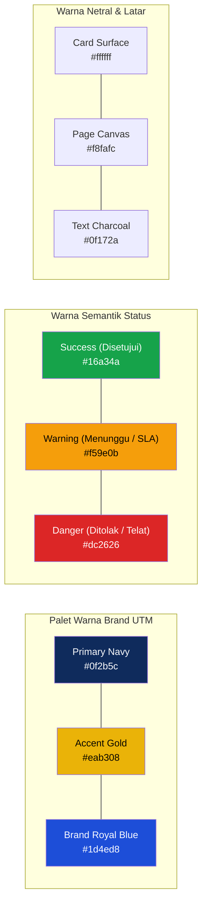

# Panduan Desain Antarmuka Pengguna (UI/UX) & Wireframes
## SiRiset: Sistem Informasi MBKM Riset Terpadu
### Program Studi Teknik Informatika, Fakultas Teknik, Universitas Trunodjoyo Madura

---

## 1. Filosofi Desain & Karakteristik Pengalaman Pengguna (UX)

Antarmuka pengguna **SiRiset** dirancang dengan pendekatan **User-Centric Enterprise Design**, berfokus pada efisiensi kerja tinggi, pengurangan beban kognitif (*cognitive load*), serta kejelasan alur status bagi seluruh pemangku kepentingan akademik.

### Prinsip Desain Kunci:
1. **Rule of Three Clicks**: Seluruh fungsionalitas inti (seperti melakukan *Approval*, mengisi logbook mingguan, atau mengunduh berita acara nilai) dapat diselesaikan dalam maksimal 3 kali interaksi klik.
2. **Visual Status Hierarchy**: Menggunakan kode warna semantik (*Traffic Light UI*) yang konsisten pada seluruh tahapan pendaftaran dan logbook guna memberikan kepastian informasi seketika bagi mahasiswa.
3. **Responsive & Mobile-Optimized**: Mendukung fleksibilitas kerja dosen dan mahasiswa baik saat diakses melalui perangkat desktop, tablet, maupun ponsel pintar (*smartphone*).

---

## 2. Design System Tokens (Identitas Visual Kampus UTM)

Sistem antarmuka mengadopsi palet warna resmi almamater **Universitas Trunodjoyo Madura (UTM)** yang dikombinasikan dengan estetika modern *Clean Dashboard*:



### Tipografi:
- **Font Utama Antarmuka**: `Inter` / `Geist Sans` (sans-serif modern untuk keterbacaan data numerik dan tabel).
- **Font Angka / Kode / Token**: `JetBrains Mono` / `Geist Mono` (monospace untuk NIM, NIP, Nomor Kontrak Hibah, dan Hash QR-Code).

---

## 3. Arsitektur Informasi & Struktur Navigasi Rute

```
siriset.trunojoyo.ac.id/
│
├── / (Halaman Utama Publik & Portal Informasi MBKM Riset)
├── /login (Otentikasi Kredensial Tunggal NIM/NIP)
│
├── /dashboard (Pengalihan Otomatis Sesuai Peran Aktif)
│   │
│   ├── /student (Dasbor Mahasiswa)
│   │   ├── /vacancies (Katalog & Pencarian Lowongan Riset Resmi)
│   │   ├── /vacancies/[id]/apply (Formulir Pendaftaran Satu Pintu)
│   │   ├── /tracker (Pelacak Status Alur & Riwayat Approval)
│   │   ├── /logbook (Pengisian & Manajemen Logbook Mingguan 1-16)
│   │   ├── /monev (Hub Unggah Dokumen Laporan Kemajuan)
│   │   └── /outputs (Pusat Unggah Luaran Riset & Transkrip Nilai MB04)
│   │
│   ├── /lecturer (Dasbor Dosen Peneliti)
│   │   ├── /vacancies (Manajemen Penawaran Riset & Kuota Hibah)
│   │   ├── /applicants (Peninjauan Portofolio Pelamar & Seleksi SLA)
│   │   ├── /mentoring (Ulasan & Validasi Logbook Mingguan Mahasiswa)
│   │   ├── /monev-review (Akses Berkas Monev & Catatan Rekomendasi)
│   │   └── /grading (Formulir Penilaian Rubrik Digital Multi-Kriteria)
│   │
│   ├── /approvals (Dasbor E-Approval Cepat: Dosen Wali, Peneliti, & Kaprodi)
│   │
│   ├── /coordinator (Dasbor Koordinator MBKM - Bu Fifin)
│   │   ├── /verification (Verifikasi Berkas Mahasiswa Daring)
│   │   ├── /sync-simpelmas (Pusat Eksekusi 1-Click Sync ke LPPM)
│   │   ├── /analytics-kpi (Grafik Pemantauan Kinerja & Kepatuhan Riset)
│   │   └── /grade-conversion (Rekapitulasi & Ekspor Berita Acara Nilai)
│   │
│   └── /lppm (Dasbor Reviewer & Staf Monev LPPM)
│       ├── /participants (Rekapitulasi Mahasiswa Terdaftar dari SIMPELMAS)
│       └── /monev-session (Penilaian Seminar Kemajuan Riset)
```

---

## 4. Rangka Layar Terperinci (*Detailed Wireframes*)

### 4.1 Layar 1: Portal Katalog Lowongan Riset (Mahasiswa View)
Memungkinkan seluruh mahasiswa melihat lowongan riset dosen terverifikasi hibah LPPM secara terbuka (Solusi *PP1*).

```
+--------------------------------------------------------------------------------------------------+
| [LOGO UTM] SiRiset | Universitas Trunodjoyo Madura              [Notifikasi (2)] [Reno Syaelendra v] |
+--------------------------------------------------------------------------------------------------+
| Navigasi: [Katalog Riset]  [Lamaran Saya]  [Logbook Mingguan]  [Laporan Monev]  [Luaran & Nilai]   |
+--------------------------------------------------------------------------------------------------+
|                                                                                                  |
| KATALOG PENAWARAN MBKM RISET (GANJIL 2026/2027)                                                  |
| Temukan proyek riset hibah dosen Teknik Informatika untuk dikonversi menjadi 20 SKS (MB04).      |
|                                                                                                  |
| [Cari Judul / Dosen Peneliti...     ] [Filter Skema Hibah v] [Filter Keahlian v] [Tombol: Cari]  |
|--------------------------------------------------------------------------------------------------|
|                                                                                                  |
| +---------------------------------------------------------+ +----------------------------------+ |
| | PENGEMBANGAN MODEL KLASIFIKASI CITRA MEDIS DENGAN ViT   | | DETEKSI HAMA JAGUNG MADURA EDGE  | |
| | Dosen: Dr. Mula'ab, S.Si., M.Kom. (NIP: 19720415...)    | | Dosen: Dr. Rika Yunitarini, ST.  | |
| | Hibah: Penelitian Mandiri LPPM (No: 042/UN46.4.1/PT)    | | Hibah: Penelitian Terapan FT     | |
| |---------------------------------------------------------| |----------------------------------| |
| | Kualifikasi Keahlian:                                   | | Kualifikasi Keahlian:            | |
| | [Python] [PyTorch] [Deep Learning] [Image Processing]   | | [Flutter] [TensorFlow Lite] [AI] | |
| |                                                         | |                                  | |
| | Kuota: [*** 3 Tersisa / 4 Total]  | Batas: 05 Sep 2026  | | Kuota: [* 1 Tersisa / 3 Total]   | |
| |---------------------------------------------------------| |----------------------------------| |
| | [Tombol: Lihat Silabus Detail]  [TOMBOL: DAFTAR RISET]  | | [Detail Silabus] [DAFTAR RISET]  | |
| +---------------------------------------------------------+ +----------------------------------+ |
+--------------------------------------------------------------------------------------------------+
```

---

### 4.2 Layar 2: Formulir Pendaftaran Satu Pintu & Status Tracker Real-Time (Mahasiswa View)
Menggabungkan pengumpulan berkas dan menampilkan SLA waktu tunggu seleksi dosen (Solusi *PP2 & PP4*).

```
+--------------------------------------------------------------------------------------------------+
| FORMULIR PENDAFTARAN MBKM RISET (KODE MK: MB04)                                                  |
+--------------------------------------------------------------------------------------------------+
| Judul Riset : Pengembangan Model Klasifikasi Citra Medis Berbasis Vision Transformer             |
| Dosen Pemb. : Dr. Mula'ab, S.Si., M.Kom.                                                         |
|--------------------------------------------------------------------------------------------------|
| VERIFIKASI KELAYAKAN AKADEMIK OTOMATIS (SIAKAD UTM):                                             |
| [v] Status Mahasiswa : AKTIF (Semester 5 - S1 Teknik Informatika)                                |
| [v] Nilai IPK Kumulatif : 3.85 (MEMENUHI SYARAT MINIMAL >= 3.00)                                 |
| [v] Kelulusan MK Wajib : 100% LULUS (Semua MK Semester 1-4 Lulus)                                |
|--------------------------------------------------------------------------------------------------|
| KELENGKAPAN BERKAS RENCANA RISET (SINGLE SUBMIT - 100% PAPERLESS):                               |
| 1. Judul Rencana Riset Mahasiswa:                                                                |
|    [ Penerapan Algoritma ViT pada Citra CT-Scan Tumor Otak                                     ] |
| 2. Paket Konversi Mata Kuliah: [ Paket Standar MB04 (20 SKS) v ]                                 |
| 3. Sertakan Konversi Kerja Praktik (KP 2 SKS)? [ ] Ya, sertakan (Topik harus berbeda)            |
| 4. Unggah Draf Proposal Ringkas (.PDF, maks 5MB):                                                |
|    [ File: Proposal_Reno_Syaelendra_ViT.pdf (1.8 MB) | [Hapus] ]                                 |
|--------------------------------------------------------------------------------------------------|
| [ Tombol Batal ]                                           [ TOMBOL: SUBMIT PENDAFTARAN SEKARANG ]|
+--------------------------------------------------------------------------------------------------+
|                                                                                                  |
| PELACAK STATUS PENDAFTARAN REAL-TIME (SLA TIMER ENGINE):                                         |
| Status Saat Ini: [ UNDER REVIEW OLEH DOSEN PENELITI ]                                            |
|                                                                                                  |
|   (v) Submit       (O) Review Dosen      ( ) E-Approval       ( ) Validasi Koor     ( ) Aktif    |
|   15 Agu 2026       Sisa Waktu: 3 Hari      3 Pihak Simultan     Prodi TI & LPPM     Riset 4 Bln |
|   [SELESAI]        [SEDANG BERJALAN]       [MENUNGGU]           [MENUNGGU]          [MENUNGGU]   |
+--------------------------------------------------------------------------------------------------+
```

---

### 4.3 Layar 3: Modal E-Approval Simultan (Dosen Wali / Dosen Peneliti / Kaprodi View)
Memberikan persetujuan dalam satu kali klik tanpa mahasiswa harus berkeliling kampus (Solusi *PP3*).

```
+--------------------------------------------------------------------------------------------------+
| MODAL PERSETUJUAN ELEKTRONIK (E-APPROVAL)                                                [ X ]   |
+--------------------------------------------------------------------------------------------------+
| Peran Approval Anda : DOSEN WALI AKADEMIK                                                        |
| Nama Mahasiswa      : Reno Syaelendra (NIM: 240411100020) | IPK: 3.85                            |
| Judul Riset Hibah   : Pengembangan Model Klasifikasi Citra Medis Berbasis Vision Transformer     |
| Dosen Peneliti      : Dr. Mula'ab, S.Si., M.Kom.                                                 |
|--------------------------------------------------------------------------------------------------|
| Rencana Paket Konversi Mata Kuliah (20 SKS):                                                     |
| 1. Capstone Project Riset (4 SKS)                 4. Rekayasa Perangkat Lunak Lanjut (3 SKS)     |
| 2. Pemrograman & Implementasi Machine Learning (4 SKS)  5. Metodologi Penelitian Ilmiah (3 SKS)  |
| 3. Pengujian & Evaluasi Model AI (3 SKS)          6. Etika Profesi Informatika (3 SKS)           |
|--------------------------------------------------------------------------------------------------|
| Pratinjau Dokumen: [ Unduh Proposal PDF (1.8 MB) ] | [ Lihat Transkrip SIAKAD ]                  |
|                                                                                                  |
| Catatan Persetujuan / Umpan Balik (Opsional):                                                    |
| [ Rencana studi dan paket mata kuliah konversi MB04 sudah sangat tepat dengan peminatan.      ]  |
|--------------------------------------------------------------------------------------------------|
| [ TOMBOL: TOLAK / MINTA REVISI ]                             [ TOMBOL: SETUJUI SEKARANG (1-CLICK) ]|
+--------------------------------------------------------------------------------------------------+
```

---

### 4.4 Layar 4: Dasbor Monitoring Logbook Mingguan (Dosen Peneliti View)
Memastikan dosen memiliki visibilitas 100% terhadap aktivitas riset harian/mingguan mahasiswa (Solusi *PP7*).

```
+--------------------------------------------------------------------------------------------------+
| SiRiset | MONITORING LOGBOOK MAHASISWA BIMBINGAN RISET                  [Dr. Mula'ab, S.Si. v]   |
+--------------------------------------------------------------------------------------------------+
| Mahasiswa: Reno Syaelendra (240411100020) | Judul: Klasifikasi Citra CT-Scan ViT                 |
| Kepatuhan Logbook: [ 93.8% Tepat Waktu ] | Status: Minggu ke-5 dari 16 Minggu                    |
|--------------------------------------------------------------------------------------------------|
| DAFTAR LOGBOOK MINGGUAN:                                                                         |
| Minggu | Tanggal      | Jam  | Ringkasan Aktivitas              | Bukti / GitHub   | Status       |
|--------+--------------+------+----------------------------------+------------------+--------------|
| M-01   | 25 Agu 2026  | 16 j | Studi literatur arsitektur ViT   | [PDF Resume]     | [VALID]      |
| M-02   | 01 Sep 2026  | 18 j | Eksplorasi dataset Brain MRI     | [Colab Notebook] | [VALID]      |
| M-03   | 08 Sep 2026  | 20 j | Preprocessing & data augmentasi  | [GitHub Commit]  | [VALID]      |
| M-04   | 15 Sep 2026  | 22 j | Training model baseline ViT-B/16 | [Loss Curve PNG] | [VALID]      |
| M-05   | 22 Sep 2026  | 18 j | Hyperparameter tuning & dropout  | [GitHub Commit]  | [NEED REVIEW]|
|--------------------------------------------------------------------------------------------------|
| DETAIL LOGBOOK MINGGU KE-5 (MENUNGGU ULASAN ANDA):                                               |
| Aktivitas   : Mengatur learning rate scheduler (Cosine Annealing) dan dropout rate 0.2.          |
| Kendala     : Terjadi overfitting saat epoch ke-40 pada data validasi.                           |
| Tautan Repo : https://github.com/renosyaelendra/vit-brain-tumor/commit/3c2e1f4                   |
|                                                                                                  |
| Umpan Balik / Catatan Bimbingan Dosen:                                                           |
| [ Coba tambahkan teknik regularisasi Weight Decay 0.01 dan uji visualisasi Attention Map.     ]  |
|                                                                                                  |
| [ Tombol: Minta Revisi Logbook ]                              [ TOMBOL: VALIDASI LOGBOOK (VALID) ]|
+--------------------------------------------------------------------------------------------------+
```

---

### 4.5 Layar 5: Dasbor Eksekutif & 1-Click Sync SIMPELMAS (Koordinator MBKM View)
Memusatkan verifikasi berkas, pemantauan metrik KPI, dan sinkronisasi ke LPPM (Solusi *PP4 & PP5*).

```
+--------------------------------------------------------------------------------------------------+
| SiRiset | DASBOR PENGELOLA MBKM TEKNIK INFORMATIKA UTM              [Ibu Fifin Ayu, M.Kom. v]    |
+--------------------------------------------------------------------------------------------------+
| METRIK KPI PROSES MBKM RISET (PERIODE GANJIL 2026/2027):                                         |
| [ Peserta Aktif: 24 Mhs ]  [ Waktu Approval Rata2: 8.5 Jam ]  [ Kepatuhan Logbook: 96.2% ]       |
| [ Paperless Rate: 100% ]   [ Sinkronisasi SIMPELMAS: 100% ]   [ Kasus Nilai Tercecer: 0 Berkas ] |
|--------------------------------------------------------------------------------------------------|
|                                                                                                  |
| INTEGRASI DATA EKSTERNAL (SINKRONISASI LPPM):                                                    |
| Terakhir Sinkron : 15 September 2026, Pukul 14:20 WIB (Oleh: Fifin Ayu Mufarroha)                |
| Status Data      : 24 Mahasiswa Terverifikasi Prodi <===> 24 Mahasiswa Tercatat di SIMPELMAS     |
|                                                                                                  |
| [!] 2 Mahasiswa baru baru saja menyelesaikan E-Approval dan siap disinkronkan ke LPPM.           |
|                                                                                                  |
|                               [ TOMBOL BESAR: 1-CLICK SINKRONKAN KE SIMPELMAS LPPM ]             |
|--------------------------------------------------------------------------------------------------|
|                                                                                                  |
| TABEL VERIFIKASI & REKAPITULASI MAHASISWA:                                                       |
| NIM          | Nama Mahasiswa   | Dosen Peneliti       | Status E-Approval   | Sinkron SIMPELMAS |
|--------------+------------------+----------------------+---------------------+-------------------|
| 240411100020 | Reno Syaelendra  | Dr. Mula'ab, S.Si.   | [v] LENGKAP (3/3)   | [v] TERSINKRON    |
| 240411100019 | Rifda Nahariyah  | Dr. Rika Yunitarini  | [v] LENGKAP (3/3)   | [v] TERSINKRON    |
| 220411100088 | Ilyas            | Dr. Mula'ab, S.Si.   | [v] LENGKAP (3/3)   | [!] SIAP SYNC     |
|--------------------------------------------------------------------------------------------------|
| [ Ekspor Rekap Peserta (PDF) ]  [ Ekspor Data untuk SK Dekan Fakultas ]  [ Ekspor Nilai SIAKAD ] |
+--------------------------------------------------------------------------------------------------+
```

---

### 4.6 Layar 6: Lembar Penilaian Rubrik Digital Multi-Kriteria (Dosen Peneliti View)
Menggantikan blangko kertas manual dengan formulir digital berbobot standar prodi (Solusi *PP8*).

```
+--------------------------------------------------------------------------------------------------+
| FORMULIR PENILAIAN DIGITAL MBKM RISET (KODE MK: MB04)                                            |
+--------------------------------------------------------------------------------------------------+
| Mahasiswa  : Reno Syaelendra (NIM: 240411100020)                                                 |
| Judul Riset: Pengembangan Model Klasifikasi Citra Medis Berbasis Vision Transformer              |
| Durasi     : 4 Bulan Penuh (16 Minggu) | Kepatuhan Logbook: 16/16 Selesai                        |
| Luaran     : Draf Artikel Jurnal Ilmiah Sinta 2 (Status: Submitted & Terverifikasi)              |
|--------------------------------------------------------------------------------------------------|
| RUBRIK PENILAIAN RESMI PROGRAM STUDI TEKNIK INFORMATIKA:                                         |
|                                                                                                  |
| 1. Kedisiplinan & Logbook Mingguan (Bobot: 20%)                                                  |
|    Nilai (0 - 100) : [ 95 ]  -> Kontribusi: 19.00                                                |
|                                                                                                  |
| 2. Kualitas Teknis & Penguasaan Metodologi Riset (Bobot: 30%)                                    |
|    Nilai (0 - 100) : [ 88 ]  -> Kontribusi: 26.40                                                |
|                                                                                                  |
| 3. Pemenuhan Target Luaran Publikasi Ilmiah (Bobot: 30%)                                         |
|    Nilai (0 - 100) : [ 90 ]  -> Kontribusi: 27.00                                                |
|                                                                                                  |
| 4. Kualitas Laporan Akhir & Presentasi Seminar Hasil (Bobot: 20%)                                |
|    Nilai (0 - 100) : [ 89 ]  -> Kontribusi: 17.80                                                |
|--------------------------------------------------------------------------------------------------|
| HASIL KALKULASI OTOMATIS:                                                                        |
| TOTAL NILAI ANGKA : 90.20 / 100.00                                                               |
| HURUF MUTU        : A (SANGAT BAIK - LULUS)                                                      |
| KONVERSI AKADEMIK : Paket Mata Kuliah MB04 (20 SKS) Diakui Penuh                                 |
|--------------------------------------------------------------------------------------------------|
| [ Tombol: Simpan Draf Nilai ]                         [ TOMBOL: KUNCI & TERBITKAN NILAI RESMI ]   |
+--------------------------------------------------------------------------------------------------+
```

