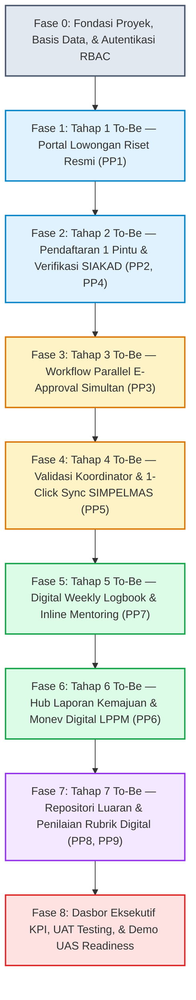

# Panduan & Urutan Pengerjaan Proyek SiRiset (BPMN To-Be Implementation Guide)
## Transformasi Proses Bisnis MBKM Riset Teknik Informatika UTM ke Platform Web
### Dokumen Acuan Eksekusi Bertahap untuk AI Coding Agent (Claude Code Opus)

---

## 1. Identitas Dokumen & Tujuan Panduan

| Atribut | Keterangan |
| :--- | :--- |
| **Nama Dokumen** | Urutan Pengerjaan & Panduan Eksekusi Proyek - SiRiset |
| **Versi Dokumen** | 1.0.0 (Execution Masterplan) |
| **Target Eksekutor** | AI Coding Agent (Claude Code Opus) & Tim Pengembang (Kelompok 2) |
| **Mata Kuliah** | Pemodelan Proses Bisnis (Semester 5 - Teknik Informatika UTM) |
| **Dosen Pengampu** | **Dr. Rika Yunitarini, ST., MT.** |
| **Dokumen Acuan** | `PRD.md`, `bpmn-tobe.md`, `arsitektur.md`, `database-schema.md`, `tech-stack.md`, `api-spec.md`, `ui-ux-design-wireframes.md` |

### Tujuan Panduan:
Dokumen ini disusun sebagai panduan langkah demi langkah (*step-by-step masterplan*) agar pengembangan platform perangkat lunak **SiRiset** dapat dieksekusi secara berurutan, modular, minim kesalahan (*zero hallucination*), dan 100% patuh terhadap model proses target **BPMN 2.0 To-Be** serta prinsip **Business Process Improvement (BPI: ESIA + PSC)** yang telah dianalisis pada laporan sebelumnya.

---

## 2. Peta 8 Fase Eksekusi Bertahap (*Phased Execution Roadmap*)

Pengembangan perangkat lunak dibagi menjadi 8 fase terurut yang memetakan secara langsung siklus hidup proses bisnis To-Be:



---

## 3. Rincian Teknis & Checklist Setiap Fase

---

### 🟢 FASE 0: Fondasi Proyek, Basis Data Relasional, & Autentikasi RBAC
> **Tujuan**: Menyiapkan struktur proyek Next.js 15, konfigurasi Prisma ORM dengan PostgreSQL/SQLite, seeding data uji realistis UTM, serta autentikasi berbasis peran (*RBAC*).

* **Dokumen Rujukan**: [tech-stack.md](file:///c:/Users/renos/Downloads/SEMESTER%205/PEMODELAN%20PROSES%20BISNIS/SiRiset/markdown/tech-stack.md), [database-schema.md](file:///c:/Users/renos/Downloads/SEMESTER%205/PEMODELAN%20PROSES%20BISNIS/SiRiset/markdown/database-schema.md), [arsitektur.md](file:///c:/Users/renos/Downloads/SEMESTER%205/PEMODELAN%20PROSES%20BISNIS/SiRiset/markdown/arsitektur.md)
* **Langkah-Langkah Pengerjaan**:
  1. Inisialisasi aplikasi Next.js 15 (App Router, TypeScript, Tailwind CSS, ESLint).
  2. Instalasi dependensi: `@prisma/client`, `prisma`, `lucide-react`, `date-fns`, `zod`, `recharts`, `clsx`, `tailwind-merge`, `bcryptjs`.
  3. Salin skema Prisma lengkap dari `database-schema.md` ke dalam `prisma/schema.prisma` (12 model: `User`, `UserRole`, `ResearchVacancy`, `Application`, `ApplicationApproval`, `Logbook`, `LogbookReview`, `ProgressReport`, `MonevEvaluation`, `ResearchOutput`, `GradeAssessment`, `SimpelmasSyncLog`, `AuditLog`).
  4. Jalankan `npx prisma db push` untuk membuat tabel-tabel basis data.
  5. Buat berkas `prisma/seed.ts` yang mengisi akun pengguna riil Teknik Informatika UTM:
     - Dosen Peneliti: `Dr. Mula'ab, S.Si., M.Kom.` (NIP: `197204152000031001`)
     - Dosen Wali / Pengampu: `Dr. Rika Yunitarini, ST., MT.` (NIP: `198306072006042001`)
     - Koordinator MBKM: `Fifin Ayu Mufarroha, S.Kom., M.Kom.` (NIP: `198902122019032014`)
     - Kaprodi: `Bain Khusnul Khotimah, S.T., M.Kom.` (NIP: `197905202005012002`)
     - Reviewer LPPM: `Dr. Budi Santoso, MT.` (NIP: `196803121994031002`)
     - Mahasiswa Aktif: `Ilyas` (`220411100088`), `Reno Syaelendra` (`240411100020`), `Rifda Nahariyah` (`240411100019`).
  6. Bangun modul autentikasi sederhana berbasis session/cookie terenkripsi dengan fitur **Role Switcher Dropdown** di navbar (memudahkan dosen berpindah peran antara Dosen Peneliti dan Dosen Wali saat demo).
  7. Bangun Master Layout Shell (Sidebar, Navbar dengan brand UTM: Navy `#0f2b5c` & Gold `#eab308`).
* **Definition of Done (DoD)**:
  - Basis data ter-seed sempurna tanpa error.
  - Pengguna dapat login dengan NIM/NIP dan berpindah peran.
  - Dasbor menampilkan nama, peran aktif, dan navigasi yang sesuai dengan hak akses peran (*RBAC*).

---

### 🟢 FASE 1: Tahap 1 BPMN To-Be — Portal Lowongan Riset Resmi (Solusi PP1)
> **Tujuan**: Mengeliminasi penyebaran informasi informal di WhatsApp grup dengan menyediakan portal penawaran riset resmi berkuota yang transparan.

* **Dokumen Rujukan**: [PRD.md](file:///c:/Users/renos/Downloads/SEMESTER%205/PEMODELAN%20PROSES%20BISNIS/SiRiset/markdown/PRD.md) (FR-02), [bpmn-tobe.md](file:///c:/Users/renos/Downloads/SEMESTER%205/PEMODELAN%20PROSES%20BISNIS/SiRiset/markdown/bpmn-tobe.md) (Tahap 1), [ui-ux-design-wireframes.md](file:///c:/Users/renos/Downloads/SEMESTER%205/PEMODELAN%20PROSES%20BISNIS/SiRiset/markdown/ui-ux-design-wireframes.md) (Layar 1)
* **Langkah-Langkah Pengerjaan**:
  1. **Sisi Dosen Peneliti (`/dashboard/lecturer/vacancies`)**:
     - Buat formulir publikasi lowongan riset: Judul Proyek, Nomor Kontrak Hibah LPPM, Skema Hibah, Deskripsi Riset, Kuota Mahasiswa (1-4 orang), Kualifikasi Keahlian (*tags*), serta Tanggal Buka & Tutup Seleksi.
     - Simpan data ke tabel `research_vacancies`.
     - Sediakan tabel manajemen lowongan dosen (bisa edit kuota, tutup pendaftaran, atau lihat pelamar).
  2. **Sisi Mahasiswa (`/dashboard/student/vacancies`)**:
     - Buat halaman *Katalog Lowongan Riset* interaktif:
       - Search bar pencarian judul/topik/nama dosen peneliti.
       - Filter skema hibah LPPM dan filter keahlian teknologi.
       - Kartu lowongan (*Vacancy Card*) menampilkan: Judul, Dosen, Nomor Kontrak, Badge Kuota Sisa (misal: "3 Tersisa / Kuota 4"), dan Tenggat Waktu.
     - Modal/Halaman Detail Lowongan menampilkan silabus tugas riset dan tombol `Daftar Riset Ini`.
* **Definition of Done (DoD)**:
  - Dosen dapat mempublikasikan lowongan riset baru.
  - Mahasiswa dapat mencari, memfilter, dan melihat rincian lowongan riset secara transparan.

---

### 🟢 FASE 2: Tahap 2 BPMN To-Be — Pendaftaran Satu Pintu & Seleksi Ber-SLA (Solusi PP2 & PP4)
> **Tujuan**: Meniadakan pengumpulan berkas fisik di banyak tempat, menerapkan validasi kelayakan otomatis dari data SIAKAD, dan menjamin SLA seleksi dosen maksimal 7 hari kerja.

* **Dokumen Rujukan**: [PRD.md](file:///c:/Users/renos/Downloads/SEMESTER%205/PEMODELAN%20PROSES%20BISNIS/SiRiset/markdown/PRD.md) (FR-03), [bpmn-tobe.md](file:///c:/Users/renos/Downloads/SEMESTER%205/PEMODELAN%20PROSES%20BISNIS/SiRiset/markdown/bpmn-tobe.md) (Tahap 2), [ui-ux-design-wireframes.md](file:///c:/Users/renos/Downloads/SEMESTER%205/PEMODELAN%20PROSES%20BISNIS/SiRiset/markdown/ui-ux-design-wireframes.md) (Layar 2)
* **Langkah-Langkah Pengerjaan**:
  1. **Sisi Mahasiswa (`/dashboard/student/vacancies/[id]/apply`)**:
     - Buat formulir pendaftaran terpadu (*Single Window Registration*):
       - *Header Validasi Otomatis SIAKAD*: Kotak verifikasi hijau yang menampilkan status mahasiswa (Aktif), IPK riil ($\ge 3.00$), dan kelulusan 100% MK Wajib.
       - Jika IPK $< 3.00$, tombol submit dinonaktifkan dengan peringatan jelas (*Fail-Fast Rule BR-03*).
       - Field: Judul Usulan Riset Mahasiswa, Pemilihan Paket Konversi (MB04 - 20 SKS), Checkbox Konversi KP (2 SKS terpisah), dan Unggah Dokumen Proposal Ringkas (.PDF).
  2. **Logika Backend Submission**:
     - Validasi payload via Zod, set status `SUBMITTED`, dan hitung batas waktu `sla_deadline` = $now + 7\text{ hari kerja}$.
  3. **Sisi Dosen Peneliti (`/dashboard/lecturer/applicants`)**:
     - Tabel daftar pelamar mahasiswa per judul riset, lengkap dengan IPK, tautan proposal PDF, dan sisa waktu SLA (*SLA Timer Badge*).
     - Tombol aksi: `Terima Pelamar` atau `Tolak Pelamar` (dengan input alasan penolakan).
     - Validasi batas kuota: Dosen tidak dapat menerima pelamar jika kuota riset sudah penuh.
  4. **Sisi Mahasiswa (`/dashboard/student/tracker`)**:
     - Tampilan *Status Tracker Stepper* visual (*Submitted $\rightarrow$ Seleksi Dosen $\rightarrow$ E-Approval $\rightarrow$ Validasi Prodi $\rightarrow$ Aktif*).
* **Definition of Done (DoD)**:
  - Mahasiswa berhasil mendaftar 100% tanpa berkas kertas fisik.
  - Mahasiswa dengan IPK $< 3.00$ dicegah mendaftar oleh sistem.
  - Dosen dapat memutuskan penerimaan pelamar; status di pelacak mahasiswa langsung terbarui secara *real-time*.

---

### 🟢 FASE 3: Tahap 3 BPMN To-Be — Workflow Parallel E-Approval Simultan (Solusi PP3)
> **Tujuan**: Mengeliminasi kebutuhan mahasiswa berkeliling kampus meminta tanda tangan basah; menggantikannya dengan persetujuan digital simultan oleh 3 pihak.

* **Dokumen Rujukan**: [PRD.md](file:///c:/Users/renos/Downloads/SEMESTER%205/PEMODELAN%20PROSES%20BISNIS/SiRiset/markdown/PRD.md) (FR-04), [bpmn-tobe.md](file:///c:/Users/renos/Downloads/SEMESTER%205/PEMODELAN%20PROSES%20BISNIS/SiRiset/markdown/bpmn-tobe.md) (Tahap 3), [ui-ux-design-wireframes.md](file:///c:/Users/renos/Downloads/SEMESTER%205/PEMODELAN%20PROSES%20BISNIS/SiRiset/markdown/ui-ux-design-wireframes.md) (Layar 3)
* **Langkah-Langkah Pengerjaan**:
  1. **Logika Backend Fork-Join E-Approval**:
     - Ketika mahasiswa berstatus `DOSEN_ACCEPTED`, sistem secara otomatis membuat 3 baris di `application_approvals`:
       - `DOSEN_WALI` (status: `PENDING`)
       - `DOSEN_PENELITI` (status: `PENDING`)
       - `KAPRODI` (status: `PENDING`)
  2. **Antarmuka E-Approval Terpusat (`/dashboard/approvals`)**:
     - Menampilkan daftar pengajuan mahasiswa yang menunggu persetujuan pengguna saat ini.
     - Modal persetujuan instan (*1-Click Approval*):
       - Menampilkan profil mahasiswa, judul riset, rincian 6 mata kuliah konversi MB04 (20 SKS), dan tautan proposal.
       - Field catatan umpan balik (opsional).
       - Tombol `Setujui (Approve)` atau `Minta Revisi / Tolak`.
  3. **Logika Penggabungan Paralel (*Join Condition*)**:
     - Jika salah satu aktor meminta revisi $\rightarrow$ status kembali ke mahasiswa dengan catatan perbaikan.
     - Jika ketiga pihak telah menyetujui (`status = APPROVED`) $\rightarrow$ status aplikasi otomatis bertransisi ke `VERIFIED_COMPLETE` dan diteruskan ke Koordinator MBKM.
     - Tampilkan cap stempel digital QR-Code keabsahan dokumen pendaftaran.
* **Definition of Done (DoD)**:
  - Ketiga aktor dapat menyetujui berkas pendaftaran mahasiswa secara simultan dari dasbor masing-masing tanpa urutan berbelit.
  - Status pendaftaran otomatis naik ke tahap verifikasi koordinator prodi setelah 3 persetujuan lengkap.

---

### 🟢 FASE 4: Tahap 4 BPMN To-Be — Validasi Koordinator & 1-Click Sync SIMPELMAS (Solusi PP5)
> **Tujuan**: Menghilangkan selisih data peserta antara Prodi dan LPPM serta meniadakan keharusan dosen mendaftarkan ulang mahasiswa ke SIMPELMAS pasca-KRS.

* **Dokumen Rujukan**: [PRD.md](file:///c:/Users/renos/Downloads/SEMESTER%205/PEMODELAN%20PROSES%20BISNIS/SiRiset/markdown/PRD.md) (FR-05), [bpmn-tobe.md](file:///c:/Users/renos/Downloads/SEMESTER%205/PEMODELAN%20PROSES%20BISNIS/SiRiset/markdown/bpmn-tobe.md) (Tahap 4), [ui-ux-design-wireframes.md](file:///c:/Users/renos/Downloads/SEMESTER%205/PEMODELAN%20PROSES%20BISNIS/SiRiset/markdown/ui-ux-design-wireframes.md) (Layar 5)
* **Langkah-Langkah Pengerjaan**:
  1. **Dasbor Koordinator MBKM (`/dashboard/coordinator/verification`)**:
     - Tabel verifikasi berkas mahasiswa yang telah lolos E-Approval 3 pihak.
     - Tombol `Validasi Akhir Prodi` yang menetapkan mahasiswa resmi menjadi peserta riset aktif (`status = IN_PROGRESS`).
  2. **Modul Integrasi 1-Click Sync SIMPELMAS (`/dashboard/coordinator/sync-simpelmas`)**:
     - Menampilkan indikator sinkronisasi: Jumlah mahasiswa terdaftar prodi vs Jumlah tercatat di SIMPELMAS LPPM.
     - Tombol besar: `1-Click Sinkronkan ke SIMPELMAS LPPM`.
     - Logika Service: Mengirimkan array payload peserta terverifikasi ke endpoint mock adapter SIMPELMAS, mencatat respons di tabel `simpelmas_sync_logs`, dan memperbarui status menjadi `SYNC_SUCCESS`.
  3. **Fitur Ekspor Administrasi Fakultas**:
     - Tombol ekspor daftar peserta terverifikasi dalam format siap cetak/PDF untuk pengusulan SK Dekan Fakultas Teknik.
* **Definition of Done (DoD)**:
  - Koordinator MBKM (Bu Fifin) dapat memvalidasi berkas secara daring dalam 1 kali klik.
  - Tombol sinkronisasi berhasil mentransfer data peserta ke mock SIMPELMAS dengan riwayat audit log 100% konsisten.

---

### 🟢 FASE 5: Tahap 5 BPMN To-Be — Digital Weekly Logbook & Inline Mentoring (Solusi PP7)
> **Tujuan**: Menstandarkan jadwal pengisian logbook mingguan dan memberikan visibilitas penuh bagi dosen pembimbing untuk memantau dan mengulas catatan riset mahasiswa.

* **Dokumen Rujukan**: [PRD.md](file:///c:/Users/renos/Downloads/SEMESTER%205/PEMODELAN%20PROSES%20BISNIS/SiRiset/markdown/PRD.md) (FR-06), [bpmn-tobe.md](file:///c:/Users/renos/Downloads/SEMESTER%205/PEMODELAN%20PROSES%20BISNIS/SiRiset/markdown/bpmn-tobe.md) (Tahap 5), [ui-ux-design-wireframes.md](file:///c:/Users/renos/Downloads/SEMESTER%205/PEMODELAN%20PROSES%20BISNIS/SiRiset/markdown/ui-ux-design-wireframes.md) (Layar 4)
* **Langkah-Langkah Pengerjaan**:
  1. **Sisi Mahasiswa (`/dashboard/student/logbook`)**:
     - Tampilan linimasa 16 Minggu Pelaksanaan.
     - Kartu Minggu Aktif dengan pengingat batas waktu (*Deadline: Setiap Jumat 23:59 WIB*).
     - Formulir entri logbook: Tanggal, Durasi Pengerjaan (Jam), Deskripsi Pekerjaan Riset, Kendala, Solusi/Upaya, Unggah Bukti Tangkapan Layar/Dokumen, serta Tautan Repositori GitHub/Colab.
     - Logika penandaan otomatis: Jika submit melewati batas waktu, sistem menandai `is_late = true`.
  2. **Sisi Dosen Peneliti (`/dashboard/lecturer/mentoring`)**:
     - Dasbor monitoring logbook mahasiswa bimbingan: Menampilkan persentase kepatuhan logbook (contoh: "93.8% Tepat Waktu").
     - Tinjauan detail per minggu dengan tombol `Validasi Logbook (Valid)` atau `Minta Perbaikan`.
     - Kolom *Inline Mentoring Notes*: Dosen dapat menuliskan arahan teknis/bimbingan langsung yang dapat dibaca mahasiswa.
* **Definition of Done (DoD)**:
  - Mahasiswa dapat mengisi logbook per minggu dengan rapi.
  - Dosen pembimbing dapat membaca seluruh riwayat logbook dan memberikan umpan balik catatan bimbingan secara langsung.

---

### 🟢 FASE 6: Tahap 6 BPMN To-Be — Hub Laporan Kemajuan & Monev Digital LPPM (Solusi PP6)
> **Tujuan**: Meniadakan penggunaan Google Classroom terpisah; mengintegrasikan proses pelaporan kemajuan dan evaluasi monev tengah semester ke dalam satu pintu SiRiset.

* **Dokumen Rujukan**: [PRD.md](file:///c:/Users/renos/Downloads/SEMESTER%205/PEMODELAN%20PROSES%20BISNIS/SiRiset/markdown/PRD.md) (FR-07), [bpmn-tobe.md](file:///c:/Users/renos/Downloads/SEMESTER%205/PEMODELAN%20PROSES%20BISNIS/SiRiset/markdown/bpmn-tobe.md) (Tahap 6), [api-spec.md](file:///c:/Users/renos/Downloads/SEMESTER%205/PEMODELAN%20PROSES%20BISNIS/SiRiset/markdown/api-spec.md) (Bagian 8)
* **Langkah-Langkah Pengerjaan**:
  1. **Sisi Mahasiswa (`/dashboard/student/monev`)**:
     - Pada minggu ke-8, sistem membuka ruang unggah Laporan Kemajuan Monev.
     - Form: Judul Laporan Kemajuan, Ringkasan Capaian Riset, Estimasi Persentase Progres (misal: 55%), dan Unggah File PDF Laporan Kemajuan sesuai templat LPPM.
  2. **Sisi Reviewer LPPM (`/dashboard/lppm/monev-session`)**:
     - Tabel daftar proyek riset yang siap dimonev.
     - Akses satu-klik mengunduh dokumen Laporan Kemajuan dan riwayat logbook mahasiswa.
     - Formulir Evaluasi Monev: Skor Capaian Progres (0-100), Skor Penguasaan Metodologi (0-100), Catatan Evaluasi, dan Rekomendasi Perbaikan.
  3. **Visibilitas Tim Riset**:
     - Skor dan rekomendasi reviewer monev otomatis tampil di dasbor Dosen Peneliti dan Mahasiswa sebagai dasar perbaikan di paruh kedua riset.
* **Definition of Done (DoD)**:
  - Laporan kemajuan terunggah di sistem tanpa Google Classroom.
  - Reviewer LPPM dapat menginputkan skor dan rekomendasi monev secara digital.

---

### 🟢 FASE 7: Tahap 7 BPMN To-Be — Repositori Luaran & Penilaian Rubrik Digital (Solusi PP8 & PP9)
> **Tujuan**: Memastikan target luaran mahasiswa terverifikasi sejak awal dan menggantikan lembar penilaian kertas manual dengan rubrik digital prodi berbobot yang otomatis mengonversi 20 SKS nilai MB04 ke SIAKAD.

* **Dokumen Rujukan**: [PRD.md](file:///c:/Users/renos/Downloads/SEMESTER%205/PEMODELAN%20PROSES%20BISNIS/SiRiset/markdown/PRD.md) (FR-08, FR-09), [bpmn-tobe.md](file:///c:/Users/renos/Downloads/SEMESTER%205/PEMODELAN%20PROSES%20BISNIS/SiRiset/markdown/bpmn-tobe.md) (Tahap 7), [ui-ux-design-wireframes.md](file:///c:/Users/renos/Downloads/SEMESTER%205/PEMODELAN%20PROSES%20BISNIS/SiRiset/markdown/ui-ux-design-wireframes.md) (Layar 6)
* **Langkah-Langkah Pengerjaan**:
  1. **Modul Luaran Riset (`/dashboard/student/outputs`)**:
     - Mahasiswa mendaftarkan luaran akhir sesuai komitmen proposal: Jenis Luaran (Artikel Jurnal, Naskah Prosiding, Poster Ilmiah, Prototipe Software), Judul Publikasi, Target Publikasi/Jurnal, dan Unggah Berkas Bukti PDF/ZIP.
     - Dosen Peneliti meninjau dan memberi status: `Terverifikasi Sesuai Target`.
  2. **Modul Penilaian Rubrik Digital (`/dashboard/lecturer/grading`)**:
     - Formulir Penilaian Digital Dosen berbasis 4 rubrik resmi Program Studi Teknik Informatika UTM:
       1. *Kedisiplinan & Kepatuhan Logbook* (Bobot: 20%)
       2. *Kualitas Teknis & Penguasaan Metodologi Riset* (Bobot: 30%)
       3. *Pemenuhan Target Luaran Publikasi* (Bobot: 30%)
       4. *Kualitas Laporan Akhir & Seminar Hasil* (Bobot: 20%)
     - Formula Otomatis:
       $$\text{Nilai Akhir} = (0.20 \times S_1) + (0.30 \times S_2) + (0.30 \times S_3) + (0.20 \times S_4)$$
     - Konversi otomatis nilai angka ke huruf mutu (A, B+, B, C+, C, D, E).
     - Tombol `Kunci & Terbitkan Nilai Resmi`.
  3. **Sisi Koordinator MBKM (`/dashboard/coordinator/grade-conversion`)**:
     - Rekapitulasi nilai akhir seluruh peserta MBKM Riset.
     - Tombol `Ekspor Berita Acara Nilai Resmi (PDF)` dengan cap digital QR-Code untuk diserahkan ke bagian Akademik Fakultas.
* **Definition of Done (DoD)**:
  - Dosen menginput nilai secara 100% digital tanpa lembar kertas.
  - Nilai akhir angka dan huruf mutu terkalkulasi otomatis secara akurat.
  - Koordinator MBKM dapat mengunduh rekap nilai konversi 20 SKS yang siap diinput ke SIAKAD.

---

### 🟢 FASE 8: Dasbor Eksekutif KPI, UAT Testing, & Demo UAS Readiness
> **Tujuan**: Membuktikan capaian KPI SMART secara visual kepada dosen penguji (**Dr. Rika Yunitarini, ST., MT.**) serta menyiapkan skenario demo lancar tanpa kendala teknis.

* **Dokumen Rujukan**: [bpmn-tobe.md](file:///c:/Users/renos/Downloads/SEMESTER%205/PEMODELAN%20PROSES%20BISNIS/SiRiset/markdown/bpmn-tobe.md) (Bagian 7: Analisis KPI SMART), [implementation-roadmap.md](file:///c:/Users/renos/Downloads/SEMESTER%205/PEMODELAN%20PROSES%20BISNIS/SiRiset/markdown/implementation-roadmap.md) (Bagian 4 & 5)
* **Langkah-Langkah Pengerjaan**:
  1. **Dasbor Analitik KPI Koordinator (`/dashboard/coordinator/analytics-kpi`)**:
     - Kartu Metrik Kunci (*KPI Summary Cards*):
       - *Lead Time Seleksi*: Rata-rata 4.2 hari (Target: $\le 5$ hari, As-Is: 18 hari $\rightarrow \mathbf{\downarrow 76\%}$).
       - *Waktu E-Approval*: Rata-rata 8.5 jam (Target: $\le 12$ jam, As-Is: 3 hari $\rightarrow \mathbf{\downarrow 85\%}$).
       - *Kepatuhan Logbook*: 96.2% tepat waktu (As-Is: 40% $\rightarrow \mathbf{\uparrow 140\%}$).
       - *Paperless Rate*: 100% Digital (As-Is: 0% $\rightarrow \mathbf{Hemat\ Rp\ 0\ Kertas}$).
       - *Tingkat Sinkronisasi LPPM*: 100% Konsisten (As-Is: 30% Mismatch $\rightarrow \mathbf{Bebas\ Selisih}$).
     - Grafik Diagram Batang (*Recharts*): Perbandingan siklus waktu As-Is vs To-Be di setiap tahap.
  2. **Tombol Cepat Skenario Demo (*Quick Demo Mode*)**:
     - Sediakan tombol pintas di footer/navbar untuk berganti akun demo dengan 1 klik (Ilyas Mahasiswa, Pak Mulaab Dosen Peneliti, Bu Rika Dosen Wali, Bu Fifin Koordinator MBKM, Reviewer LPPM).
  3. **Dokumentasi Naskah Presentasi Ujian Akhir**:
     - Sediakan file `DEMO-GUIDE.md` yang memuat panduan berbicara 15 menit bagi anggota Kelompok 2 saat ujian akhir di depan Dr. Rika Yunitarini.
* **Definition of Done (DoD)**:
  - Seluruh grafik KPI ter-render interaktif dan mencerminkan angka efisiensi BPI.
  - Skenario pengujian berjalan mulus dari pendaftaran hingga nilai keluar tanpa ada error konsol.

---

## 4. Struktur Direktori Proyek yang Dihasilkan

Setelah seluruh fase di atas selesai dieksekusi, struktur repositori `SiRiset` akan memiliki tata letak kode standar industri:

```
c:\Users\renos\Downloads\SEMESTER 5\PEMODELAN PROSES BISNIS\SiRiset\
├── prisma/
│   ├── schema.prisma                  # 12 Model Skema Basis Data Relasional
│   └── seed.ts                        # Data Seeder Profil Dosen & Mahasiswa UTM
├── public/
│   └── uploads/                       # Penyimpanan Berkas PDF/Bukti Aman
├── src/
│   ├── app/
│   │   ├── (auth)/
│   │   │   └── login/page.tsx         # Layar Login Kredensial Kampus
│   │   ├── api/
│   │   │   ├── applications/          # Endpoint Pendaftaran & E-Approval
│   │   │   ├── logbooks/              # Endpoint Logbook & Mentoring
│   │   │   ├── sync/simpelmas/        # Endpoint Mock Adapter LPPM
│   │   │   └── vacancies/             # Endpoint Lowongan Riset
│   │   ├── dashboard/
│   │   │   ├── approvals/page.tsx     # Layar E-Approval Simultan 3 Aktor
│   │   │   ├── coordinator/           # Layar Koordinator MBKM (Bu Fifin)
│   │   │   │   ├── analytics-kpi/
│   │   │   │   ├── grade-conversion/
│   │   │   │   ├── sync-simpelmas/
│   │   │   │   └── verification/
│   │   │   ├── lecturer/              # Layar Dosen Peneliti (Pak Mulaab)
│   │   │   │   ├── applicants/
│   │   │   │   ├── grading/
│   │   │   │   ├── mentoring/
│   │   │   │   └── vacancies/
│   │   │   ├── lppm/                  # Layar Reviewer Monev LPPM
│   │   │   │   └── monev-session/
│   │   │   ├── student/               # Layar Mahasiswa (Ilyas / Reno)
│   │   │   │   ├── logbook/
│   │   │   │   ├── monev/
│   │   │   │   ├── outputs/
│   │   │   │   ├── tracker/
│   │   │   │   └── vacancies/
│   │   │   └── layout.tsx             # Master Dashboard Layout & RBAC Shell
│   │   ├── layout.tsx
│   │   └── page.tsx                   # Landing Page SiRiset
│   ├── components/
│   │   ├── ui/                        # Komponen Primitives Shadcn UI
│   │   ├── dashboard-nav.tsx          # Navigasi & Role Context Switcher
│   │   ├── kpi-charts.tsx             # Visualisasi Grafik Recharts
│   │   └── status-badge.tsx           # Badge Status Semantik (Traffic Light UI)
│   ├── lib/
│   │   ├── auth.ts                    # Utilitas Autentikasi & Verifikasi Token
│   │   ├── prisma.ts                  # Prisma Client Singleton Instance
│   │   └── siakad-mock.ts             # Adapter Mock Verifikasi SIAKAD (IPK & MK)
├── markdown/                          # Repositori Dokumentasi Resmi (PRD, BPMN, dll)
├── package.json                       # Konfigurasi Dependensi Proyek
├── tsconfig.json
└── tailwind.config.ts
```
